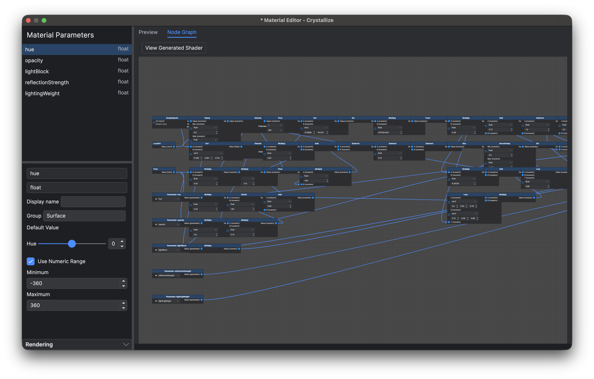
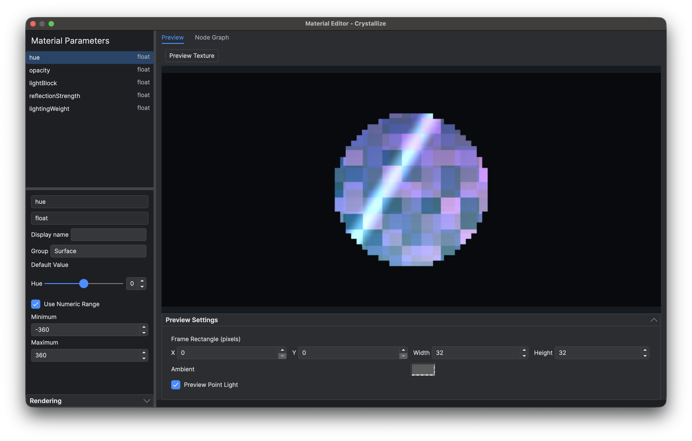

# Materials

A 2D material controls sprite colour, alpha, local emission, lighting response, light blocking, reflection strength and vertex displacement. Actors, CharacterView controls, tiles, autotiles and tile layers reference material resources under `Data/Materials`. An empty reference uses the built-in default: the source texture receives scene lighting, with no emission, reflection, light blocking or displacement.

The standard material is `Data/Materials/Global/Standard.json`. The `Global` directory identifies this shared standard resource; effect examples and `Surfaces` presets remain outside it.

## Create and assign

Use **New Material** in the project file explorer or File menu, then choose a file under `Data/Materials`. Double-click an existing material to open it. An empty Actor `material` field also offers creation; the open action beside an assigned field opens that resource. Resources belong to the project and can be shared by many instances.

The editor opens on the **Preview** tab. A parameter list stays on the left, with the selected parameter's details below it. The right side contains **Preview** and **Node Graph** tabs; drag the dividers to adjust the panes. Switching tabs preserves selections, graph zoom and position, preview settings and playback time. Changing a parameter default changes the resource for all users that do not override that parameter. Use the ordinary Save and Undo/Redo shortcuts; edits and renames participate in the managed-document workflow. Recognised material and texture references are included in reference inspection, rename rewriting and deletion checks. Dynamically constructed script paths still require manual maintenance.

Assign a full `Data/Materials/...json` path to `material`. An Actor or CharacterView stores instance overrides in `materialParameters`: check a parameter to override it, or uncheck it to use its resource default. Changing the material clears old overrides in the same edit. A Blueprint child that chooses a different material writes an explicit empty override dictionary so it does not inherit parameters from the previous material. Resetting the entire instance retains the normal Blueprint inheritance rules.

Tilesets store only assigned materials in a sparse `materials` object whose keys are zero-based tile indices, for example `{"7":"Data/Materials/Water.json"}`. Missing entries use the default, and clearing a selection removes its key. Autotiles store one `material` reference. A tile layer evaluates the tile or autotile material first, then the layer material on that surface. Actors on the layer use their own material.

## Exposed parameters

Use the parameter list on the left of either tab. Each item shows its display name and type; its tooltip includes the stable ID and group. Right-click an item or the list background and choose **Add Parameter**. In the dialog, enter a non-empty, unique stable ID and choose a type from the dropdown: `float`, `vec2`, `vec3`, `vec4`, `color`, `bool` or `texture`. Confirm to create and select the parameter; cancelling leaves the material unchanged. To delete a parameter, right-click that item and choose **Delete**, or press Delete while its list item has focus. The adjacent parameter is selected after deletion, and Undo/Redo applies to creation and deletion. Vectors use numeric arrays; colours use four channels in `[0,1]`; textures use canonical `/Game/Assets/...` paths.

Edit the selected parameter's default value, display name, group and optional numeric range directly below the list. Changing the display name preserves the ID used by node references and saved overrides. Numeric ranges also apply to vector components, and the minimum must not exceed the maximum; colour channels remain within `[0,1]`. IDs and types remain read-only after creation. Boolean values use checkboxes, colours use colour pickers, and textures use resource selectors with read-only paths. Deleting a parameter that is still referenced produces a diagnostic; reconnect or remove those Parameter nodes. The instance panel offers removal of overrides whose IDs no longer exist.

## Edit the graph

Open **Node Graph**, then right-click the canvas background to open the menu headed **Add Node**. Choose a category and then a node type to create it at that location. Drag its header to move it, and drag between ports to connect values. Edit unconnected literal inputs directly below their pins and node properties inside the node. Connected inputs hide their value controls. Declared defaults are displayed without writing an override; implicit and inherited inputs show **Default input** or **Pass-through**. Right-click an unconnected input pin and choose **Set Constant** to supply a value, or **Reset Input** to remove an explicit constant. Material-wide settings, including maximum vertex displacement, are in the initially collapsed **Rendering** section below the left parameter pane.



*The parameter list and selected parameter’s details stay beside the graph; use **View Generated Shader** above the canvas to open the generated source.*

Right-click an input pin to disconnect its link, or an output pin to disconnect all links from that pin. A node's context menu also offers **Disconnect All Inputs** and **Disconnect All Outputs**, affecting only that node. Unavailable disconnection actions are disabled, and a batch disconnection is restored by one Undo. Disconnected inputs return to their declared default or implicit/pass-through behaviour; earlier constants are not stored behind connections.

Right-click a node to delete it. Right-clicking a node already in a multiple selection preserves that selection; right-clicking another node selects that node first. The `Surface` output cannot be deleted. Dragging with the right mouse button pans the canvas without opening a menu on release. Standard selection, Delete, Copy/Paste and Undo/Redo also apply. While a value control has focus, text editing and numeric adjustments operate on that control. Pasted nodes receive new IDs and keep connections within the copied selection.

On macOS, two-finger scrolling pans the graph horizontally and vertically. Pinch or Command+wheel zooms around the pointer, from 10% to 1000%. Wheel input over a node’s input controls stays with those controls.

Constrained node properties use dropdowns: Parameter references display parameter names while retaining their stable IDs, numeric values offer supported scalar/vector dimensions, and Compose allows 2, 3 or 4 components. Swizzle has an output-length selector and a dropdown for each component (`X/R`, `Y/G`, `Z/B`, `W/A`). The compiler still checks that selected channels exist in the input; invalid saved values remain visible as errors until corrected. Numeric fields apply declared bounds without imposing an extra range on unrestricted values.

The graph is a pure data-flow graph. It has one protected `Surface` output and no gameplay events or Blueprint execution. Nodes provide surface inputs, exposed parameters, time, positions, sprite/texture sampling, arithmetic, vector composition, swizzles and hue adjustment. For example, connect `SurfaceInput.BaseColor` and a float Parameter to `HueShift`, then connect its `Value` output to `Surface.BaseColor`. Hue uses degrees. Effects such as freezing, burning or holograms are authored from these nodes, with their controls exposed as ordinary parameters.

| Surface input | Meaning |
| --- | --- |
| `BaseColor`, `Alpha` | RGB colour and transparency. |
| `Emission` | Local RGB emission added independently of scene illumination. Use a Light component when surrounding objects must receive light. |
| `LightingWeight` | Blend between unlit colour and scene lighting. |
| `LightBlock` | Light opacity per `CellSize` of penetration; see [lighting](<Tilesets Autotiles and Maps.md#lights-and-actors>). |
| `ReflectionStrength` | Contribution to the map reflection surface. |
| `VertexOffset` | Additional local vertex displacement in pixels. |

Unconnected surface channels pass through the incoming surface; an unconnected `VertexOffset` contributes zero displacement. This lets a layer change one channel without replacing the tile material's remaining channels. Set `rendering.maxVertexOffset` to non-negative `[x,y]` bounds that contain every possible displacement, including parameter ranges. Rendering uses these bounds for culling and expanded preview frames. Texture sampling is fragment-only; invalid stage connections produce compiler diagnostics. The node registry supplied by the project's native runtime defines the available nodes and ports.

## Preview and diagnose

On **Preview**, choose **Preview Texture** and set the frame's integer X, Y, Width and Height fields. X and Y must be non-negative; Width and Height must be at least 1. Adjust preview ambient light and the optional point light to inspect lighting and emission. These preview settings are temporary. The preview reads the unsaved resource, and Actor, map and UI previews receive the same unsaved material snapshots.



*Parameters remain on the left. **Preview Settings** below the image contains the frame rectangle, ambient light and optional point light.*

Compilation errors appear beneath the right-hand tabs and highlight the affected node when a node is known. Select an error to switch to **Node Graph** and focus it. **View Generated Shader** on the graph page displays the generated vertex and fragment GLSL for diagnosis. Fix missing parameters, invalid connections, incompatible values or unsupported stages in the graph. Graphs generate GLSL through the native compiler; they do not accept raw shader source. This version does not include normal maps, graph inheritance or subgraphs.

## Export for runtime

Use **Export** after editing materials. Export validates the saved graphs through the native compiler after the Export plug-in hooks, then writes GLSL sources and runtime metadata to `Assets/Shaders/MaterialGenerated`. Ordinary Save and Construct do not generate these files. Previews continue to compile unsaved snapshots in memory, using the same compiler as Export, without changing the exported files.

`Data/Materials/Surfaces/Water.json` maps to `Assets/Shaders/MaterialGenerated/Materials/Surfaces/Water/`. The empty material reference maps to `Assets/Shaders/MaterialGenerated/Builtin/Default/`, independently of `Global/Standard.json`. Each base directory contains:

| Entry | Contents |
|---|---|
| `resource.json` | Parameter definitions and defaults, and maximum vertex displacement. |
| `single/` | The base material without a layer. |
| `layers/<path relative to Data/Materials, without the final .json>/` | The base material followed by that layer material. |

Export covers every ordered base/layer combination, including a material layered over itself, plus each base without a layer. An empty layer means no layer. Every program directory contains one shared `vertex.vert`, the four fragment files `color.frag`, `surface.frag`, `transmission.frag` and `source.frag`, and `program.json` runtime metadata. Shader files begin with `Automatically generated by Ludork Material Export. Do not edit.` in a comment and identify their source material, layer and pass. Export rejects material names that map to conflicting output files or directories.

Runtime metadata uses a stable JSON object-key order while preserving array order and numeric precision. With identical authored materials and compiler results, Source and Standalone exports produce byte-identical generated directories, including `export.json`, across Debug and Release configurations. Unchanged files retain their contents and timestamps.

The game loads the generated files, binds instance parameters and evaluates exported numeric analysis instructions; it no longer parses material graphs or assembles GLSL. The target GPU driver still compiles and links the shader programs. Missing, damaged or unsupported generated files fail explicitly. Material references and Lua parameter interfaces remain unchanged.

The generated directory is ignored by version control and excluded from templates; Export recreates it. Its root `export.json` records the format version, generator, authored-material input hashes and generated-file hashes. Preview/compiler identity remains in the editor's local export state and still triggers a new Export when it changes; it is not stored in this shared record. The editor uses the record for export checks and ownership of obsolete files; command-line run and pack tools use it for preflight validation. The game does not read this record. Packaging validates it, then removes it from the staging copy before encryption or archiving, while preserving the source project’s copy.

Game packages retain the authored materials, shaders and runtime metadata (`resource.json` and `program.json`). The runtime files support shader/data encryption and are stored in `Assets.ldpak` when archiving is enabled. See [Run, Debug and Package](<Run Debug and Package.md>) for export freshness and command-line checks.

## File shape

The resource format is fixed at version `1`. A new material starts with this shape:

```json
{
  "type": "material",
  "version": 1,
  "parameters": [],
  "graph": {
    "nodes": [{"id": "surface", "type": "Surface", "inputs": {}, "properties": {}}],
    "output": "surface"
  },
  "rendering": {"maxVertexOffset": [0, 0]},
  "editor": {"positions": {"surface": [400, 200]}}
}
```

Each input is a literal or a link such as `{"node":"tint","port":"Value"}`. Node positions and the canvas `editor.view` (zoom and offset) are saved editing data; a continuous pan or zoom gesture shares one Undo entry. Parameter definitions contain `id`, `type`, `default` and optional `displayName`, `group`, `min` and `max`; instance dictionaries contain only ID-to-value overrides. Materials and referenced textures are included in normal project packaging, including encrypted Data and `.ldpak` output.
