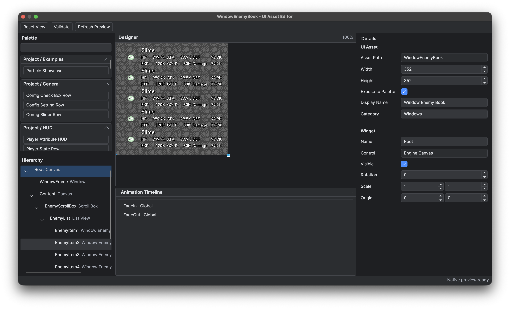

# UI Asset Editor

The UI Asset Editor lays out a declarative UI asset visually, with the Palette, Hierarchy, Designer, Inspector and Timeline in one window. Use it for any screen, window or reusable part that is authored by hand rather than built entirely from code.

## Open or create an asset

Choose **Game → New UI Asset**, or create and open the JSON asset beneath `Data/UI/Assets` through the project file explorer. Asset ownership (`Parts/<Owner>` versus `Shared`) is described in [Declarative UI Authoring Workflow](<../Lua and Blueprint Scripting/Declarative UI/Authoring Workflow.md>).

*The UI Asset Editor separates available controls, tree structure, visual placement and selected-node properties.*

## Steps

1. Set the design width and height for the asset.
2. Add a root control. A new screen normally starts with `Engine.Canvas`.
3. Drag system controls or exposed project assets from the Palette into the Hierarchy. [UI Controls in the Palette](<UI Controls in the Palette.md>) says what each control is for and helps you choose between them.
4. Select each node and edit control properties in the Inspector.
5. Configure the child Slot. Whether a container accepts children at all, and which Slot it supplies, is fixed by its `childPolicy` and `slotType`; the table is in [Children and Slots](<UI Controls in the Palette.md#children-and-slots>). Canvas children use anchors, offsets, alignment, auto-size and z-order, while List children use list-owned placement.
6. Give every node a meaningful name that is unique within the asset. Generated Views preserve these names as typed control or child-View keys.
7. Set **Exposed** only when the asset is a complete, reusable item intended to appear in the Project Palette.
8. Save, then use **Export** in the main window to generate the Lua View and declarations.

Drag a Palette control onto the middle of a container's Hierarchy row to add a child, or onto the top or bottom quarter of a row to insert a sibling. Dropping in blank Hierarchy space appends to the root. Double-clicking a Palette control also adds it using the current selection.

Moving a node to a Canvas preserves its visual position and fixed dimensions; stretched axes follow the new parent’s available size. Rotation and scale are retained, so a differently transformed parent can change the result. Reordering within one parent preserves the Slot. Each reparenting or indent/outdent action is one Undo step.

Nested project assets cannot be expanded or edited from their parent. Open the original asset to change its contents.

A WrapBox has one child template. The Designer displays every repetition, but editing any repetition changes the same template. See [UI Controls in the Palette](<UI Controls in the Palette.md>) for control properties and child rules, and the [WrapBox API](<../Lua and Blueprint Scripting/Global and Core Modules/Core Modules/Engine/Layout and Image Controls.md#wrapbox>) to access repeated instances.

## Timeline

The Timeline lists animations on the left and starts with no selection, an empty detail area and the authored UI appearance. Right-click to add or delete a local animation, then select one to edit its name, target, duration, pivot, tracks and keys. Clicking blank list space clears the selection. Colour keys use integer RGBA components.

Animation playback and scrubbing are described in [UI previews](<../PreviewHost/UI Actor Particle and Subtitle Previews.md#ui-previews>).

A nested project node lists the Global animations inherited from its asset. Use the override action to create a same-name animation targeted at this instance, and then edit it locally, because inherited definitions themselves remain read-only.

## Asset paths and node names

The asset identity is the exact-case path relative to `Data/UI/Assets`, with forward slashes and no extension. Moving or renaming an asset rewrites managed JSON nesting references. The next Export regenerates its View and declarations, so update handwritten `require` paths and references to renamed nodes before exporting. The full key contract is in [UI Asset Schema and Control Registry](<../Lua and Blueprint Scripting/Declarative UI/Asset Schema and Control Registry.md>).

## Related pages

- [UI Controls in the Palette](<UI Controls in the Palette.md>)
- [Declarative UI Authoring Workflow](<../Lua and Blueprint Scripting/Declarative UI/Authoring Workflow.md>)
- [Declarative UI Controller Examples](<../Lua and Blueprint Scripting/Declarative UI/Controller Examples.md>)
- [UI Asset Schema and Control Registry](<../Lua and Blueprint Scripting/Declarative UI/Asset Schema and Control Registry.md>)
