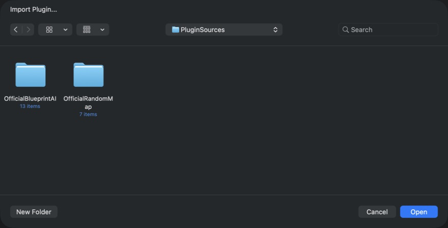
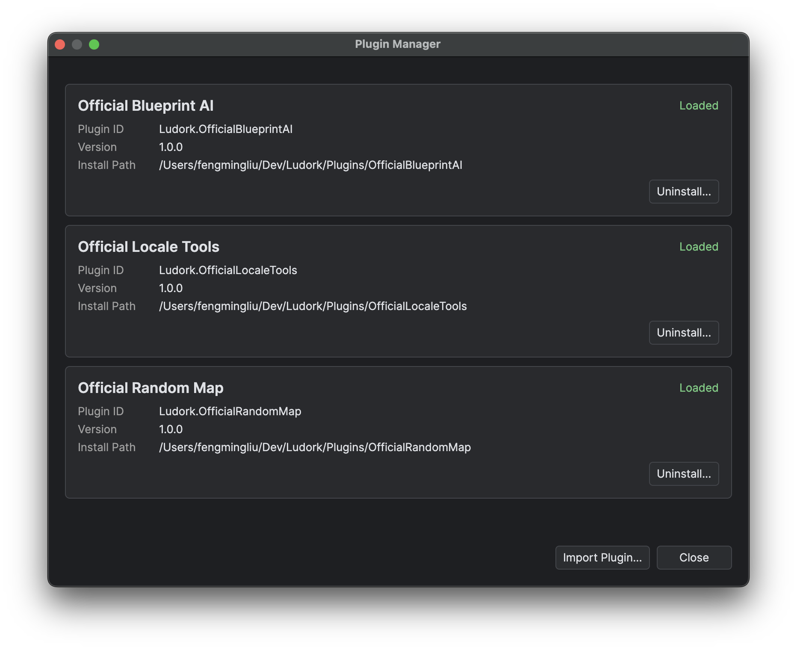

# Installing and Managing Plug-ins

Create, import, update or uninstall source plug-ins for all projects or the current project.

Editor plug-ins are trusted code. They run with the permissions of the editor process and are not sandboxed. Import only directories whose source is trusted.

The plug-in owns its source, windows, labels, settings, retained data and third-party notices. The host owns registration, life cycle, command contexts, the restricted map, Blueprint and resource-cleanup bridges, and operation sequencing.

Plug-ins can add commands, text hints and operation hooks through the [public registration API](<Registration and Hook Reference.md>). To extend the game runtime, use [native C++](<../Native C++ Development/Build and Module Layout.md>).

## Create a plug-in

1. Open **Plugins → Manage Plugins** and choose **New Plugin...**.
2. Enter a display name and unique plug-in ID. Choose **With a Window** or **Logic Only**; **With a Window** is selected initially.
3. Choose **Global Plugins** or **Current Project Plugins**. An open project defaults to **Current Project Plugins**; the start page allows only **Global Plugins**.
4. Create the plug-in. The editor generates and compiles the template, validates its entry type, then installs and registers it. An error leaves no partially created plug-in or overwritten directory.
5. The source folder opens automatically. Edit the generated files, then restart Ludork to load your changes.

Both templates leave `Register` empty. **With a Window** adds an empty Avalonia window, but does not register a menu or open it automatically. See [Manifest and Minimal Plug-in](<Manifest and Minimal Plug-in.md>) for the generated layout and a complete hand-written command example.

## Import a third-party plug-in

1. Close any work that must not be exposed to the selected code, then inspect the plug-in's source, manifest and origin.
2. Choose **Plugins → Import Plugin** or **Import Plugin** in the manager. Select **Global Plugins** or **Current Project Plugins** when a project is open, then select the complete source directory and accept the trust confirmation. The default scope is the current project; the start page imports globally.
3. Read the import result. Resolve any manifest or compilation error before continuing.
4. Restart Ludork. Imported source is not hot-loaded.
5. Open **Plugins → Manage Plugins** and confirm that the plug-in reports **Loaded** in its scope. Open the target project first for a project plug-in.



*Select the directory containing `plugin.json`, not an individual source file or build output.*

The imported directory keeps its name. Invalid manifests, compilation failures, duplicate IDs within the effective global-plus-project set and existing target directories prevent installation. `__ProjectPlugins` is reserved for project plug-in storage and cannot be imported as an ordinary plug-in directory.

The directory must contain `plugin.json` and at least one participating `.cs` source file. Inaccessible paths, links (including broken links), reparse points, embedded `.data`, host-shared DLLs, F# or VB projects, and loose Avalonia XAML source are rejected before installation. A C# project file may remain for IDE use, but the plug-in compiler does not execute it. Sources below `bin`, `obj`, `.git` and `.vs` are ignored.

## Global and project storage

Newly created and imported plug-ins normally use `~/Ludork/Plugins` and `~/Ludork/plugins.json` on Windows and macOS. `~` is the current user's home directory, typically `C:\Users\<user>` on Windows. Retained plug-in data always uses this user directory.

At startup, the editor reads both the working directory's `plugins.json` with its sibling `Plugins` directory and the user installation. For a development build launched from another directory without a registry, it uses the repository identified by the build's development marker. Within each scope, working-directory registrations come first: the same plug-in ID loads only from that source, while IDs unique to either location also load. A selected plug-in's load error is reported without substituting the other copy. A missing registry contributes no plug-ins; an invalid registry reports a diagnostic while the other location can still load. Source directories must be registered; scanning does not automatically register every folder.

The manager shows the selected source and routes unregistration or source deletion to its own registry and directory. Selecting an unregistered immediate child of the working directory's plug-in root for import registers it in place; other imports and newly created plug-ins go to the user directory. If a user copy remains after removing a working-directory registration, it becomes active after restart.

Repository official plug-ins can therefore load directly from the checkout. The Windows package's `tools/OfficialPlugins` payload remains an installation input; startup never copies or replaces official plug-ins. See [User data directory](<../Editor User Guide/Start Page Workspace and Shortcuts.md#user-data-directory>) for other editor data and manual migration.

Project plug-ins use the following layout under either scanned root, with the same working-directory priority. Writable `.data` remains under the user root:

```text
Plugins/__ProjectPlugins/<project-key>/
├── plugins.json
├── .data/<plugin-id>/
└── <plugin-directory>/
    ├── plugin.json
    └── Plugin.cs
```

`<project-key>` identifies a project by its absolute path, so projects with the same directory name at different paths remain independent. Newly created plug-in directories use the plug-in ID; imported directories retain their original name.

Each project scope has its own registry and data. The manager groups **Global Plugins** and **Current Project Plugins** separately, including their status and diagnostics. Project plug-ins apply only to that project's menus, map context menus, text hints and operation hooks. Moving or renaming a project directory creates a new scope: import its plug-ins into the new scope to use them again. There is no automatic migration.

## Official release plug-ins

Official Blueprint AI, Official Locale Tools, Official Random Map and [Official Resource Cleanup](<Official Plug-ins/Resource Cleanup.md>) are distributed as global plug-ins. Their prepared payload includes a `plugins.json` generated from their manifests; after installation they are registered for loading on the next editor start, without the third-party import trust dialog. Official editor distributions contain no project plug-ins.

Both Windows installers install official plug-ins for the user who started setup by default. Clear **Install Official Plugins** in the EXE wizard or pass `INSTALL_OFFICIAL_PLUGINS=0` to MSI to skip this step without changing existing plug-ins. Start setup normally to keep plug-ins with your user account when another administrator supplies UAC credentials. If you explicitly launch setup as another account, that account becomes the installer user. Service-account installations must skip user plug-ins. Repair and editor uninstall preserve user plug-ins; an upgrade that installs official plug-ins replaces them again.

Close Ludork and back up anything needed before installing official plug-ins. The operation replaces the complete `~/Ludork/Plugins` directory and `~/Ludork/plugins.json`; it does not merge them. This deletes existing third-party source, registrations and `Plugins/.data`, plus all project plug-ins, registries and data below `Plugins/__ProjectPlugins`. Other settings and template caches are preserved. An ordinary failure rolls back the previous installation. If rollback cannot finish, follow the reported recovery instructions. A successful replacement removes its backup; a failure to clean up the backup is reported separately.

The macOS DMG keeps plug-ins outside `Ludork.app`. Finder displays `Ludork.app`, an `Applications` link and **Install Official Plugins**. The `.command` extension of the installer and the plug-in payload are hidden. Drag the app to Applications, keep Ludork closed, then double-click the installer. After the user accepts its explicit warning, the installer validates the hidden payload and transactionally replaces `~/Ludork/Plugins` and `~/Ludork/plugins.json` as one installation.

Do not drag plug-in files to Applications. The same complete-replacement rules apply: preserve anything needed before selecting **Replace and Install**.

### Repository and portable installation

Repository runs can load the checkout’s registered plug-ins directly. To install a separate user copy for use outside the checkout, run these commands after building ScriptTools, with Ludork closed:

```sh
.tools/ScriptTools/ScriptTools editor-official-plugins prepare Plugins obj/official-plugins
.tools/ScriptTools/ScriptTools editor-official-plugins install-current-user obj/official-plugins
```

On Windows, use `.tools\ScriptTools\ScriptTools.exe` instead. From the root of an extracted Windows portable package, or from an installed editor directory when retrying a failed plug-in installation, run:

```bat
tools\ScriptTools\ScriptTools.exe editor-official-plugins install-current-user tools\OfficialPlugins
```

Run installation commands as your normal user, without **Run as administrator** or `sudo`. These commands replace all existing plug-ins and their data as described above. Windows installer plug-in operations and `install-current-user` commands save their latest output to `~/Ludork/Log/OfficialPluginInstall.log` when that location is writable. If an EXE installation reports that plug-ins failed, the editor itself remains installed; inspect this log and the installer output before retrying. If identity checks fail before the user directory can be resolved, use the installer output for details. The macOS DMG installer displays its own result and recovery details.

## Restart and status

Creation and import compile source before registration. Global plug-ins compile and load at editor startup. Each project’s plug-ins compile and load before its first project window opens in that editor session, and that result is reused when reopening or switching projects. Creating, importing, uninstalling or directly editing plug-in source requires a restart; reopening a project does not reload it. **Plugins → Manage Plugins** reports the Loaded, manifest-invalid, compile-failed, initialisation-failed and pending restart or deletion states, together with diagnostics.

A registered plug-in is enabled after restart, when its scope loads, and there is no hot enable or disable switch. Treat **Loaded** as the effective enabled state.



*Use the status and diagnostics shown here before replacing or removing installed source.*

## Data and uninstall

Global plug-in writable state belongs in `~/Ludork/Plugins/.data/<plugin-id>` in every editor mode, and the plug-in obtains it from `PluginDataDirectory`. Official Blueprint AI therefore uses `~/Ludork/Plugins/.data/Ludork.OfficialBlueprintAI`. Project plug-in data instead resides in `~/Ludork/Plugins/__ProjectPlugins/<project-key>/.data/<plugin-id>`. The same plug-in ID in different project scopes has independent data and credentials. Always use `PluginDataDirectory` rather than writing settings or history into the plug-in source directory.

Uninstall unregisters the plug-in and can schedule safe deletion of its installed files. A loaded directory may remain present until the restart, because its assembly is active. A plug-in that was unregistered without deletion can be registered again by selecting its existing immediate child directory under the same scope’s plug-in root. Plug-in data is retained in both uninstall modes, and deleting that data is a separate explicit operation. Do not edit the registry by hand while the editor is running.

Resource Cleanup's project-specific additional keep list is managed by its host bridge in `EditorCache/ResourceCleanupKeep.list`. It belongs to the project and is separate from both plug-in program content and `PluginDataDirectory`.

## Limitations

Source compilation can reference the .NET runtime, `Ludork.Plugin.Abstractions`, `Ludork.Plugin.Avalonia` and the editor's shared Avalonia assemblies. Plug-ins cannot reference editor implementation assemblies.

## Related pages

- [Manifest and Minimal Plug-in](<Manifest and Minimal Plug-in.md>)
- [Registration and Hook Reference](<Registration and Hook Reference.md>)
- [Distribution](<Distribution.md>)
- [Official Resource Cleanup](<Official Plug-ins/Resource Cleanup.md>)
