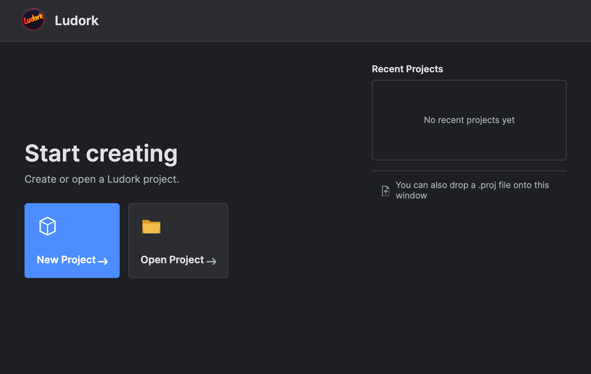
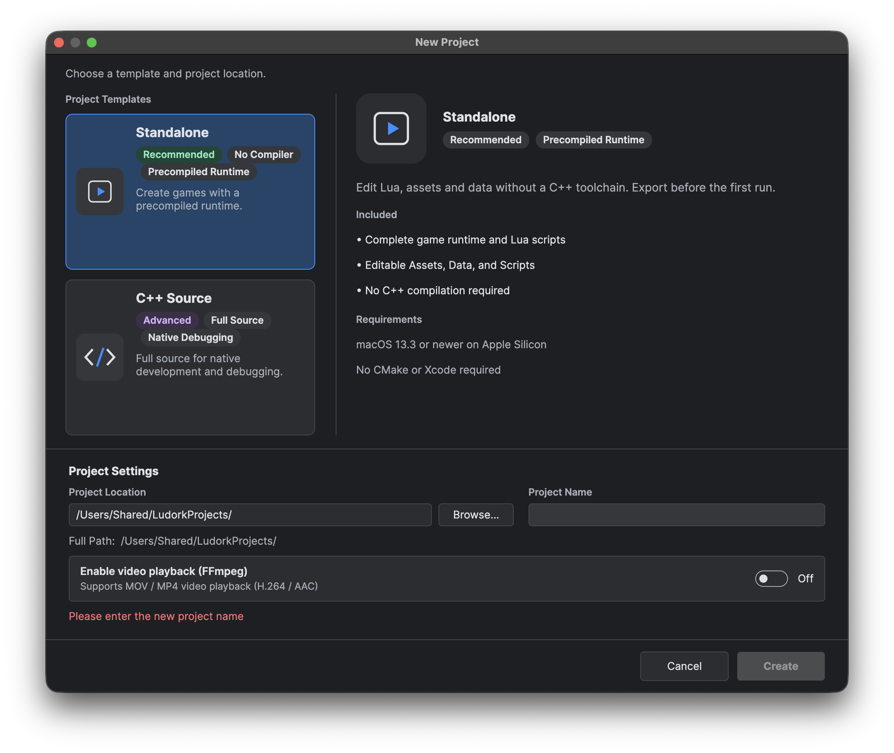

# 创建第一个项目

创建一个 Standalone 项目，打开初始地图并运行。

### 创建项目

1. 在启动页选择 **新建项目**。

2. 选择 **Standalone**。
3. 除非游戏需要播放视频，否则保持 **启用视频播放（FFmpeg）** 关闭。
4. 选择一个已存在的目标目录，并输入新的项目名称。
5. 确认目标路径后点击**创建**，完成后会自动打开 `Main.proj`。

正式版编辑器首次使用时会下载匹配的模板。模板可用性、离线使用与取消操作见[获取模板](<项目模板.md#获取模板>)。

### 保存与运行

1. 在 **地图列表** 中选择一张地图。
2. 点击 **导出**，处理所有报错；成功导出后才能运行。
3. 点击 **运行**。Windows 支持内嵌或独立窗口，其他平台使用独立窗口。窗口设置与导出细节见[编译、导出与运行](<../编辑器用户指南/运行、调试与打包.md#编译导出与运行>)。
4. 打开**控制台**查看运行输出。游戏运行时默认不能编辑项目；需要修改运行中的地图时，请在运行前开启[实时调试](<../编辑器用户指南/运行、调试与打包.md#实时调试>)。
5. 点击同一位置的 **停止**，停止游戏并恢复编辑。

新项目不包含 `Main.ini`，首次运行时会自动创建。各文件和目录的用途见[项目设置与资产布局](<../编辑器用户指南/项目设置与资产布局.md>)。

## 相关页面

- [Lua 基础语法](<Lua 基础语法.md>)
- [启动页、工作区与快捷键](<../编辑器用户指南/启动页、工作区与快捷键.md>)
