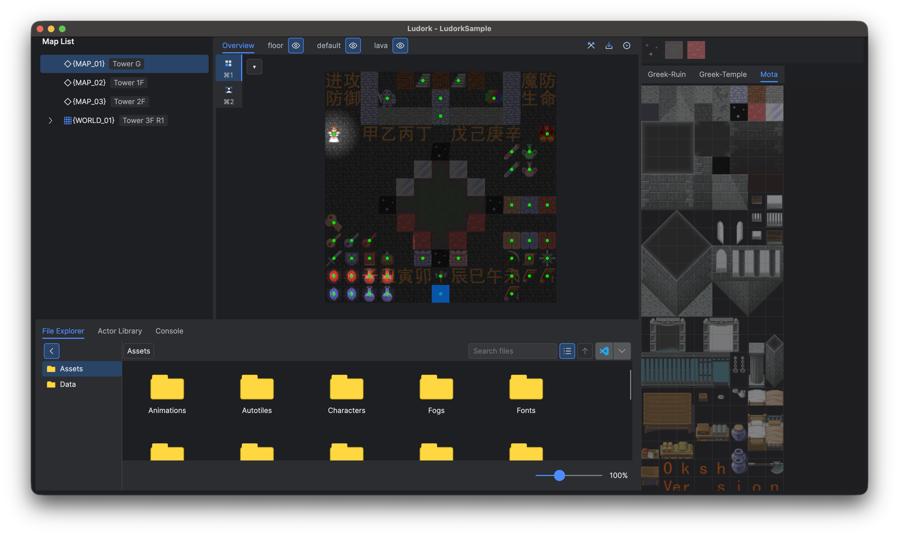
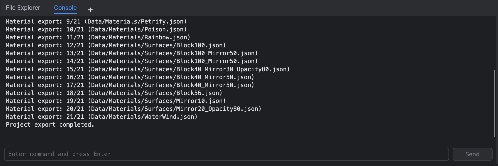
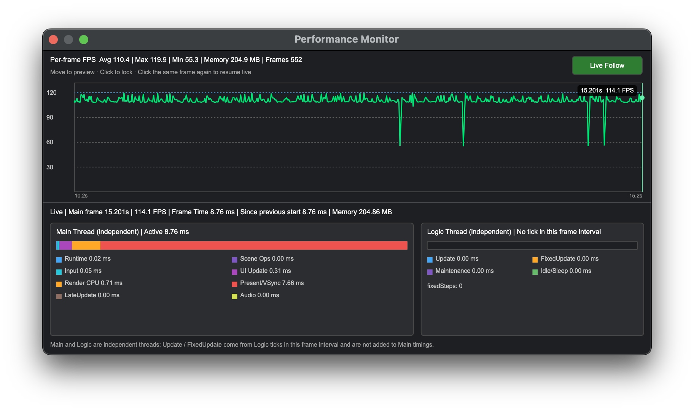

# 启动页、工作区与快捷键

## 启动页

启动页最多列出三个最近打开的项目，并提供 **新建项目** 与 **打开项目**。打开通过校验的 `.proj` 文件后，该项目会移到列表顶部。启动页加载时会清除已不可用的记录。处理完当前项目未保存的改动后，才会打开新项目。

把已有的 `.proj` 文件拖放到启动页任意位置即可打开。一次拖入多个文件时，编辑器只取第一个存在的 `.proj` 文件，其余文件忽略。

项目版本不受支持时无法打开。支持范围见 [Main.proj](<项目设置与资产布局.md#mainproj>)。

## 主工作区

主窗口左侧是**地图列表**，中间是地图画布，图层页签位于画布上方。右侧面板随模式切换：图块模式显示图块面板，角色模式显示**世界大纲**与**角色信息**。画布下方是**文件浏览器**、**Actor 库**和**控制台**标签页。图块和角色模式开关位于画布旁，世界地图模式下隐藏。工具栏提供 **编译 → 导出 → 运行** / **停止**；Standalone 项目隐藏编译按钮。操作流程见[运行、调试与打包](<运行、调试与打包.md>)。

资源窗口打开时会显示加载提示；加载失败后可点击**重试**。

*全貌同时显示所有可见图层，右侧为图块面板，地图画布下方为文件浏览器。*

## 在线文档

按 **F1** 可在编辑器中打开对应版本的在线手册，例如编辑器 1.0.7 打开 1.0 文档。手册默认使用编辑器的当前语言，也可在章节标签右侧切换语言和版本。

嵌入页面隐藏官网导航。文档链接留在窗口内，首页、下载及外部链接在系统浏览器中打开。在线页面需要网络连接，加载失败可点击 **重试**。Windows 需要 Microsoft Edge WebView2 运行时，缺失时提供安装入口；macOS 使用系统 WKWebView。

## 编辑器全局偏好

`~/Ludork/Ludork.ini` 保存所有项目共用的偏好，重启编辑器后会恢复这些设置。

| 区域 | 保存内容 |
|---|---|
| 主窗口 | 正常位置和尺寸、最大化状态、地图列表与 Inspector 宽度、下方区域高度、Actor 大纲与属性区比例，以及世界地图子地图列表宽度。 |
| 文件浏览器 | 图标／列表模式、内容缩放、来源栏展开／折叠状态，以及首选外部打开方式。 |
| Actor 库 | 图标／列表模式。 |
| 工具窗口 | 按窗口类型保存位置、正常尺寸和最大化状态。 |
| 工具内容 | 现有可拖动分区的宽度或比例、UI 时间轴和系统控件分类的展开状态，以及粒子配置分组的展开状态。 |

默认使用图标模式、100% 文件浏览器缩放、折叠的来源栏和系统文件管理器。偏好缺失或无效时使用默认值。项目浏览目录和地图选择保存在 `Main.proj`；全局偏好不会修改项目资源，也不恢复搜索文字、输入草稿、图层选择或画布视图状态。

恢复的窗口布局会适应当前显示器。每种窗口采用最近一次调整的布局，不恢复最小化状态。

项目独立保存的显示偏好见[视口选项](<../PreviewHost/地图与世界预览.md#视口选项>)。

## 用户数据目录

Windows 与 macOS 编辑器统一在 `~/Ludork` 中保存持久数据，安装版、便携版和从仓库运行的编辑器均采用此位置。`~` 表示当前用户的主目录，Windows 上通常为 `C:\Users\<用户名>`，macOS 上通常为 `/Users/<用户名>`。保存这些数据不需要编辑器安装目录的写入权限。

| 数据 | `~/Ludork` 下的路径 |
|---|---|
| 偏好、最近项目与窗口布局 | `Ludork.ini` |
| 全局与项目插件、注册记录及保留数据 | `Plugins/` 与 `plugins.json` |
| 四种模板的下载缓存 | `Templates/v<基础版本>/` |
| 签名配置索引 | `macos-signing.json`、`ios-signing.json`、`harmony-signing.json`、`android-signing.json` |
| 本地测试服务器设置 | `.localserver/<项目目录名>/test.json` |
| 各项目的编辑器控制台输出 | `Log/<项目标识>/Ludork.log` |
| Windows 内嵌浏览器数据 | `WebView2/` |

插件查找还会读取工作目录的注册表与源码，同 ID 时优先使用工作目录中的版本。插件保留数据仍存放在 `~/Ludork`，详见[全局与项目存储](<../插件开发与安装/安装与管理插件.md#全局与项目存储>)。

项目文件、构建产物和 `EditorCache` 仍在各自项目中。游戏运行时设置与存档保持原有位置；密码仍由操作系统凭据存储保管，macOS 的 WebKit 缓存也继续由系统管理。卸载编辑器会保留用户数据目录。

### 迁移已有编辑器数据

除上述工作目录插件扫描外，编辑器不会自动读取或迁移旧位置的数据。请关闭 Ludork，**在卸载旧版之前**备份需要保留的内容。Windows 旧版曾将编辑器数据放在安装目录中；从仓库运行时，设置可能位于当时的工作目录，插件位于仓库中。macOS 旧版设置与签名索引位于 `~/Library/Application Support/Ludork`，其发布版插件和模板缓存已经使用 `~/Ludork`。

新版本安装完成后，再将需要的 `Ludork.ini`、签名索引、模板缓存和本地服务器设置恢复到上表对应位置。`Plugins` 与 `plugins.json` 必须从同一份备份一起恢复。如需安装过程中保留现有插件，可取消 EXE 的 **Install Official Plugins** 选项，或向 MSI 传入 `INSTALL_OFFICIAL_PLUGINS=0`，随后再恢复备份。不要先恢复插件再按默认选项安装，否则官方插件安装步骤会再次替换它们。覆盖目标位置已有文件前，也应先备份。系统凭据存储中的条目和项目文件无需搬迁。

## 全局快捷键

Windows 上的主修饰键是 `Ctrl`，macOS 上是 `Command`。

| 快捷键 | 操作 |
|---|---|
| `Ctrl/Command+N` | 新建项目 |
| `Ctrl/Command+O` | 打开项目 |
| `Ctrl/Command+S` | 保存 |
| `Ctrl/Command+Z` | 撤销 |
| `Ctrl/Command+Shift+Z` 或 `Ctrl/Command+Y` | 重做 |
| `Ctrl/Command+W` | 退出或关闭项目窗口 |
| `Ctrl/Command+1` | 图块模式 |
| `Ctrl/Command+2` | 角色模式 |
| `F1` | Ludork 文档 |
| `F3` | 游戏配置 |
| `F4` | 系统配置 |
| `F5` | 动画总览 |
| `F6` | 通用粒子总览 |
| `F7` | 图块集数据 |
| `F8` | 公共函数 |
| `F9` | 游戏变量 |
| `F10` | 通用数据 |

部分文档窗口还会附加各自的上下文快捷键。在蓝图编辑器中，`F2` 重命名当前选中的事件页签；在公共函数窗口中重命名选中的公共函数；在文件浏览器中重命名选中的文件，macOS 上除外；在动画编辑器中重命名选中的时间标签。任何窗口都不显示 `F2` 提示。

只有一个按钮的提示与错误对话框，按 `Enter`、`Return`、`Space` 或 `Escape` 均可关闭。确认对话框中，`Enter`、`Return` 与 `Space` 表示确认，`Escape` 表示取消。

## 编辑与保存

支持清空的文件字段会在文件选择窗口中显示**清空**，始终位于每个目录和文件类型筛选的第一项。选中后点击**打开**、按回车或双击该项即可清空字段；点击**取消**或按 Escape 保留原值。保存窗口、多文件导入和必须选择实际文件的窗口不提供该项。

界面上显示的字段默认值，只在字段被编辑后才写入。

受管资源的改动在保存之前只留在内存中。所有保存按钮与 `Ctrl/Command+S` 都会写入全部已修改文档，包括未打开的资源；编译、导出、运行和打包走同一套流程。保存成功不弹出结果提示；保存失败时仅显示失败项及其错误。普通保存会校验改动过的蓝图，强制保存则可以保留尚未完成的图。[游戏配置](<项目设置与资产布局.md#mainini>)在确认时立即写入。

保存和重命名资源期间暂时不能编辑、切换项目或关闭窗口。耗时较长的操作会显示进度，不能中途取消。操作期间项目数据发生变化时，编辑器会提示重试。

撤销与重做只作用于当前活动文件，每个文件保留最近 100 条记录。显示同一文件的多个窗口共享数据与历史，关闭后重新打开依然如此。同一字段中连续的文本或数字输入会合并为一步。切换控件或编辑视图、自动更新、保存、撤销和重做都会结束该步。按钮、复选框和选择操作则各自单独成步。

撤销不能恢复指向已删除资源的引用。遇到这种情况，操作会被拒绝，文档内容和历史记录保持不变。

自动更新引用时，每个被改动的目标文件中都会留下一个带标记的撤销屏障，未打开的文件也不例外。之后的编辑仍可撤销，但撤销无法越过屏障，并会提示屏障的来源。撤销或重做源文件的重命名时，编辑器按目标文件的当前内容更新引用，并加入新的屏障，无关的编辑因此得以保留。保存会同时保留历史与屏障，所以已保存的文件可以因撤销而再次变为已修改。

已修改的文件在文件浏览器和编辑器标题中显示 `*`，资源选择器也会标记。关闭或替换项目时会列出未保存的文件，并提供 **保存**、**不保存** 和 **取消**，其中 **保存** 会写入每一个已修改的文档。保存失败会保留修改标记并阻止关闭。关闭资源窗口后，未保存的数据会一直保留到项目关闭。

## 文件浏览器与引用树

文件浏览器通过来源栏和面包屑浏览 `Assets` 与 `Data`，“返回上级”到所选根目录为止。打开项目时恢复上次有效的浏览目录，默认进入 `Assets`。

右键点击条目可打开文件操作菜单，右键点击空白处可打开当前目录菜单。粘贴以当前浏览目录为目标。

右键文件或文件夹，选择 Windows 上的**在文件资源管理器中查看**或 macOS 上的**在 Finder 中查看**，可打开其所在目录并选中该条目。展开的子目录和搜索结果同样支持此操作。多选时只定位右键点击的条目；磁盘上尚不存在的条目会禁用该操作，点击不会保存资源修改。

列表视图中，点击文件夹箭头可原地展开或收起多级目录，双击文件夹进入目录。`Right` 展开文件夹或选中第一个子项，`Left` 收起文件夹或选中父项。展开状态在本次项目会话中保留；图标视图和搜索结果保持平铺。

搜索按文件名匹配当前目录及子目录中的文件，忽略大小写；结果包含未保存资源，并显示相对路径。清空搜索恢复浏览，切换目录或定位文件会清空搜索。符号链接文件夹不参与展开和递归搜索。

按住 `Ctrl/Command` 滚动滚轮，或使用右下角滑杆，可在 50%–200% 之间缩放图标和文字。按 F5 刷新外部文件变更。

图片和视频在格式受支持时显示缩略图。蓝图 JSON 条目的预览见[Actor 预览](<../PreviewHost/UI、Actor、粒子与字幕预览.md>)。

在文件浏览器中选中图片、音频或视频，按**空格**即可预览。文件选择窗口也会在右侧预览音频和视频。媒体默认暂停，可使用播放、进度跳转和音量控件；按 **Escape** 关闭预览或取消选择。

媒体预览支持常见音频和视频格式，实际可播放的编码取决于系统。Windows 需要 Microsoft Edge WebView2 运行时。预览无需启用项目的 FFmpeg 选项或编译原生游戏，文件也不会上传。格式不受支持或文件损坏时会显示错误。

引用树显示当前文件使用的资源，以及哪些文件引用了它。通过编辑器创建、重命名和移动受管资源，可以同步更新可识别的引用；普通字符串和源码中的引用需要手动修改。

新建或复制的受管资源处于未保存状态，创建动作本身不产生撤销步骤。重命名会立即反映在编辑器中。全局保存时，新路径与更新后的引用一起写入磁盘。删除之前，必须先移除并保存所有可识别的引用。确认删除立即生效，且无法撤销。

复制粘贴重名时自动使用 `name_copy.ext`、`name_copy2.ext` 等名称，不覆盖已有文件或文件夹。

右上角的打开菜单始终提供系统文件管理器，用于打开当前浏览目录。选择菜单项后会保存为首选打开方式；如果它在其他项目或当前计算机上不可用，按钮暂时使用系统文件管理器，同时保留已保存的偏好。只有安装了对应程序时，才会列出 VS Code 或 Cursor。C++ Source 项目还会列出已安装的 CLion，Windows 上另有 Visual Studio 2022。VS Code、Cursor 和 CLion 始终打开项目根目录，不受文件浏览器当前目录影响。如果本机缺少 `.idea` 或 `.vs` 配置，首次打开 CLion 或 Visual Studio 时会先询问，再决定是否运行项目自带的环境生成器；取消则项目保持原样。Visual Studio 打开的是项目根目录下生成的 `Main.sln`。

## 控制台与性能监视器

控制台汇集插件、构建和运行时的输出。只有兼容的运行时连接就绪后，才能向控制台发送输入。游戏运行期间，**编辑 → 开发工具与设置 → 性能监视器** 会显示最近的帧、逻辑和内存样本。

控制台输出保存在 `~/Ludork/Log/<项目标识>/Ludork.log`。项目标识由绝对路径生成，因此路径不同的同名项目各有独立日志。开始新的日志会话时，已有日志会按最后修改时间归档。移动或重命名项目后会使用新的日志目录，原日志仍会保留。

### 大地图流送样本

对组合式大地图做性能采样时，性能监视器会附带一个可选的 `worldStreaming` 快照。普通地图和未采样的 tick 都不包含它。

| 字段 | 含义 |
|---|---|
| `queueDepth` | 排队等待流送的子区域数量。 |
| `reading` | 当前处于 `Reading` 状态的区域数量。 |
| `prepared` | 已加载且处于 `Prepared` 状态的区域数量。 |
| `active` | 处于 `Active` 状态的区域数量。 |
| `dormant` | 已加载且处于 `Dormant` 状态的区域数量。 |
| `cacheBytes` | 非 Active 区域缓存采用的保守估算值。它并不等于精确的进程、Lua、native 或 GPU 内存占用。 |
| `publishMilliseconds` | 一次逻辑 tick 中转换并发布区域所花费的时间。 |
| `visibleTileChunks` | 最近一次绘制中，可见子图层提交的不重复 32×32 格 TileLayer chunk 数量。 |
| `activeActors` | 当前位于大地图 Active 更新与绘制批次中的 Actor 数量。 |

*控制台记录启动进度、运行时诊断与进程结束结果。*

*没有兼容的运行时会话时，监视器保持等待是正常现象；连上遥测后，时间轴才会开始填充。*

## 相关页面

- [通用粒子](<通用粒子.md>)
- [项目设置与资产布局](<项目设置与资产布局.md>)
- [运行、调试与打包](<运行、调试与打包.md>)
