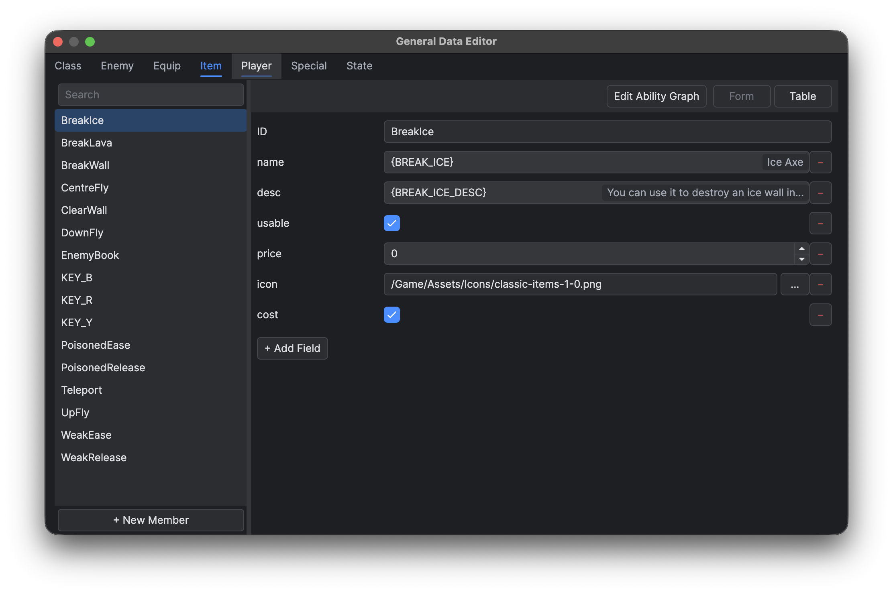
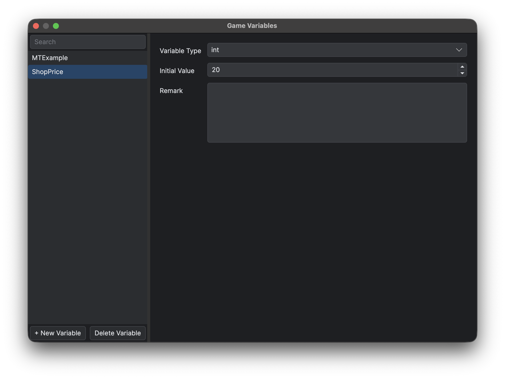
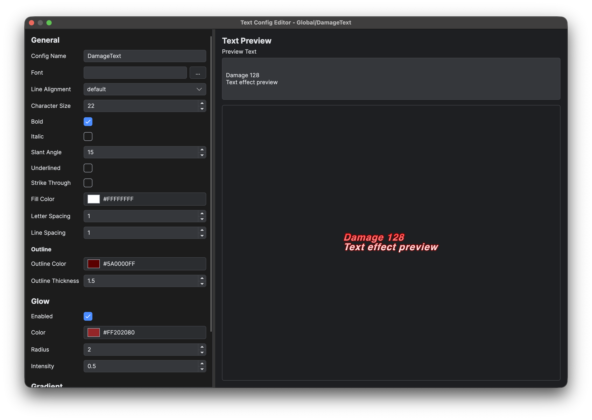

# 通用数据与文本配置

通用数据是编辑器管理的数据库，位于 `Data/General`，适合存放敌人、物品、装备、玩家预设、状态等会被多张地图或多个蓝图共用的数据。每个 JSON 文件定义一个类型 schema 和若干命名成员。同一个类型文件的 Form、Table 与成员能力图窗口共享一份文档和一份撤销/重做历史。

## 类型结构

| 键 | 含义 |
|---|---|
| `params` | 有序字段定义，包含 `type`、`defaultValue`、可选的 `comment`，以及枚举和容器的递归类型 schema |
| `members` | 为这些字段保存值的命名记录 |
| `events` | 可选的有序事件名；每个成员可以为各事件保存独立的图 |

支持的字段有字符串、布尔值、整数、浮点值、文件、列表、字典，以及 `sf.Vector2f/i/u`、`sf.Vector3f/i/u`、`sf.Color` 与 `sf.IntRect`。新增或编辑的字段保存完整递归 `type`，例如 `{ "list": "int" }` 或 `{ "dict": "int", "key": { "enum": "Enums.GeneralData.Item", "valueType": "string" } }`。已有的 `"type": "list"` 加 `itemType`、`"type": "dict"` 加 `valueType` 仍可读取。枚举、元组与联合类型的组合规则见 [Metadata 结构与 Decorator](<../Lua 与蓝图脚本/蓝图脚本/Metadata 结构与 Decorator.md>)。填写联合类型的值之前，先选中分支。

在 **添加字段** 或 **编辑字段** 中选择 `enum`，通过 **kind** 选择模块，再选择推断或显式的标量值类型及默认值。项目托管枚举使用 `string`，空源码枚举必须显式声明标量类型。字典的键类型和键枚举可独立于值类型选择。这些选择器直接写入 schema，不保存单独的 `kind` 或 `reference` 属性。

物品键使用 `{ "enum": "Enums.GeneralData.Item", "valueType": "string" }`；类型键使用 `Enums.GeneralDataKey`，动画键使用 `Enums.Animation`，粒子键使用 `Enums.Particle`。选择器会显示尚未保存的新增、重命名和删除结果。列表、字典键和值、元组及联合类型均可使用这些枚举。

缺少子类型、成员字段缺失或出现 schema 之外的、不以下划线开头的字段，以及值与 schema 不符，加载时都会失败。需要存放类型不一的 JSON 值时使用 `any`：它保留字面类型，也从不把字符串当作代码求值。

`linkedType` 不受支持，出现即被拒绝。

每个字段定义可以保存一段可选的英文 `comment`。新增或编辑字段时通过 **注释** 填写，注释为空则不写入。把鼠标停在 Form 的字段名或 Table 的表头上会显示该注释。这条 schema 注释与恰好命名为 `desc` 的字段中保存的成员值不是一回事；它只是项目里的普通文本，不是 locale key。

字符串枚举选择器包含 **— 不选择 —**，保存为空字符串。未知的非空值会保留；枚举校验标量类型，不强制限定选项成员。空的托管集合仍是有效的字符串枚举。枚举键字典的新行会一直待定，直到选中非空且唯一的键，不会保存占位键。旧 `GeneralDataVars` decorator 与通用数据字段 `reference` 协议不受支持；这些选项应通过类型 schema 表达。

即使没有成员选中某个值，枚举声明本身也算作依赖。删除被引用的类型前，需要先移除这些依赖。枚举 ID 中的空白和引号按字面保留。

类型重命名只会自动更新存放在可编辑 JSON 中的可识别模块路径，包括自身引用，以及因标识符冲突而重新分配的其他模块名。Lua metadata 声明的依赖仍会显示，但不会触发源码改写。动画与粒子重命名会更新具有对应类型的标量引用。字典键冲突会拒绝整次重命名，不留下部分修改；Undo/Redo 按统一的[引用更新规则](<启动页、工作区与快捷键.md#编辑与保存>)恢复关联引用。删除被引用类型前应先移除并保存依赖。普通字符串以及 Lua 或 C++ 源码不会被改写。

## 步骤

1. 打开 **数据库 → 通用数据**（`F10`）。
2. 选择一个类型，或右键点击类型标签栏创建类型。
3. 在批量创建成员之前先定义好字段。右键单击 Form 中的字段名即可编辑它的定义。
4. 添加成员并填写它们的值。右键点击成员列表条目或 Table 行，可以修改 ID、复制、删除成员，或打开可用的能力图。
5. 通过类型标签的右键菜单管理该类型的事件，再用 **编辑能力图** 打开成员图。重命名或删除事件会更新全部成员图；运行时显式激活这些图。
6. 重命名或删除类型、成员之前，先查看引用。
7. 保存数据。

保存会生成 `Enums.GeneralDataKey`、各 `Enums.GeneralData.<TypeName>` 模块、`Enums.Animation`、`Enums.Particle`，以及 `Source.Configs.GeneralDataTypes` 和对应的 LuaLS 声明。例如，`local Item = require("Enums.GeneralData.Item")` 可访问 `Item.EnemyBook`。需要修改时，请编辑数据库记录，不要直接修改生成文件。重命名或删除类型会同步更新所属的生成模块，不会删除手写文件。

使用 `GeneralDataTypes.Create(typeName, memberID, memberData)` 可按 ID 和字段类型还原已保存的成员。

编辑字段可以改动它的名称、类型、容器元素或值类型、默认值与注释。重命名会保留每个成员当前的字段值。修改字段类型、列表的元素类型或字典的键或值类型时，编辑器先请求确认，然后把所有已有成员中该字段重置为新默认值。只改默认值不会覆盖已有成员。删除字段会移除它的含义，但不会自动修复读取它的脚本。

成员图由 `Source.Gameplay.GeneralDataGraphAbility` 同步执行，使用 `GameplayEventData` 作为上下文。请通过全局节点和该上下文编写逻辑；成员图没有类继承、parent 或 self 节点。只能使用类型中声明的事件，不支持 latent 节点；没有起始节点时返回 `NoGraph`。

## 搜索与视图

搜索不区分大小写，可匹配成员 ID、名称、数字和布尔值，不搜索容器或图内部的内容。窗口保持打开期间，每种类型都会保留自己的搜索条件、选中项和 Form/Table 视图。

Form 用于完整编辑单个成员。Table 按声明顺序列出 ID 和字段，可直接编辑布尔值、数值和字符串。编辑结构化值时，点击**编辑**即可在 Form 中打开该成员。列可横向滚动；编辑遵循统一的[撤销规则](<启动页、工作区与快捷键.md#编辑与保存>)。

*先定义好 schema 再录入记录，确保所有成员都使用预期的字段类型。*

## 游戏变量管理器

打开 **数据库 → 游戏变量**（`F9`），声明由蓝图与当前游戏实例共享的可变值。左侧列出已声明的变量名。选中一项后，在右侧编辑它的类型、初始值与可选备注；备注只在编辑器内可见，对运行时没有影响。变量名是运行时标识符，一旦图、地图或脚本开始引用，就应保持稳定。

用搜索框按变量名过滤，不区分大小写。**新建变量** 会先询问名称与类型，然后添加一条声明；**删除变量** 在确认后移除当前选中的声明。

*在右侧详情区修改当前声明的类型、初始值和仅供编辑器查看的备注。*

创建变量时就要选定类型。Manager 提供 `bool`、`int`、`float`、`string`、`list` 与 `dict`，写入 metadata 时依次对应 `bool`、`int`、`float`、`string`、`any[]` 与 `Dict[string, any]`。列表与字典使用普通 Lua table，而不是 Standard 的原生 `list` 或 `dict`。修改已有变量的类型会清空它的初始值，换成新类型的空默认值。

保存会一起生成 `Scripts/Source/Configs/GameVariables.lua` 和 `GameVariables_meta.lua`，分别存放初始值和声明。请在变量管理器中修改，不要手动编辑这两个文件；仅打开管理器不会写入文件。

带 `InstVar` 标记的蓝图字段或节点参数使用可搜索的选择器，而不是自由输入的文本框。配套的 `InstVarValue` 字段读取所选声明的类型，并切换为该类型的常规编辑器。带类型过滤的选择器只列出兼容的变量，Game 项目的条件门即为一例。

## 文本配置

普通 UI 文本直接在节点上设置样式。需要共享样式或为富文本标签设置样式时，使用**游戏 → 新建文字配置**。

*文本配置为项目使用的结构化文本数据提供专用编辑界面。*

`{ITEM_NAME}` 等显示字符串在展示时解析，加载数据时不会自动本地化。语言文本的编写和使用方法见[游戏本地化工作流](<../插件开发与安装/Official 插件/游戏本地化工作流.md>)。

Game 各类型的精确 schema，见通用数据参考各页。

## 限制

修改 schema 或游戏变量声明，不会自动修复脚本、图、存档或字符串引用。通用数据与生成的游戏变量声明属于项目定义数据，不用来保存可变的对局状态。

## 相关页面

- [Class](<通用数据参考/Class.md>) — Game 项目的 Class schema
- [蓝图、公共函数与 Actor](<蓝图、公共函数与 Actor.md>)
- [游戏本地化工作流](<../插件开发与安装/Official 插件/游戏本地化工作流.md>)
