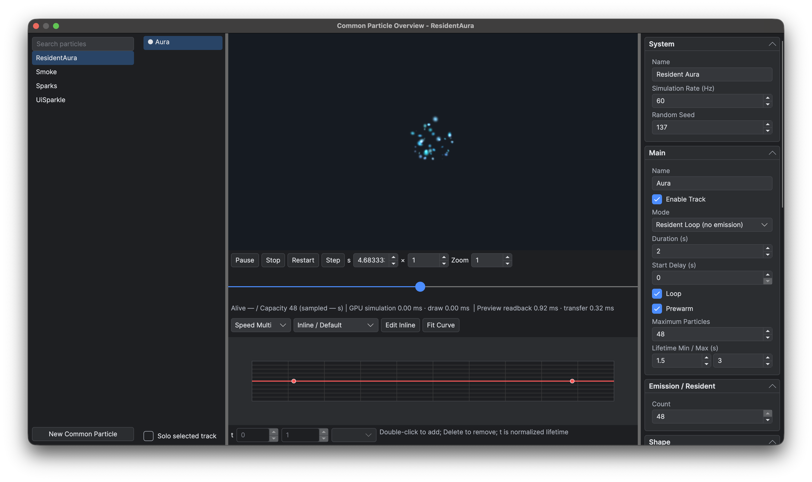

# 通用粒子

通用粒子资源包含按顺序排列的 GPU 发射轨道。Actor 通过 `EmitterComponent` 使用，UI 通过 `Engine.EmitterView` 使用。

## 编辑资源

选择 **游戏 → 新建通用粒子**，或在项目文件浏览器中新建粒子。**数据库 → 通用粒子总览**（`F6`）列出 `Data/Particles` 下的资源。选中资源后编辑轨道、属性和生命周期曲线。在轨道列表中右键可新增轨道；右键轨道项会选中该项，并启用针对该项的“复制轨道”和“删除轨道”。在列表空白处打开菜单时，这两项操作禁用。轨道顺序也是同一发射器内的绘制顺序。



*左侧是轨道列表，中间显示效果预览与生命周期曲线，右侧编辑属性。*

纹理区域字段用于设置贴图区域的位置和尺寸。播放、轨道单独显示与时间定位见[粒子预览](<../PreviewHost/UI、Actor、粒子与字幕预览.md#粒子预览>)。

资源编辑遵循统一的[保存和撤销规则](<启动页、工作区与快捷键.md#编辑与保存>)。

## 资源标识与 Schema

定义保存在 `Data/Particles/<key>.json`。引用使用大小写精确、以 `/` 分隔、不带目录前缀和扩展名的键，例如 `Combat/Hit`。纹理使用完整的 `/Game/Assets/...` 逻辑路径。定义不包含 version 字段。

以下 JSON 格式的颜色分量取值为 0–255。对应的运行时配置类型见 [Emitter 配置 API](<../Lua 与蓝图脚本/全局与 Core 模块/Core Modules/Engine/时间、渲染与粒子.md#emittertrack>)。

```json
{
  "type": "particle",
  "simulationRate": 60,
  "seed": 1,
  "tracks": [
    {
      "name": "Glow",
      "mode": "resident",
      "capacity": 64,
      "count": 32,
      "loop": true,
      "shape": "disk",
      "radius": 24,
      "lifetime": [0.8, 1.6],
      "speed": [4, 12],
      "texture": "/Game/Assets/Particles/Glow.png",
      "blend": "add",
      "curves": {
        "alpha": {
          "keys": [
            { "time": 0, "value": 0 },
            { "time": 0.2, "value": 1 },
            { "time": 1, "value": 0 }
          ]
        }
      }
    }
  ]
}
```

此例需要项目内存在所引用的纹理。空纹理透明。`simulationRate` 是 1–240 的整数，默认 60；`seed` 是 0–16,777,215 的整数，默认 1。`tracks` 为有序数组，轨道名称唯一。固定种子便于在同一运行时和 GPU 上重复编辑结果，但 GPU 浮点模拟不保证跨设备确定性。

| 轨道字段 | 默认值与含义 |
|---|---|
| `name`、`enabled` | `"Track"`、`true`；手动发射通过名称指定轨道。 |
| `mode` | `"emission"` 或 `"resident"`，生命周期规则见下文。 |
| `duration`、`delay`、`loop`、`prewarm` | `2`、`0`、`true`、`false`；时间单位为秒，`duration` 为正数，`delay` 非负。 |
| `capacity`、`count` | `1024`、`min(32, capacity)`；容量为 1–1,000,000，常驻初始数量为 0–capacity。 |
| `rate`、`distanceRate`、`bursts` | `30`、`0`、`[]`；分别为每秒粒子数、宿主每移动一个逻辑像素的粒子数，以及定时爆发。 |
| `shape`、`extent`、`radius`、`innerRadius` | `"point"`、`[32,32]`、`16`、`8`；形状支持 `point`、`line`、`rectangle`、`disk`、`ring`。线段使用 `extent.x`，矩形使用两个分量。半径非负，圆环内半径不超过外半径。 |
| `direction`、`spread` | `-90`、`30` 度；初始方向在 `direction ± spread` 内采样，Y 轴正方向向下。 |
| `lifetime`、`speed` | `[1,2]` 秒、`[20,40]` 逻辑像素/秒；数组给出最小值和最大值，寿命为正数。 |
| `sizeMin`、`sizeMax` | `[8,8]`、`[16,16]` 逻辑像素；每轴非负的尺寸最小值和最大值。 |
| `rotation`、`angularVelocity` | `[0,360]` 度、`[0,0]` 度/秒。 |
| `colourMin`、`colourMax` | 均为 `[255,255,255,255]`；RGBA 各分量的最小值和最大值，范围 0–255。 |
| `gravity`、`radialAcceleration`、`tangentialAcceleration`、`damping` | `[0,0]`、`0`、`0`、`0`；加速度单位为逻辑像素/秒²，非负阻尼按指数衰减速度。 |
| `texture`、`textureRect` | `""`、`[0,0,0,0]`；裁剪矩形为整数 `[x,y,width,height]`。宽高均为零时使用整图，否则宽高必须为正且位于图片内部。 |
| `columns`、`rows`、`frameCount`、`frameRate` | `1`、`1`、`1`、`0`；网格行列为 1–4096，帧数为 1–`columns × rows`，帧率为非负帧/秒。 |
| `randomStartFrame`、`frameLoop` | `false`、`true`；帧从左向右、再从上向下排列。零帧率保持初始帧，不循环的序列停在最后一帧。 |
| `space`、`scaleMode`、`blend` | `"local"`、`"hierarchy"`、`"alpha"`，其他选项见下文；混合还支持 `"add"`。 |
| `offset`、`rotationOffset`、`scale` | `[0,0]`、`0` 度、`[1,1]`；轨道相对于宿主的变换。 |
| `curves` | 可选生命周期通道 `speed`、`sizeX`、`sizeY`、`rotation`、`red`、`green`、`blue`、`alpha`。 |

每个爆发条目的格式为 `{ "time": 0, "count": 16, "cycles": 1, "interval": 0 }`。首次时间位于 `[0,duration)`，数量为 0–1,000,000，重复次数为 1–10,000，间隔为非负秒数，多次重复时必须大于零。数值必须有限，最小值与最大值范围必须有序。

曲线可使用内联标量 [Curve](<动画与曲线.md>)，或 `Data/Curves` 下不带扩展名的键。键时间使用粒子归一化年龄 `[0,1]`。速度、尺寸和 RGBA 通道乘以初始值，默认值为 1；旋转通道追加角度，默认值为 0。内联曲线支持 `defaultValue`、`preInfinity`、`postInfinity`，以及包含 `time`、`value`、`interpolation`、`arriveTangent`、`leaveTangent` 的 `keys`。运行时把每个通道采样成 256 项 GPU 查找表，因此渲染结果是原始曲线的近似。

## 发射、空间与所有权

`emission` 组合时间发射、宿主距离发射、爆发和 `emit(trackName, count)`。`loop` 重复轨道时长；关闭循环后，自动发射在时长结束时停止，已有粒子继续完成生命周期。固定 GPU 槽位按环形使用，新粒子占用后续槽位，容量耗尽时覆盖最旧槽位。容量是模拟预算，不保证每次发射都保留到寿命结束。

`resident` 在延迟后创建 `count` 个粒子。`loop = true` 时每个粒子重复自己的生命周期，无需继续发射；关闭循环时初始粒子只播放一次。时间/距离发射、爆发和手动 `emit` 不用于常驻轨道。图集序列播放独立于这个生命周期模式。

`prewarm` 只作用于循环轨道。正常播放前，GPU 在宿主当前位置重演足以覆盖最大粒子寿命的完整发射周期，每帧最多执行 120 个固定步。预热期间公开播放时间保持为零，重播时重新执行预热。

`local` 空间中已有粒子跟随当前宿主变换；`world` 空间中粒子在宿主移动后仍保留出生时的位置和变换。Actor 使用地图坐标域，`EmitterView` 使用所属 Canvas 的逻辑坐标域，UI 粒子不使用地图 View。Canvas 缩放只在 UI 合成时应用一次。控件转移到另一个 Canvas 时坐标域发生变化，粒子会重置。

`hierarchy` 把完整宿主和轨道缩放应用于形状、运动和粒子尺寸。`local` 缩放模式移除宿主缩放，保留轨道缩放。`shape` 只把组合缩放应用于出生形状，粒子尺寸与运动保持不缩放。

将粒子资源挂载到 Actor 的操作见 [Emitter 组件](<Actor 组件/Emitter.md>)，包括资源选择、相对位置与绘制顺序。

UI 效果通过资产或代码创建 [Engine.EmitterView](<Palette 控件.md#engineemitterview>)。其 `ControlBase` 和父节点负责布局与裁剪，`getEmitter()` 返回播放对象。

Actor 隐藏或休眠、UI 隐藏或卸载时，粒子会暂停并保留当前状态。重新显示宿主后继续播放，隐藏期间的移动不会触发按距离发射。手动暂停的发射器仍保持暂停。销毁宿主会清除粒子，粒子状态也不会随地图持久化。

播放控制和性能统计见 [Emitter、EmitterComponent 与 EmitterView API](<../Lua 与蓝图脚本/全局与 Core 模块/Core Modules/Engine/时间、渲染与粒子.md#emitter>)。

## GPU 要求

通用粒子需要兼容的 GPU，移动端需要 OpenGL ES 3。缺少所需能力时会报错，不会改用 CPU 模拟。

## 限制

本次粒子功能不包含碰撞、拖尾、噪声与子发射器。

## 相关页面

- [项目设置与资产布局](<项目设置与资产布局.md>)
- [资源、音频、视频与特效](<../Lua 与蓝图脚本/Game 玩法/资源、音频、视频与特效.md>)
