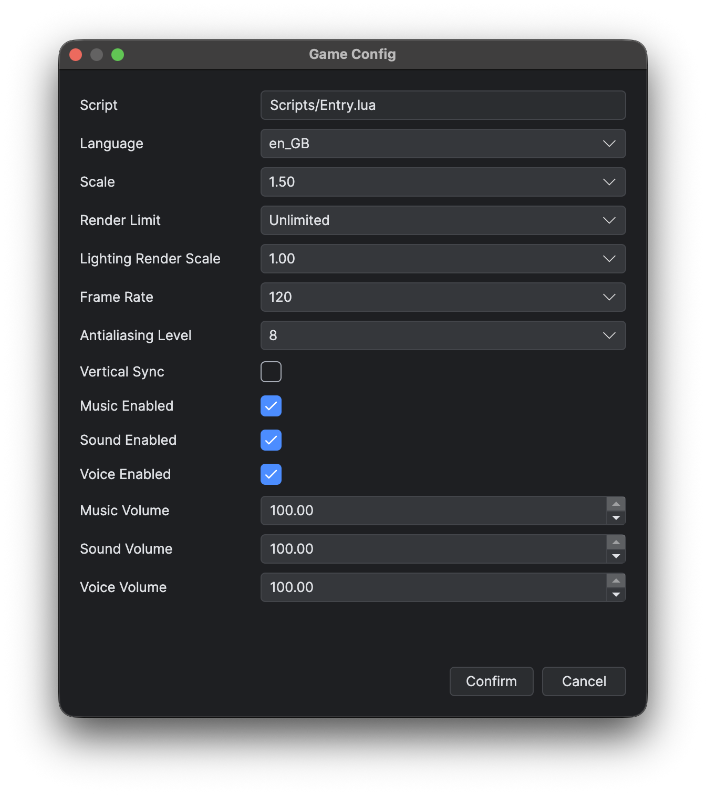
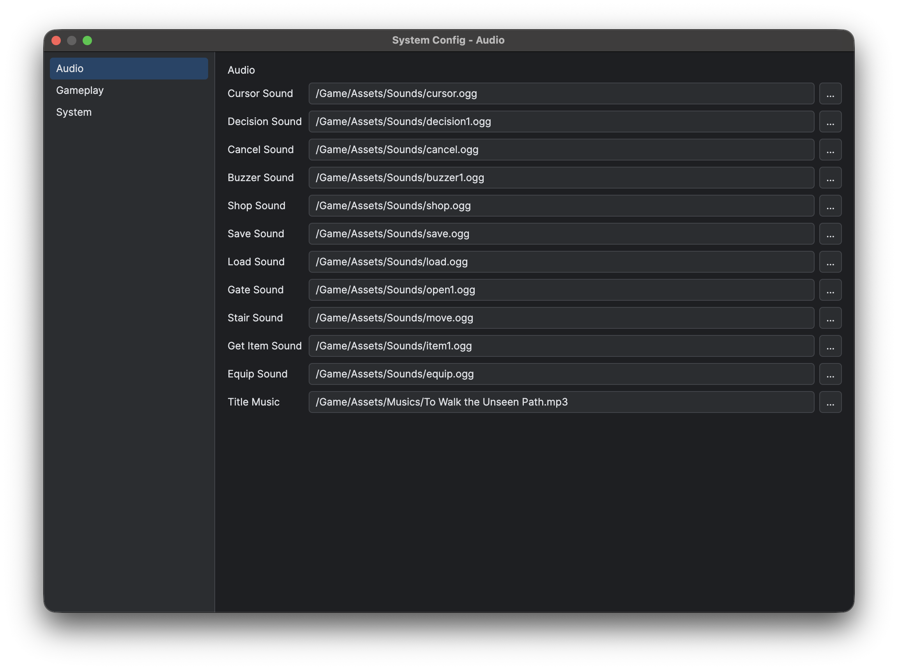

# 项目设置与资产布局

项目的编辑器和打包设置保存在 `Main.proj`，运行设置保存在 `Main.ini`；资源、编辑数据和运行时代码分别位于 `Assets`、`Data` 和 `Scripts`。C++ Source 项目还包含原生源码，其布局见[构建与模块布局](<../C++ 原生开发/构建与模块布局.md>)。

## Main.proj

`Main.proj` 声明编辑器和打包所需的能力。Game 项目启用了 C++ 运行时与 FFmpeg，并保存首选的运行窗口模式：

```json
{
  "version": "v1.0",
  "Cpp": true,
  "ffmpeg": true,
  "IndividualWindow": true,
  "packaging": {
    "version": "1.0.0",
    "dev": false
  },
  "lastFileExplorerPath": "Assets"
}
```

顶层必填字段 `version` 表示引擎兼容版本，格式为 `v<major>.<minor>`。例如编辑器 `1.0.7` 创建 `"v1.0"` 项目，本版支持 `v1.0`。字段缺失、格式错误或版本不受支持时，项目无法打开。打开受支持的旧项目不会自动迁移内容或修改版本。

`packaging.version` 独立保存**游戏自身**的基础发行版本，`packaging.dev` 选择内部测试包。打包字段缺失时分别使用 `"1.0.0"` 与 `false`，这些默认值不适用于必填的顶层工程版本。可在打包窗口保存设置，或由命令行仅覆盖一次打包，见[发行包与开发包](<运行、调试与打包.md#发行包与开发包>)。

未知的键属于编辑器自身的状态，原样保留即可。选择模板时，FFmpeg 模板要与 `ffmpeg` 设置保持一致。

`lastFileExplorerPath` 保存相对于项目根目录的上次浏览位置。新建项目时，所有模板都将其初始化为 `Assets`。

编辑器将上次选中的地图键保存在 `lastOpenedMapKey`，编辑时切换地图即保存该偏好，不会保存地图内容。重新打开项目时恢复选中项，支持世界地图及其子地图。记录缺失或失效时选择第一项；空项目不选地图。实时调试触发的切图不会覆盖此偏好。

编辑器外观和工具偏好通过 `Ludork.ini` 全局共用，与这些项目工作区状态分别保存。见[编辑器全局偏好](<启动页、工作区与快捷键.md#编辑器全局偏好>)。

## Main.ini

通过**游戏 → 游戏配置**（`F3`）修改 `Main.ini` 中的语言、显示和音频设置。入口脚本仅供查看。

语言列表读取已导出的 `Scripts/Source/Locale/*.lua`，排除 `Core.lua`，并在每次打开游戏配置时刷新。即使对应导出文件缺失，当前配置的语言仍会保留在列表中。工作簿新增语言后，先执行导出，再选择该语言。

点击**确认**立即保存，**取消**则保留原值。写入失败时，窗口保持打开并显示错误。这些设置不参与文档撤销，也不计入未保存的文档修改。



*游戏配置包含语言、显示和音频选项。*

在编辑器中，游戏配置始终显示缩放一行。游戏内的 Config 窗口只有在 `Display.isDisplayScaleConfigurable()` 报告宿主支持显示缩放时才显示该行。

在编辑器中运行时使用项目内的 `Main.ini`。打包后的 Windows 桌面游戏把 `Main.ini` 与 `Save/` 写入运行时根目录，与 `Assets`、`Data`、`Scripts` 并列，因为 Windows 把用户数据解析到进程工作目录。macOS 与 Linux 桌面版使用 `$HOME/<AppName>`，iOS 使用 `~/Library/Application Support/<AppName>`，HarmonyOS 与 Android 使用应用私有的用户数据根目录。各项键名、可选项、默认值与生效时机见 [游戏设置参考](<../Lua 与蓝图脚本/Game 玩法/游戏设置参考.md>)。

## 系统配置

打开 **数据库 → 系统配置**（`F4`）编辑 `Data/Configs` 下的配置文件。左侧列表按相对键名列出各项配置；选择 **Audio**、**System** 等条目后，右侧只显示当前配置的字段。

配置文件使用 `type: "system"` 或不带 `type` 的 JSON 对象。配置键是相对于 `Data/Configs`、不含扩展名的路径。

切换配置会保留尚未保存的编辑，不会自动保存。列表和窗口标题中的星号表示修改状态。Windows 使用 Ctrl+S、macOS 使用 Command+S 执行全局保存；撤销/重做针对列表中当前选中的配置。



*选择 System 编辑游戏标题、尺寸和启动设置；选择 Audio 编辑音效与音乐资源。*

## Assets

创作期的文件放在物理目录 `Assets` 下。存储的资源使用大小写精确的 `/Game/Assets/...` 路径，以 `/` 分隔并带文件扩展名。`Assets/...`、类别相对路径、原生绝对路径和路径穿越都无效。`PathVars` 把字段标记为经过校验的规范 `/Game/Assets/...` 引用，`PathRoot` 选择 `"Project"` 工程文件或 `"Data"` 数据文档时使用对应的路径规则。Config 的 `base` 只决定选择器的根目录。`/Game` 通过 Ludork 资源 API 生效；Standard 文件系统 API 与直接使用 LuaSF 文件构造函数时仍需原生路径。

资源解析会检查从目标到项目根目录的路径，拒绝符号链接、断链、重解析点及不可访问的路径。路径换算与选择器根目录可以指向尚未创建的文件或目录，但已有祖先仍须通过相同检查。存储的资源路径在所有平台上都严格区分大小写。

保留约定的一级目录，选择器才能正确过滤：`Tilesets`、`Autotiles`、`Characters`、`Animations`、`Particles`、`Icons`、`Fonts`、`Musics`、`Sounds`、`Voices`、`Shaders`、`Panoramas`、`Transitions`、`System` 和 `Videos`。`.ldpak` 选项把完整的 `Assets` 树归档为根级 `Assets.ldpak`，直接位于 `Assets` 下的普通文件也包含在内，逻辑资源路径保持不变。

移动资产不会自动修复所有已保存的引用。移动或删除之前先打开它的引用树，再手工更新受影响的数据。

## Data 与 Scripts

`Data/Materials` 保存编写用的 [2D 材质](<材质.md>)节点图，固定使用 `type: "material"` 和 `version: 1`，引用仍为完整的项目相对路径 `Data/Materials/...json`。导出将运行时着色器和元数据写入 `Assets/Shaders/MaterialGenerated`：普通材质在 `Materials/` 下保留相对路径，去掉末尾的 `.json` 扩展名，空引用使用 `Builtin/Default/`。程序布局见[材质导出](<材质.md#导出运行文件>)。生成目录被版本管理忽略，不进入模板；游戏发行包保留两个目录，运行时读取生成文件，支持数据／着色器加密和 `Assets.ldpak`。

项目根目录下可选的 `MaterialExport.json` 保存通过[游戏 → 材质组合](<材质.md#材质组合>)管理的额外基础材质／图层材质组合，普通地图中的用法由导出自动扫描。该文件存在时应随源项目和模板保留，打包在校验后将其移除。

`Data/Subtitles` 保存 [视频字幕](<视频字幕.md>) JSON 文档，包含 `type: "subtitle"` 和 `sections` 数组。引用使用项目相对的 `Data/Subtitles/...json` 路径。这些文档由编辑器管理，随 Data 打包，支持加密数据和 `Data.ldpak`。

`Data/Particles` 保存 [通用粒子](<通用粒子.md>) 定义。粒子引用使用不带扩展名的相对键；粒子纹理使用完整逻辑路径，通常位于 `/Game/Assets/Particles`。

`Data` 保存编辑器生成的 JSON；`Data/Locale/Locale.xlsx` 是由 Official Locale Tools 管理的本地化工作簿。声明式 UI 资产放在 `Data/UI`；`Data/TextConfigs` 保存共享或专用文本样式，普通 UI 文本的样式直接保存在各自的 UI 节点上。

`Scripts` 包含运行时 Lua、metadata 和声明。模块位置与文件归属见 [Lua 运行时与模块](<../Lua 与蓝图脚本/Lua 运行时与模块.md>)；UI 资产与生成的 View 见[声明式 UI 编写工作流](<../Lua 与蓝图脚本/声明式 UI/编写工作流.md>)；保存项目数据时生成的文件见[通用数据与文本配置](<通用数据与文本配置.md>)。

`Engine_meta.lua`、`GlobalCore_meta.lua`、`GlobalFunctions_meta.lua` 以及生成的 Core/LuaSF 声明都不得手工修改。打包会移除 `Scripts/stub`，并拒绝任何位置不正确的 `.d.lua`。

编辑期间保留散放的 `Data` 和 `Scripts` 目录。`.ldpak` 产物规则见[运行、调试与打包](<运行、调试与打包.md#散放与归档>)。

### 地图与大地图资产

普通地图是 `Data/Maps/<Name>.json`。大地图是 `Data/Maps/<WorldFolder>/`，其中恰好有一个 `_world.json` 和若干直接子地图 `.json` 文件，不允许继续嵌套。加载大地图时只读取这些直接的 `.json` 文件，`.DS_Store` 等其他普通文件一律忽略。目录名是大地图的路径身份，`_world.json` 另存一份独立的 `worldName`。每张直接子地图都保留可编辑的 `mapName`，因此文件被移出大地图后仍是一张完整的地图；子地图的文件名继续充当它的路径身份与摆放身份。清单是大地图在选择器和存档中的身份，在地图列表中始终隐藏。

清单采用以下由编辑器管理的封闭结构：

```json
{
  "type": "worldMap",
  "worldName": "{WORLD_01}",
  "width": 256,
  "height": 192,
  "fog": {
    "enabled": false,
    "colour": [255, 255, 255, 255],
    "density": 0.5,
    "scale": 256,
    "velocity": [15, 15],
    "turbulence": 0.5,
    "seed": 0
  },
  "panorama": "",
  "layerOrder": ["floor", "default"],
  "placements": [
    {
      "map": "Map_01.json",
      "rect": [0, 0, 64, 64]
    }
  ]
}
```

`width`、`height` 与 `[x, y, width, height]` 形式的摆放矩形都使用从零开始的格子坐标。矩形必须与对应子地图的尺寸一致，每张子地图只能出现一次。摆放之间可以相邻，未被覆盖的格子属于合法空洞，摆放不能越出大地图边界。编辑器允许在调整地图时暂时重叠，但保存前必须消除重叠；已保存的清单中不能包含重叠的摆放项。

`worldName` 是必填的非空显示名称。`layerOrder` 由已摆放的子地图推导而来，出现矛盾环时会报错。清单持有大地图的显示名称、尺寸、拼合关系、全局雾与全局远景；音频、滤镜和环境光仍属于各子地图的数据。

普通地图与大地图使用相同的 `fog` 对象保存雾。通过[雾效](<图块集、自动图块与地图.md#雾效>)设置世界坐标中的程序化图案，不需要引用资源图片。

## 限制

重命名或移动地图时，会更新可识别的地图文件设置，以及 `GotoMap`、`RecordTelepoint` 图节点中的目标。普通字符串和动态拼接的路径需要手动修改。

## 相关页面

- [项目模板](<../快速入门/项目模板.md>)
- [Lua 运行时与模块](<../Lua 与蓝图脚本/Lua 运行时与模块.md>)
- [运行、调试与打包](<运行、调试与打包.md>)
