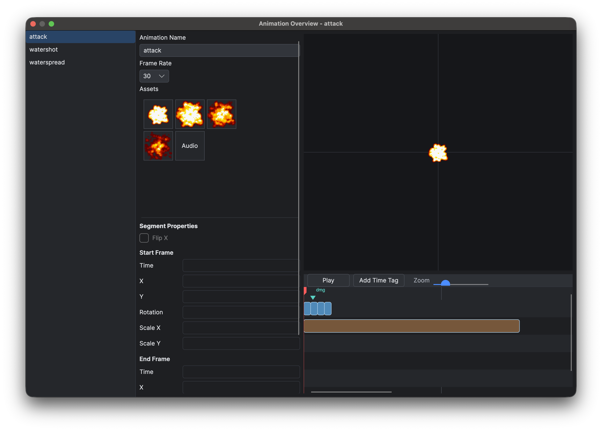
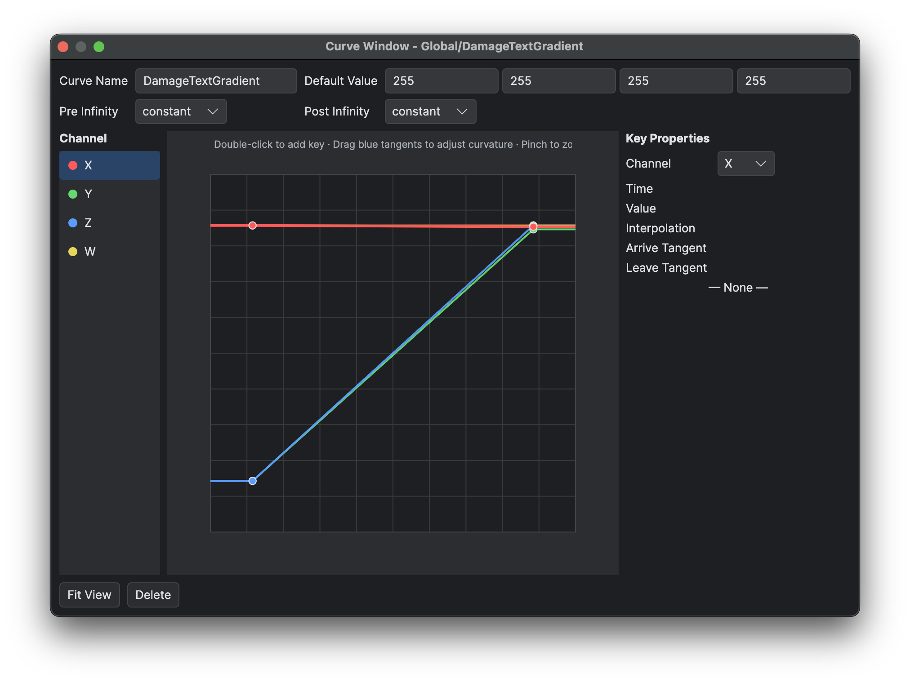

# Animations and Curves

Author frame-based 2D animations under `Data/Animations` and scalar interpolation curves under `Data/Curves` for combat effects, UI transitions and particle tracks.

## Animations

Open **Database → Animation Overview** (`F5`) to browse project animations, or choose **Game → New Animation** to create a JSON asset under `Data/Animations`. The editor exposes frame timing, visual tracks, audio segments and event time tags.

Store source images under `Assets/Animations` (or another asset subdirectory); non-empty image and sound fields save canonical `/Game/Assets/...` paths.



### Exporting MP4 locally

Save the animation before exporting. From the repository root, run `tools\animation_to_mp4.bat` (Windows) or `sh tools/animation_to_mp4.sh` (macOS) to export all `Game/Data/Animations` JSON files to `Game/EditorCache/AnimationMp4`. This requires a rebuilt Toolchain with Pillow and a standalone FFmpeg binary supporting `libx264` and AAC; see [tool setup and options](https://github.com/JasonLeon01/Ludork/blob/main/tools/README.md#animation-mp4-export).

```bat
tools\animation_to_mp4.bat Game --input Game/Data/Animations/attack.json --output Game/EditorCache/attack.mp4
```

| Option | Effect |
|---|---|
| `--input`, `--output` | Target a single JSON file or a directory (directories scan recursively and preserve subdirectory structure). |
| `--size 512x512` | Fix an even-sized canvas and crop overflowing content without rescaling (by default the canvas auto-fits all sampled frames around the animation origin). |
| `--background "#202020"` | Set an opaque background colour (defaults to black). |
| `--mute` | Omit audio without shortening the timeline. |
| `--overwrite` | Replace existing output files only after export succeeds. |

Exports preserve frame rate, track order, position/rotation/scale interpolation, horizontal flips and sound timing/trimming. Each clip plays one pass up to the last image or sound segment (rounded up to whole frames; only the background shows after visual tracks end). Time tags are not encoded as video events, and inputs must be saved source JSON with loose assets rather than compressed caches or `.ldpak` archives.

## Curves

Choose **Game → New Curve** to create a curve under `Data/Curves`. Each curve defines a name, default value, pre-/post-infinity behaviour and ordered keys (time, value, interpolation and arrive/leave tangents).

Add, drag and delete keys in the curve editor while keeping key times ordered; avoid duplicate timestamps unless the chosen interpolation explicitly supports discontinuities.



## Referencing data

Metadata-driven selectors reference animation and curve keys from Blueprints and General Data. Because renaming a JSON file changes its path-derived logical key, inspect the reference tree before renaming.
