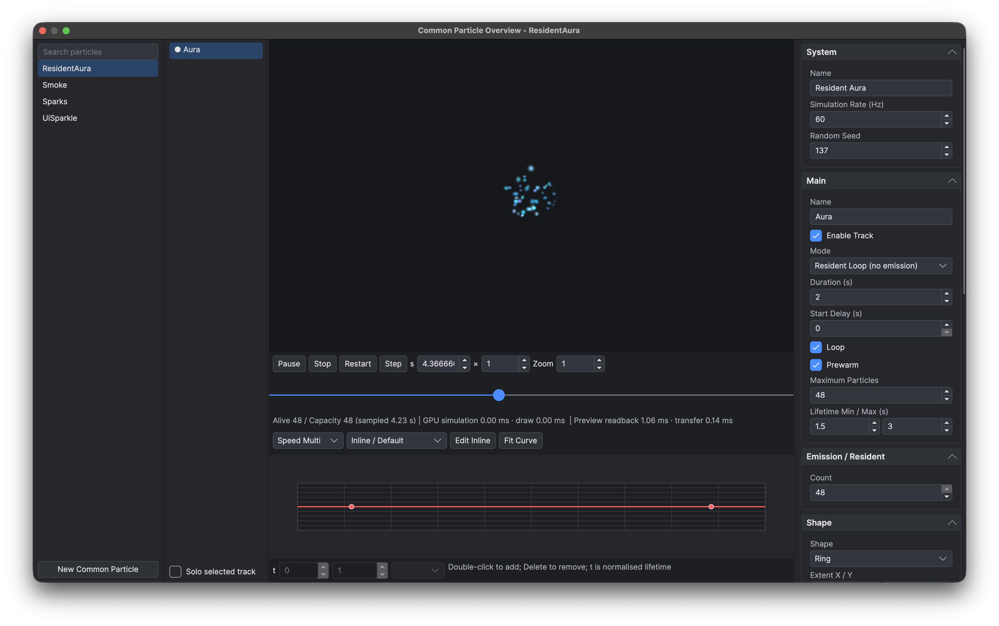

# Common Particles

Author GPU-simulated particle effects as ordered emitter tracks under `Data/Particles`, then attach them to map Actors via `EmitterComponent` or to UI screens via `Engine.EmitterView`.

## Authoring

Create a particle asset via **Game → New Common Particle** or File Explorer, and browse all assets under `Data/Particles` in **Database → Common Particle Overview** (`F6`). Track order defines draw order within the emitter. Right-click the track list to add a track, or right-click a specific track to select it and enable **Duplicate Track** and **Remove Track** (both are disabled on empty space).



*Track list on the left, preview and lifetime curve in the centre, and track properties on the right.*

Textures accept PNG (`.png`) and JPEG (`.jpg`), with **Texture Rect** cropping a sub-region. See [Particle previews](<../PreviewHost/UI Actor Particle and Subtitle Previews.md#particle-previews>) for playback, track isolation and scrubbing. Edits follow the shared [save and Undo rules](<Start Page Workspace and Shortcuts.md#editing-and-saving>).

## Resource identity and schema

Store definitions at `Data/Particles/<key>.json` and reference them by exact-case extensionless key using `/` separators (for example `Combat/Hit`). Texture paths use canonical `/Game/Assets/...` logical paths. Definitions have no version field.

The JSON schema below uses `0–255` RGBA components. See the [Emitter configuration API](<../Lua and Blueprint Scripting/Global and Core Modules/Core Modules/Engine/Time Rendering and Particles.md#emittertrack>) for matching runtime types.

```json
{
  "type": "particle",
  "simulationRate": 60,
  "seed": 1,
  "tracks": [
    {
      "name": "Glow",
      "mode": "resident",
      "capacity": 64,
      "count": 32,
      "loop": true,
      "shape": "disk",
      "radius": 24,
      "lifetime": [0.8, 1.6],
      "speed": [4, 12],
      "texture": "/Game/Assets/Particles/Glow.png",
      "blend": "add",
      "curves": {
        "alpha": {
          "keys": [
            { "time": 0, "value": 0 },
            { "time": 0.2, "value": 1 },
            { "time": 1, "value": 0 }
          ]
        }
      }
    }
  ]
}
```

This example requires `/Game/Assets/Particles/Glow.png` in the project (an empty texture renders transparent). Top-level `simulationRate` is an integer in `1–240` (default `60`); `seed` is an integer in `0–16,777,215` (default `1`); `tracks` is an ordered array with unique `name` values. Fixed seeds produce repeatable results on the same runtime and GPU, though floating-point GPU simulation is not guaranteed deterministic across devices.

| Track fields | Defaults and rules |
|---|---|
| `name`, `enabled` | `"Track"`, `true`. Track names identify targets for manual emission. |
| `mode` | `"emission"` or `"resident"` (see [Emission, space and ownership](#emission-space-and-ownership)). |
| `duration`, `delay`, `loop`, `prewarm` | `2`, `0`, `true`, `false` (seconds; `duration > 0`, `delay ≥ 0`). |
| `capacity`, `count` | `1024`, `min(32, capacity)`. Capacity is `1–1,000,000`; resident `count` is `0–capacity`. |
| `rate`, `distanceRate`, `bursts` | `30`, `0`, `[]`. Particles per second, per logical pixel of host travel, and scheduled bursts. |
| `shape`, `extent`, `radius`, `innerRadius` | `"point"`, `[32, 32]`, `16`, `8`. Shapes: `point`, `line` (`extent.x`), `rectangle` (`extent`), `disk`, `ring` (`0 ≤ innerRadius ≤ radius`). |
| `direction`, `spread` | `-90`, `30` degrees (`direction ± spread`; positive Y points down). |
| `lifetime`, `speed` | `[1, 2]` s (`> 0`), `[20, 40]` logical px/s (`[min, max]`). |
| `sizeMin`, `sizeMax` | `[8, 8]`, `[16, 16]` logical px (non-negative per axis). |
| `rotation`, `angularVelocity` | `[0, 360]` degrees, `[0, 0]` degrees/s. |
| `colourMin`, `colourMax` | `[255, 255, 255, 255]` each (RGBA `0–255`). |
| `gravity`, `radialAcceleration`, `tangentialAcceleration`, `damping` | `[0, 0]`, `0`, `0`, `0` (logical px/s²; non-negative `damping` applies exponential velocity decay). |
| `texture`, `textureRect` | `""`, `[0, 0, 0, 0]` (`[x, y, width, height]`; `0` width and height select the full image, otherwise positive and in bounds). |
| `columns`, `rows`, `frameCount`, `frameRate` | `1`, `1`, `1`, `0`. Grid `1–4096`, count `1–(columns × rows)`, non-negative frames/s. |
| `randomStartFrame`, `frameLoop` | `false`, `true`. Frames run left-to-right, top-to-bottom; `0` frame rate holds the initial frame; non-looping holds the last frame. |
| `space`, `scaleMode`, `blend` | `"local"`, `"hierarchy"`, `"alpha"` (blend also accepts `"add"`). |
| `offset`, `rotationOffset`, `scale` | `[0, 0]`, `0` degrees, `[1, 1]` (track transform relative to host). |
| `curves` | Optional lifetime channels: `speed`, `sizeX`, `sizeY`, `rotation`, `red`, `green`, `blue`, `alpha`. |

- **Bursts:** Each entry is `{ "time": 0, "count": 16, "cycles": 1, "interval": 0 }` with `time` in `[0, duration)`, `count` in `0–1,000,000`, `cycles` in `1–10,000`, and `interval ≥ 0` seconds (strictly positive when `cycles > 1`). All numbers must be finite and `[min, max]` pairs ordered.
- **Lifetime curves:** Accept either an inline scalar [Curve](<Animations and Curves.md>) (`defaultValue`, `preInfinity`, `postInfinity`, `keys` with `time`, `value`, `interpolation`, `arriveTangent`, `leaveTangent`) or an extensionless `Data/Curves` key, sampled over normalised age `[0, 1]`. Speed, size and RGBA curves multiply base values (default `1`); rotation adds degrees (default `0`). Each channel is baked into a `256`-entry GPU lookup table, so rendered curves approximate the source curve.

## Emission, space and ownership

### Lifecycle modes

- **`emission`:** Combines time emission, host-distance emission, bursts and `emit(trackName, count)`. With `loop = true`, cycles repeat across `duration`; disabling `loop` stops automatic emission after `duration` while live particles finish. GPU slots operate as a ring buffer that overwrites the oldest slots once `capacity` fills — capacity is a simulation budget, not a survival guarantee.
- **`resident`:** Spawns `count` particles after `delay`. With `loop = true`, each particle recycles through its own lifetime without further emission; with `loop = false`, the initial set expires once. Time/distance emission, bursts and manual `emit` do not apply. Atlas frame animation runs independently of track mode.
- **`prewarm`:** Applies only to looping tracks. Before playback starts, the GPU simulates full cycles covering maximum particle lifetime with the host stationary, capped at `120` fixed steps per frame. Public playback time stays `0` while warming; restarting replays prewarm.

### Coordinate space and scale

- **`space`:** `local` transforms live particles with the host; `world` leaves spawned particles at their birth coordinates and transform (map coordinates for Actors; parent Canvas logical coordinates for `EmitterView`, independent of the map View). Canvas scale applies once during UI composition, and reparenting an `EmitterView` onto another Canvas resets its particles.
- **`scaleMode`:** `hierarchy` applies host and track scale to spawn shape, motion and particle size; `local` strips host scale and keeps track scale; `shape` applies combined scale only to the spawn shape while keeping particle size and motion unscaled.

### Host ownership and pause rules

Attach particles to Actors via [Emitter Component](<Actor Components/Emitter.md>) or to UI via [Engine.EmitterView](<UI Controls in the Palette.md#engineemitterview>) (where `ControlBase` and parent own layout/clipping and `getEmitter()` returns the playback object). See [Emitter, EmitterComponent and EmitterView APIs](<../Lua and Blueprint Scripting/Global and Core Modules/Core Modules/Engine/Time Rendering and Particles.md#emitter>) for playback controls and statistics.

Particles pause automatically when their Actor is invisible or dormant, or their UI control is hidden or unmounted, and resume when shown again (host movement while hidden emits no distance particles; manually paused emitters stay paused). Destroying the owner clears its particles; live particles are excluded from map persistence.

## Requirements and scope

> **Important:** Common Particles require a compatible GPU (OpenGL ES 3 on mobile). Unsupported GPUs raise an error with no CPU fallback.

Collision, trails, noise and sub-emitters are outside this particle system.
