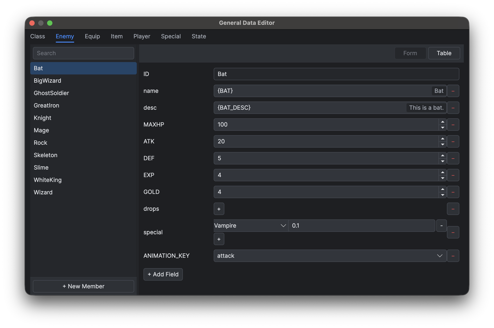
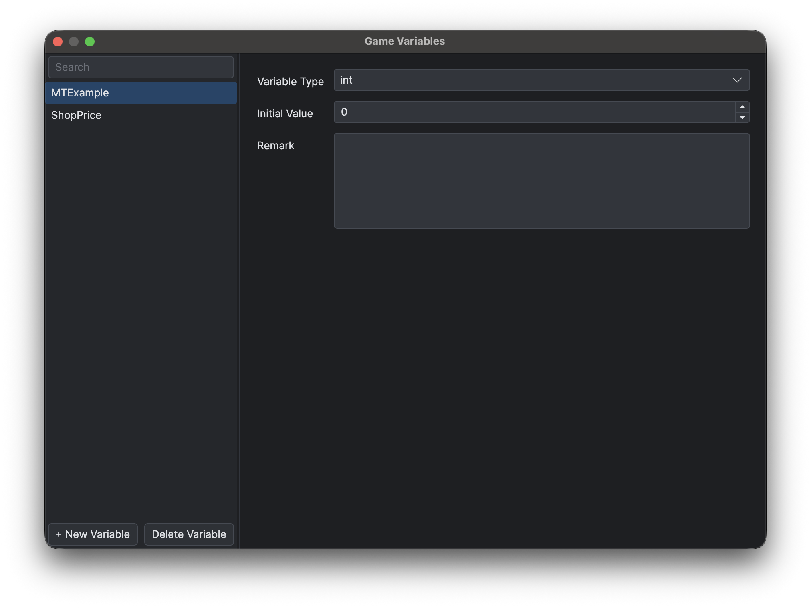
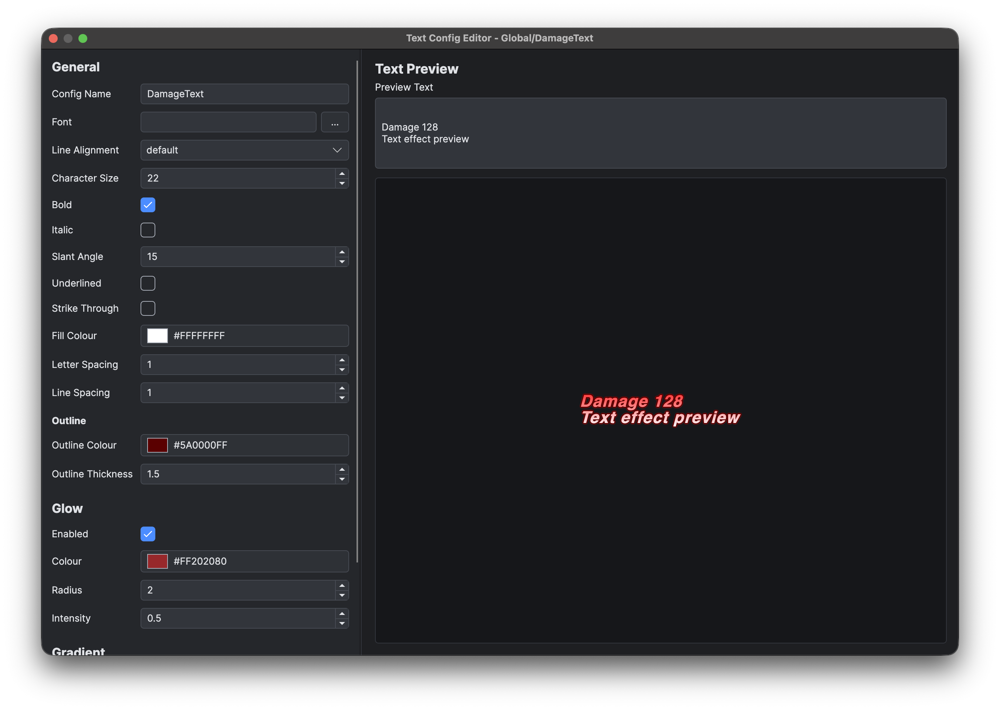

# General Data and Text Config

Author structured project databases under `Data/General`, declare shared runtime Game Variables and configure reusable rich-text styles in Text Config.

General Data suits enemies, items, equipment, player presets, states and other records shared across maps and Blueprints. Each JSON file defines one type schema and its named members; its Form, Table and member ability-graph windows share a single document and Undo/Redo history.

## Type structure

| Key | Purpose |
|---|---|
| `params` | Ordered field definitions with `type`, `defaultValue`, optional `comment`, and recursive schemas for enums and containers. |
| `members` | Named records storing values for every schema field. |
| `events` | Optional ordered event names; each member can define an independent graph per event. |

### Supported types and enums

Supported types include strings, booleans, integers, floats, files, lists, dictionaries, `sf.Vector2f/i/u`, `sf.Vector3f/i/u`, `sf.Color`, `sf.IntRect` and `any` (preserves heterogeneous JSON literal types without evaluating strings). Enum, tuple and union composition follows [Metadata Schema and Decorators](<../Lua and Blueprint Scripting/Blueprint Scripting/Metadata Schema and Decorators.md>); choose a union branch before entering its value.

New and edited fields write complete recursive `type` objects — such as `{ "list": "int" }` or `{ "dict": "int", "key": { "enum": "Enums.GeneralData.Item", "valueType": "string" } }` — while legacy `"type": "list"` + `itemType` and `"type": "dict"` + `valueType` remain readable.

- **Adding or editing enum fields:** In **Add Field** / **Edit Field**, choose `enum`, pick its module in **kind**, choose an inferred or explicit scalar value type (managed project enums use `string`; empty source enums require an explicit scalar type) and set a default. Dictionaries select key and value types independently. Selectors write directly to `type` without saving separate `kind` or `reference` fields.
- **Built-in managed enums:** Reference Item keys with `{ "enum": "Enums.GeneralData.Item", "valueType": "string" }`, type keys with `Enums.GeneralDataKey`, animations with `Enums.Animation` and particles with `Enums.Particle` (including inside lists, dictionary keys/values, tuples and unions). Selectors reflect unsaved additions, renames and deletions.
- **Enum rules:** String enum pickers include **— None —** (`""`), retain unknown non-empty values (validation checks scalar type rather than option membership), preserve literal whitespace and quotes in IDs, and allow empty managed collections. Enum-keyed dictionary rows stay pending until a non-empty unique key is selected so no placeholder key is saved. Enum declarations count as dependencies even when unused by any member.
- **Rejected legacy and invalid schemas:** Loading fails on missing subtypes, missing or unknown non-underscore member fields, type mismatches, `linkedType`, the old `GeneralDataVars` decorator and the old `reference` protocol.
- **Field comments:** Enter optional plain English tooltips in **Comment** (omitted when empty; shown on hover over Form labels and Table headers; not locale keys or member data).

### Renaming types and member IDs

- **Type renames:** Update recognised module paths across editable JSON (including self-references and modules reassigned due to identifier collisions). Lua metadata dependencies appear in the reference tree but must be updated manually. Remove and save all dependencies before deleting a referenced type.
- **Member ID renames (`Change ID`):** Update typed member references across defaults, Blueprint and map fields, graph parameters and containers (including dictionary keys). Inherited values update at their declaring definition without creating child or map overrides. Animation and particle renames similarly update typed scalar references. Dictionary key collisions reject the entire rename. Undo/Redo follows [Editing and saving](<Start Page Workspace and Shortcuts.md#editing-and-saving>); update arbitrary strings and Lua/C++ source manually.

## Authoring workflow

1. Open **Database → General Data** (`F10`).
2. Select a type, or right-click the type-tab strip to create one.
3. Define fields before creating many members (right-click a Form field name to edit its definition).
4. Add members and enter values. Right-click a member in the list or Table to change its ID, duplicate it, delete it or open its ability graph.
5. Manage events from the type tab's context menu, then open member graphs via **Edit Ability Graph**. Renaming or deleting an event updates all member graphs.
6. Inspect references before renaming or deleting types or members, then save.

- **Generated Lua modules:** Saving generates `Enums.GeneralDataKey`, each `Enums.GeneralData.<TypeName>` (e.g. `require("Enums.GeneralData.Item")` exposes `Item.EnemyBook`), `Enums.Animation`, `Enums.Particle` and `Source.Configs.GeneralDataTypes` (with its LuaLS declaration). Do not edit these generated files by hand; type renames and deletions update generated modules while preserving handwritten files. Use `GeneralDataTypes.Create(typeName, memberID, memberData)` to restore a typed member record.
- **Schema edits:** Renaming a field preserves member values; changing only the default leaves existing members unchanged. Changing a field's type or a container's item/key/value type asks for confirmation and resets every existing member's field to the new default. Removing a field does not automatically update scripts that read it.
- **Member graphs:** Support only declared type events and synchronous nodes, with no inheritance, Parent or `self` node; use global nodes and `GameplayEventData`. Runtime code activates member graphs explicitly (see [General Data event execution](<../Lua and Blueprint Scripting/Blueprint Scripting/Execution Flow Events and Variables.md#events>)).

To generate missing Actor Blueprints for a declared General Data type in bulk, use [Official General Data Blueprint Export](<../Plug-in Development and Installation/Official Plug-ins/General Data Blueprint Export.md>).

## Search and views

Search filters case-insensitively across member IDs and direct scalar fields (strings, numbers, booleans), excluding containers and graphs. Each type remembers its search query, selection and Form/Table mode while the window stays open.

- **Form view:** Edits one member completely.
- **Table view:** Lists IDs and fields in declaration order with horizontal scrolling and inline editing for booleans, numbers and strings; click **Edit** on structured cells to jump to Form view. Editing follows the shared [Undo rules](<Start Page Workspace and Shortcuts.md#editing-and-saving>).

## Game Variable Manager

Open **Database → Game Variables** (`F9`) to declare mutable runtime variables shared across Blueprints and the active game instance. Filter names case-insensitively with the search box, click **New Variable** to add a declaration, select an entry to edit its type, initial value and editor-only remark, or click **Delete Variable** to remove it after confirmation. Keep variable names stable once referenced by graphs, maps or scripts.

| Manager type | Written metadata type | Notes |
|---|---|---|
| `bool`, `int`, `float`, `string` | `bool`, `int`, `float`, `string` | Scalar defaults |
| `list` | `any[]` | Ordinary Lua table (not Standard native `list`) |
| `dict` | `Dict[string, any]` | Ordinary Lua table (not Standard native `dict`) |

Changing an existing variable's type clears its initial value and resets it to the new type's empty default. Saving generates `Scripts/Source/Configs/GameVariables.lua` (initial values) and `GameVariables_meta.lua` (declarations) together; edit declarations through the manager only (opening the window alone writes nothing).

Blueprint fields and node pins marked with `InstVar` display a searchable variable selector (type-filtered selectors, such as conditional doors in the Game project, show compatible variables only), and paired `InstVarValue` fields automatically adapt their editor to the selected variable's type.

> **Important:** Schema and Game Variable edits cannot automatically repair scripts, graphs, save files or hardcoded string references. General Data and generated variable declarations are project definition data, not stores for mutable play-session state.

## Text Config

Style ordinary UI text directly on its UI node; use **Game → New Text Config** for reusable shared styles or named rich-text tags.

Localised display keys such as `{ITEM_NAME}` resolve at presentation time rather than load time; see [Game Localisation Workflow](<../Plug-in Development and Installation/Official Plug-ins/Game Localisation Workflow.md>). For the Game project's built-in database schemas, see [General Data Reference](<General Data Reference/Overview.md>).
