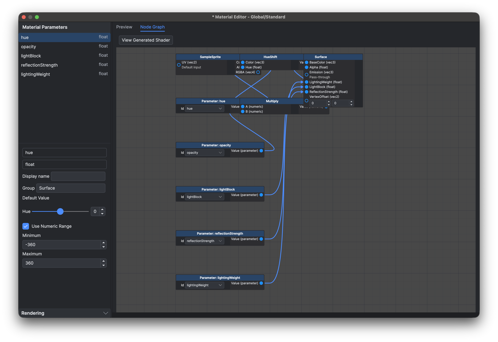
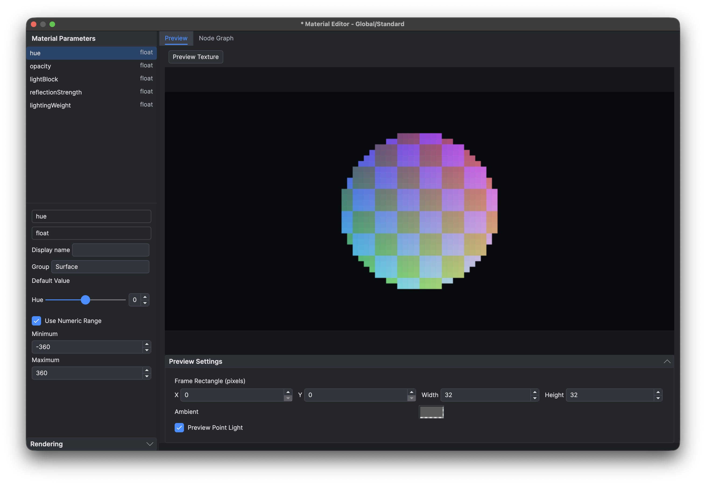

# Materials

Author 2D materials in a visual node graph to control sprite colour, alpha, local emission, scene lighting response, light blocking, reflection strength and vertex displacement. Actors, `CharacterView` controls, tiles, autotiles and tile layers reference material assets beneath `Data/Materials`.

Actors default to `Data/Materials/Global/Standard.json`, while `CharacterView` controls, tiles and autotiles with an empty material use the built-in default (source texture with scene lighting, and no emission, reflection, light blocking or displacement). Effect examples and `Surfaces` presets live outside `Global`.

## Create and assign

Create a material via **New Material** in File Explorer or the **File** menu under `Data/Materials`, or double-click an existing `.json` asset to open it. In an Actor Blueprint, the material field also offers creation when set to `Standard`; use the open action beside the field to edit the active material. Materials are shared project resources.

The material editor opens on the **Preview** tab with the parameter list on the left, selected parameter details beneath it, and **Preview** / **Node Graph** tabs on the right (drag dividers to resize). Switching tabs preserves selections, graph zoom and pan, preview settings and playback time. Editing a parameter default updates every instance that does not override that parameter.

- **Assignment paths:** Set `material` to a full `Data/Materials/...json` path. Recognised material and texture references participate in reference checks, renames and deletion guards under the shared [save and Undo rules](<Start Page Workspace and Shortcuts.md#editing-and-saving>); maintain dynamically constructed script paths manually.
- **Inheritance:** Child Blueprints and map instances inherit their parent's material unless overridden. Selecting **Clear** or explicit `Standard` overrides an inherited material (such as `Rainbow`) back to `Standard`; removing the override restores inheritance. The Actor field, parameter list and previews reflect the effective material.
- **Parameter overrides (`materialParameters`):** On Actors and `CharacterView` controls, check a parameter to override it or uncheck it to use the resource default. Switching an Actor between **Clear** and explicit `Standard` keeps overrides such as `lightBlock`; switching to a different material clears previous overrides in the same edit. A child Blueprint that switches material writes an empty override dictionary to block inherited parameters from the prior material; resetting the full instance restores inheritance.
- **Tiles, autotiles and layers:** Tilesets save assigned materials in a sparse `materials` object keyed by zero-based tile indices (e.g. `{"7": "Data/Materials/Water.json"}`), removing the key when cleared. Autotiles store a single `material` field. Tile layers evaluate the tile or autotile material first and the layer material second; Actors on the layer use their own material.

## Exposed parameters

The left parameter list shows display names and types, with stable IDs and groups in tooltips. Right-click an entry or the background and choose **Add Parameter**, then provide a non-empty unique stable ID and a type (`float`, `vec2`, `vec3`, `vec4`, `color`, `bool` or `texture`). Delete entries from the context menu or with `Delete` (creation and deletion support Undo/Redo).

Edit the selected parameter's default value, display name, group and optional numeric range below the list:

- **IDs and types** are read-only after creation; editing the display name preserves the ID referenced by graph nodes and saved overrides.
- **Values and bounds:** Vectors use numeric arrays (numeric ranges apply per component with `min ≤ max`); colours use four channels in `[0, 1]`; textures use canonical `/Game/Assets/...` paths and accept PNG (`.png`) and JPEG (`.jpg`, `.jpeg`).
- **Deleted references:** Deleting a parameter used in the graph produces a diagnostic until affected Parameter nodes are reconnected or removed. Instance panels let you delete overrides whose IDs no longer exist.

## Edit the graph

Open **Node Graph** and right-click the canvas background to open **Add Node**, choose a category and node type, drag headers to move nodes, and drag between ports to connect values. Material-wide settings, including maximum vertex displacement, live in the initially collapsed **Rendering** section below the parameter pane.



*Click **View Generated Shader** above the canvas to inspect the compiled vertex and fragment GLSL.*

### Editing and navigation

- **Inputs and constants:** Edit unconnected literal inputs directly below their pins and node properties inside the node (connected inputs hide value controls). Declared defaults display without writing an override; implicit and inherited inputs show **Default input** or **Pass-through**. Right-click an unconnected input pin for **Set Constant** or **Reset Input**.
- **Disconnecting links:** Right-click an input pin to disconnect its link, or an output pin to disconnect all outgoing links. A node's context menu also provides **Disconnect All Inputs** and **Disconnect All Outputs** (each batch action is one Undo step; unavailable actions are disabled). Disconnected inputs return to their default or pass-through behaviour without keeping pre-connection constants.
- **Selection, copy and pan:** Right-click a node to delete it (right-clicking a node inside a multi-selection preserves the group; right-clicking another node selects it first). The `Surface` output cannot be deleted. Right-drag pans the canvas without opening a menu on release. Copy/Paste assigns new node IDs while preserving internal links; standard Undo/Redo and focused control input apply.
- **macOS trackpad and zoom:** Two-finger scroll pans horizontally and vertically; pinch or `Command+wheel` zooms around the pointer (`10%–1000%`). Scrolling over a node's value control adjusts that control.
- **Constrained node properties:** Parameter pickers display names while saving stable IDs; numeric nodes offer supported scalar/vector dimensions; Compose offers `2`, `3` or `4` components; Swizzle offers an output-length selector and component drop-downs (`X/R`, `Y/G`, `Z/B`, `W/A`). The compiler validates that selected channels exist in the input and flags invalid saved values until fixed. Numeric fields enforce declared bounds without adding artificial limits to unrestricted values.

### Surface channels and data flow

Material graphs are pure data-flow graphs with one protected `Surface` output and no gameplay events or Blueprint execution.

The native runtime's node registry supplies available nodes (surface inputs, exposed parameters, time, positions, sprite/texture sampling, arithmetic, vector composition, swizzles and degree-based `HueShift`). For example, connect `SurfaceInput.BaseColor` and a `float` Parameter to `HueShift`, then link `Value` to `Surface.BaseColor`.

| Surface input | Meaning |
|---|---|
| `BaseColor`, `Alpha` | RGB colour and transparency. |
| `Emission` | Local RGB emission independent of scene illumination (use a Light component to illuminate surrounding objects). |
| `LightingWeight` | Blend between unlit colour and scene lighting. |
| `LightBlock` | Light opacity per `CellSize` of penetration; see [light occlusion](<Tilesets Autotiles and Maps.md#lights-and-actors>). |
| `ReflectionStrength` | Contribution to the map reflection surface. |
| `VertexOffset` | Additional local vertex displacement in pixels. |

Unconnected channels pass through the incoming surface; an unconnected `VertexOffset` applies zero displacement, allowing layer materials to modify a single channel without replacing tile channels. Set `rendering.maxVertexOffset` to non-negative `[x, y]` bounds enclosing every possible displacement (including parameter ranges) for culling and preview framing. Texture sampling is fragment-only; invalid stage connections report compiler diagnostics.

## Preview and diagnose

On **Preview**, pick a **Preview Texture** and set integer frame bounds (`X`, `Y ≥ 0`; `Width`, `Height ≥ 1`), then adjust ambient light and the optional point light to inspect lighting and emission. These preview settings are temporary. The preview — along with Actor, map and UI previews — reads unsaved material snapshots directly.



*Adjust the preview frame rectangle, ambient light and optional point light in **Preview Settings**.*

Compilation diagnostics appear below the right-hand tabs and highlight the offending node when identifiable; click an error to jump to **Node Graph** and focus it. **View Generated Shader** displays the generated vertex and fragment GLSL. Graphs compile to GLSL through the native compiler and do not accept raw shader source; normal maps, graph inheritance and subgraphs are not supported.

## Material combinations

Map tile-plus-layer combinations are discovered automatically during game initialisation. Open **Game → Material Combinations** only to register additional combinations used dynamically by scripts (such as assigning layer materials or building maps at runtime). Switching an Actor or UI control between individual materials, or modifying parameters, requires no extra entry.

| List | Contents |
|---|---|
| **Material** | All materials under `Data/Materials`, with **Default Material** first (evaluated before the layer). |
| **Layer** | The same materials without an empty/default entry. |
| **Existing Combinations** | Additional saved combinations only (`Material + Layer`); auto-detected map combinations are omitted. |

Entries display paths relative to `Data/Materials` without `.json` (keeping subdirectories, e.g. `Surfaces/Water`). Select one entry from **Material** and **Layer**, then click **Add** (disabled until both are chosen and while that ordered pair already exists; `A + B` and `B + A` are distinct, and a material may combine with itself). Select a saved entry to enable **Delete**.

Each addition or deletion saves immediately (opening or selecting writes nothing; failed saves show an error and preserve the list). Missing saved references are flagged and stay removable; runtime preparation reports missing references with their source location.

The editor manages `Data/MaterialCombinations.json` automatically (do not edit by hand), creating it on the first addition and deleting it when empty. Each `additionalCombinations` item stores full `Data/Materials/...json` paths in `material` (empty string for default) and `layer`. Templates and game packages include this file; updates take effect on the next material-cache preparation.

## Runtime generation

Save material changes before running the game. During `SceneInit`, the native material compiler generates GLSL shaders and metadata under `<user-data>/Assets/Shaders/MaterialGenerated` (independent of editor **Export**). Desktop previews compile unsaved snapshots in memory with the same compiler without writing the runtime cache.

- **Discovered programs:** Preparation compiles every individual material (plus the built-in default) and the deduplicated, path-sorted union of [additional combinations](#material-combinations) and map usage. Source reads follow [user-directory resource priority](<Project Settings and Asset Layout.md#runtime-resource-lookup>).
- **Map scanning:** Preparation recursively scans all ordinary maps under `Data/Maps` (including world-map children) regardless of startup map or visibility. Each layer with a material is paired with the base materials of tiles and autotiles placed on that layer (unassigned tiles use default; unused tileset entries are skipped). Scripts are not scanned or executed.
- **Cache layout:** `Data/Materials/Surfaces/Water.json` maps to `Assets/Shaders/MaterialGenerated/Materials/Surfaces/Water/`, and the built-in default maps to `Assets/Shaders/MaterialGenerated/Builtin/Default/`.

| Entry | Contents |
|---|---|
| `resource.json` | Parameter declarations, defaults and `maxVertexOffset`. |
| `single/` | Base material without a layer. |
| `layers/<relative path without .json>/` | Base material combined with the specified layer material. |

Every program directory contains `vertex.vert`, `color.frag`, `surface.frag`, `transmission.frag`, `source.frag` and `program.json` metadata (conflicting output mappings are rejected). Logical filenames map to encrypted shader suffixes and `.ldc` metadata when enabled by [packaging encryption settings](<Run Debug and Package.md#packaging>).

- **Cache validation:** Reused only when input content, generator version, encryption settings and generated-file hashes match; changed, missing or damaged files regenerate. Replacements build and verify atomically before publication (no partial output on failure or cancellation), pruning obsolete combinations and plaintext/encrypted forms on success.
- **Cache storage:** Always stored as loose files (even with `.ldpak`), excluded from templates and packages, and safe to delete while the game is stopped (recreated on next launch).
- **Initialisation order:** The default [initialisation scene](<../Lua and Blueprint Scripting/Default Gameplay/Default Template Overview.md#entry-and-modules>) finishes material preparation before creating shaders or material-dependent UI/graphics; custom initialisation scenes must do the same. See [Material cache preparation](<../Lua and Blueprint Scripting/Global and Core Modules/Core Modules/Engine/Maps and Materials.md#material-cache-preparation>). Drawing binds prepared runtime files and parameters directly.

## File format

Material JSON is fixed at version `1`:

```json
{
  "type": "material",
  "version": 1,
  "parameters": [],
  "graph": {
    "nodes": [{"id": "surface", "type": "Surface", "inputs": {}, "properties": {}}],
    "output": "surface"
  },
  "rendering": {"maxVertexOffset": [0, 0]},
  "editor": {"positions": {"surface": [400, 200]}}
}
```

Node inputs hold either literals or links (`{"node": "tint", "port": "Value"}`). Node positions and `editor.view` (zoom and offset; a continuous pan/zoom shares one Undo step) are saved as editor data.

Parameter entries store `id`, `type`, `default` and optional `displayName`, `group`, `min` and `max`; instance dictionaries store only ID-to-value overrides. Materials and referenced textures are included in normal packaging (including encrypted Data and `.ldpak`).
