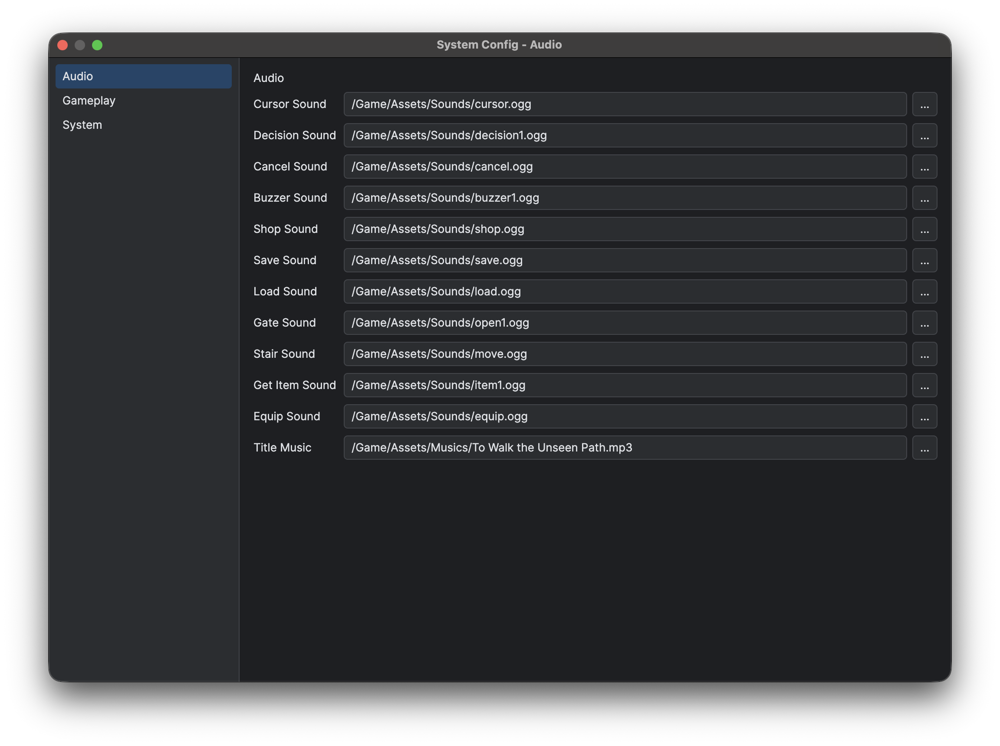

# Project Settings and Asset Layout

A Ludork project stores editor and packaging settings in `Main.proj`, runtime preferences in its [game configuration](#game-configuration), raw resources in `Assets`, editor-authored JSON in `Data` and runtime Lua code in `Scripts`. C++ Source projects also include the native sources described in [Build and Module Layout](<../Native C++ Development/Build and Module Layout.md>).

All editor-written project JSON (`Main.proj`, `Data` documents and export records) uses UTF-8 without a byte order mark (BOM) and LF line endings on every platform, preventing platform-specific line-ending diffs.

## Main.proj

`Main.proj` defines project compatibility, native build flags, packaging defaults and project-scoped workspace state. For example, the Game project enables C++ and FFmpeg and defaults to an individual run window:

```json
{
  "version": "v1.0",
  "Cpp": true,
  "ffmpeg": true,
  "IndividualWindow": true,
  "packaging": {
    "version": "1.0.0",
    "dev": false
  },
  "editor": {
    "fileExplorer": {
      "tabs": [
        {
          "number": 1,
          "path": "Assets",
          "iconView": true,
          "zoom": 100,
          "sourcesExpanded": false
        }
      ],
      "activeTabNumber": 1
    }
  }
}
```

| Key | Purpose and rules |
|---|---|
| `version` | Required engine compatibility version (`v<major>.<minor>`, e.g. `"v1.0"` from editor `1.0.7`). This edition supports `v1.0`; missing, malformed or unsupported values block opening. Opening a supported older project neither migrates contents nor rewrites `version`. |
| `Cpp`, `ffmpeg` | Enable C++ Source mode and FFmpeg support; match the template selected at project creation. |
| `compiler` | Optional Windows C++ Source compiler selector. Absent means MSVC; MinGW stores the absolute path to `g++.exe` (e.g. `"C:\\Tools\\mingw64\\bin\\g++.exe"`); LLVM Clang stores the absolute path to `clang-cl.exe` (e.g. `"C:\\Program Files\\LLVM\\bin\\clang-cl.exe"`). Selecting MSVC removes this field. |
| `packaging.version`, `packaging.dev` | Store the game's base release version (default `"1.0.0"`) and internal dev-package flag (default `false`), independent of top-level `version`. Managed via Pack Options or overridden per CLI run; see [Release version and internal packages](<Run Debug and Package.md#release-version-and-internal-packages>). |
| `editor.fileExplorer` | Saves `tabs` (ordered entries with `number`, relative `path`, `iconView`, `zoom` `50–200` and `sourcesExpanded`) and `activeTabNumber`. Tab 1 always exists and cannot close. Defaults to `Assets` with [global initial display preferences](<Start Page Workspace and Shortcuts.md#global-editor-preferences>). |
| `lastOpenedMapKey` | Stores the last selected map key (including world maps and child maps) and saves immediately on selection change without saving map data. Missing or invalid values pick the first entry (none if empty). Live Debug map changes do not overwrite it. |
| `editor.mapList.expanded` | Lists keys of expanded Map List parent rows (e.g. `["World_01", "Map_02"]`). Toggling rows does not mark the project modified; the state saves with the project and restores on open. Missing keys are ignored and an empty list omits the entry. |

Preserve unknown keys as editor-owned state. Editor appearance and window layouts are stored globally rather than in `Main.proj` (see [Global editor preferences](<Start Page Workspace and Shortcuts.md#global-editor-preferences>)).

- **Machine-specific Windows compiler:** Construct, Preview and Windows packaging require the exact configured `compiler` and report an error instead of falling back to another toolchain. After moving a project to another machine, select a local compiler via [Change project compiler](<Run Debug and Package.md#windows-project-compiler>) so required build cleanup runs; do not edit `compiler` by hand while old native outputs exist. General templates and converted Standalone projects omit this field.
- **File Explorer path recovery:** Saved paths must stay beneath `Assets` or `Data`. If a saved folder no longer exists, reopening falls back to its nearest existing parent in the same root; invalid, absolute, symlinked or out-of-root paths fall back to `Assets`. Search text, navigation history, selection and scroll position are not written to `Main.proj`. See [File explorer and reference tree](<Start Page Workspace and Shortcuts.md#file-explorer-and-reference-tree>).

## Game configuration

Open **Game → Game Config** (`F3`) to edit the game's language, display and audio settings. **Confirm** writes immediately outside document Undo and unsaved changes; **Cancel** keeps previous values. A write error leaves the dialog open.

- **Format:** macOS stores settings in XML `Main.plist`; other platforms (including iOS) use `Main.ini` with identical sections, keys and defaults. macOS never reads or migrates an existing `Main.ini`; when `Main.plist` is absent, defaults apply and `Main.ini` is untouched. An unreadable or malformed plist is reported and cannot be overwritten with defaults — repair it before saving. See [Platform, configuration and files](<../Getting Started/Ludork Lua Advanced.md#platform-configuration-and-files>).
- **Languages:** Populated from exported `Scripts/Source/Locale/*.lua` (excluding `Core.lua`) each time the dialog opens, keeping the currently configured language selectable even if its export is missing. Export workbook changes before choosing a newly added language.
- **Scale row:** Always shown in the editor; the in-game Config window shows it only when `Display.isDisplayScaleConfigurable()` reports host support.

### User data locations

| Platform | User data root (`Main.plist`/`Main.ini`, `Save/`, runtime caches) |
|---|---|
| Windows, macOS, Linux | `~/<APP_NAME>` (`C:\Users\<user>\<APP_NAME>` on Windows, `/Users/<user>/<APP_NAME>` on macOS) across Play, IDE runs, direct runs and packaged builds. |
| iOS | `~/Library/Application Support/<APP_NAME>` |
| Android, HarmonyOS | `<APP_NAME>` beneath the app-private user-data root |
| WebGL | Virtual `/UserData/<APP_NAME>` persisted in IndexedDB per browser profile and site origin (scheme, host and port). |

On WebGL, the host restores `/UserData/<APP_NAME>` before `Entry` runs, and built-in config/save writes synchronise IndexedDB so refreshes retain completed writes. Clearing site data, changing origin or using private browsing can remove or isolate storage; `APP_NAME` never grants cross-origin access.

`APP_NAME` is configured during [project creation](<../Getting Started/Project Templates.md#template-reference>) and stored statically in `Scripts/Entry.lua`. Projects sharing an `APP_NAME` share configuration, saves and caches for the current user; changing it points to a new directory without migrating old files.

Project-local configs and `Save/` are never read or written. Use the [runtime path APIs](<../Lua and Blueprint Scripting/Default Gameplay/Runtime Data Configuration and Saves.md#configuration>) to resolve paths, and see [Game Settings Reference](<../Lua and Blueprint Scripting/Default Gameplay/Game Settings Reference.md>) for keys, defaults and timing.

## System Config

Open **Database → System Config** (`F4`) to edit JSON configuration files under `Data/Configs` (objects with `type: "system"` or no `type`, keyed by extensionless relative paths). Select **Audio**, **System** or **Gameplay** on the left to display its fields on the right.



*Select **System** to configure title, dimensions and startup settings, or **Audio** for music and sound resources.*

**Gameplay** edits shared gameplay settings using a **Use default** checkbox on every row:

- **Enabled (default for new data):** Hides the value editor and writes `null` to `value` so the game uses the Lua script default. Re-checking **Use default** clears a saved override.
- **Disabled:** Reads the saved Lua source (save script edits first) to populate the current script default and create an override. Existing overrides do not track later script changes; toggle **Use default** on and off to re-read. If the default cannot be read, the row stays on **Use default** and shows the reason.
- **Field inputs:** Enums use drop-downs, text/numbers accept typed input, and booleans use checkboxes. Clearing a numeric input restores **Use default**, whereas an empty string, `false` and numeric `0` are explicit values (enter positive values for save-slot count and tutorial shrink duration).

See the [shared Gameplay configuration reference](<../Lua and Blueprint Scripting/Default Gameplay/Runtime Data Configuration and Saves.md#shared-gameplay-configuration>) for supported keys and defaults. Save and restart the game to apply changes. Switching entries preserves unsaved edits (marked with `*` in the list and title). Global Save (`Ctrl/Command+S`) writes changes; Undo/Redo applies per selected configuration.

## Fixed resource directories

The editor protects the following project directories — including all files and subdirectories inside them — for runtime configuration and built-in resources:

| Directory | Contents |
|---|---|
| `Data/Configs` | Game configuration (startup, audio and gameplay settings) |
| `Assets/Shaders/Global` | Built-in rendering shaders |
| `Data/Curves/Global` | Shared animation and effect curves |
| `Data/Materials/Global` | Shared materials such as `Standard.json` |
| `Data/TextConfigs/Global` | Shared text styles |

You can edit, save and copy resources inside these directories, but File Explorer blocks renaming (including case-only renames), moving or deleting any protected entry or ancestor containing one. Selecting a protected entry with other items blocks the entire operation and reports the protected path.

## Assets

Authoring files live in the physical `Assets` directory. Stored references must use exact-case `/Game/Assets/...` paths with `/` separators and file extensions on every platform (paths like `Assets/...`, category-relative paths, native absolute paths and traversal segments are invalid).

`PathVars` marks a field as a validated `/Game/Assets/...` reference unless `PathRoot` selects `"Project"` files or `"Data"` documents; config `base` sets only the picker root. Direct LuaSF file constructors and standard physical filesystem calls use native paths.

Resource resolution rejects symbolic links, broken links, reparse points and inaccessible paths anywhere from the target up to its resource root. Path conversion and picker roots may name files or directories not yet created, provided existing ancestors pass those checks.

Keep conventional top-level subdirectories so pickers filter accurately: `Tilesets`, `Autotiles`, `Characters`, `Animations`, `Particles`, `Icons`, `Fonts`, `Musics`, `Sounds`, `Voices`, `Shaders`, `Panoramas`, `Transitions`, `System` and `Videos`. Packaging with `.ldpak` archives the entire `Assets` tree into `Assets.ldpak` (including files directly in `Assets`) without changing logical paths.

Rename or move files and folders inside `Assets` through the editor so recognised references update automatically; external renames, handwritten source strings and dynamic paths require manual updates. See [Editing and saving](<Start Page Workspace and Shortcuts.md#editing-and-saving>).

## Data and Scripts

`Data` holds editor-authored JSON and the localisation workbook:

| Location | Reference format and purpose |
|---|---|
| `Data/Materials` | Full `Data/Materials/...json` paths; see [Materials](<Materials.md>). |
| `Data/Subtitles` | Full `Data/Subtitles/...json` paths; see [Video Subtitles](<Video Subtitles.md>). |
| `Data/Particles` | Extensionless relative keys such as `Combat/Hit`; see [Common Particles](<Common Particles.md>). |
| `Data/UI` | Extensionless relative asset keys; see [UI Asset Editor](<UI Asset Editor.md>). |
| `Data/TextConfigs` | Shared text styles and rich-text tags (ordinary UI text styles live on their UI nodes). |
| `Data/Locale/Locale.xlsx` | Localisation workbook managed by [Official Locale Tools](<../Plug-in Development and Installation/Official Plug-ins/Locale Tools.md>). |

`Scripts` stores runtime Lua, metadata and type declarations. See [Lua Runtime and Modules](<../Lua and Blueprint Scripting/Lua Runtime and Modules.md>), [Declarative UI Authoring Workflow](<../Lua and Blueprint Scripting/Declarative UI/Authoring Workflow.md>) and [General Data and Text Config](<General Data and Text Config.md>) for module layout and generated outputs.

> **Important:** Do not hand-edit `Engine_meta.lua`, `GlobalCore_meta.lua`, `GlobalFunctions_meta.lua` or generated Core/LuaSF declarations. Keep `Data` and `Scripts` as loose directories while authoring; packaging removes `Scripts/stub` and rejects misplaced `.d.lua` files (see [Loose and packed output](<Run Debug and Package.md#loose-and-packed-output>)).

### Runtime resource lookup

Logical `/Game/Assets/...`, `/Game/Data/...` and `/Game/Scripts/...` paths, relative `Data/...` references and Lua module names resolve in strict priority order:

1. **User data directory:** Beneath `Engine.getUserDataPath()` (set by `Engine.setAppName` in default Entry; the Entry script itself loads from the game root). The user root need not contain all three trees.
2. **Game root or `.ldpak` archive:** The packaged game's loose directory or archive entry.

For example, `/Game/Assets/System/icon.png` loads `<user-data>/Assets/System/icon.png` if present, otherwise the game's `Assets/System/icon.png` or `Assets.ldpak` entry. Absolute physical Data paths use their explicit location.

- **Source beats format:** A user `.ldc` overrides a game `.json`, a user `.luac` overrides a game `.lua`, and encrypted shader variants follow the same rule. Each API's normal format rules apply within each source; exact-path JSON reads never fall back to encrypted files.
- **Errors and enumeration:** Missing files fall through to the next source, whereas unreadable, damaged or invalid files report their error immediately. Data directory enumeration merges both sources, deduplicates and gives user entries priority (including file/directory conflicts).
- **Downloaded updates:** Games can write updates to physical user-data paths; new files take effect on the next read or first `require`, while already loaded modules and cached resources keep their live caches (no live replacement or startup rerun). Logical `/Game/...` paths are read-only; write files using explicit physical user-data paths. Native `io.open` and direct LuaSF constructors do not use `/Game` resolution. See [Entry and module order](<../Lua and Blueprint Scripting/Lua Runtime and Modules.md#entry-and-module-order>).

### Map and world-map assets

An ordinary map is `Data/Maps/<Name>.json`. A composite world is a folder `Data/Maps/<WorldFolder>/` containing one `_world.json` manifest and direct child-map `.json` files (deeper nesting is disallowed; non-JSON regular files such as `.DS_Store` are ignored).

Editor [Map List order](<Tilesets Autotiles and Maps.md#map-list-and-composite-worlds>) is stored in `Data/Maps/_info.json` and `Data/Maps/<WorldFolder>/_info.json` as `{"order": ["Map_01", {"Map_02": ["Map_03"]}, "World_01"]}`, where strings name file stems or world folders and single-key objects nest rows visually. The runtime ignores `_info.json`, [packaging](<Run Debug and Package.md#packaging>) excludes it, and `_info` is reserved as a map or world name.

The folder name is the world's path identity, while `_world.json` stores its display `worldName` and serves as the world's identity in selectors and saves (hidden in the Map List). Each child stores its editable `mapName` (staying valid if moved out of the world) and uses its filename as its path and placement identity.

```json
{
  "type": "worldMap",
  "worldName": "{WORLD_01}",
  "width": 256,
  "height": 192,
  "fog": {
    "enabled": false,
    "colour": [255, 255, 255, 255],
    "density": 0.5,
    "scale": 256,
    "velocity": [15, 15],
    "turbulence": 0.5,
    "seed": 0
  },
  "panorama": "",
  "layerOrder": ["floor", "default"],
  "placements": [
    {
      "map": "Map_01.json",
      "rect": [0, 0, 64, 64]
    }
  ]
}
```

- **Coordinates and bounds:** `width`, `height` and `[x, y, width, height]` placement rects use zero-based cells. Each rect must match its child's size and fit inside the world, and each child may be placed at most once. Touching placements and uncovered holes are valid. Temporary overlaps are allowed during editing, but Save rejects overlapping placements.
- **Manifest ownership:** `worldName` must be non-empty. `layerOrder` is derived from placed children (contradictory cycles are rejected). The manifest owns world display name, size, composition, global fog and global panorama; audio, filters and ambient light belong to each child map.
- **Fog format:** Ordinary maps and worlds use the same procedural `fog` object (no fog image asset required); configure it via [Fog](<Tilesets Autotiles and Maps.md#fog>).

> **Note:** Renaming or moving maps updates recognised map-file settings and destinations in `GotoMap` and `RecordTelepoint` Blueprint nodes. Update arbitrary strings and dynamically constructed paths manually.
