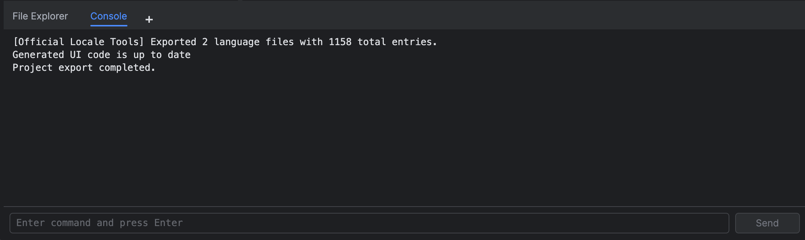
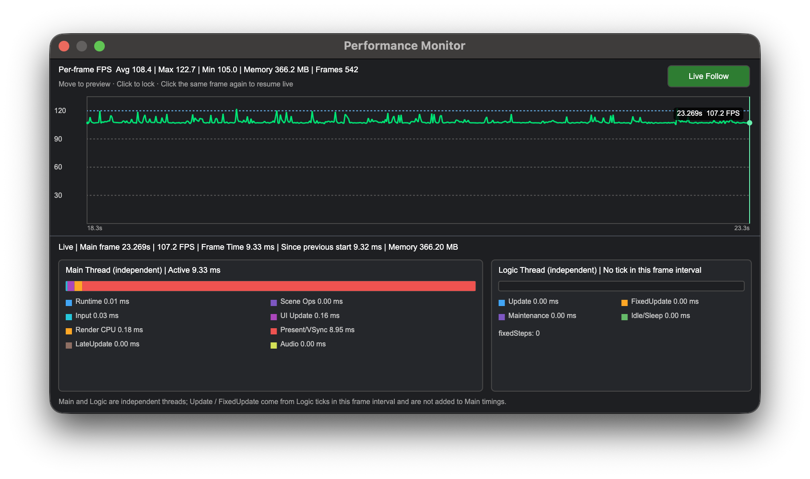

# Start Page, Workspace and Shortcuts

Navigate the Ludork editor workspace, manage global preferences and user data, browse project files and use keyboard shortcuts, save workflows and diagnostic tools.

## Start page

The Start page displays up to three recently opened projects alongside **New Project** and **Open Project**. Opening a validated `.proj` file moves it to the top of the list; unavailable entries are pruned automatically when the page loads. Opening `Main.proj` replaces the active project only after unsaved-work checks pass.

Drag and drop an existing `.proj` file anywhere onto the Start page to open it (if multiple files are dropped, the first existing `.proj` is opened and the rest are ignored). Projects with an unsupported version cannot be opened; see [Main.proj](<Project Settings and Asset Layout.md#mainproj>).

## Main workspace

| Area | Contents |
|---|---|
| **Left panel** | **Map List** for ordinary maps and composite worlds. |
| **Centre panel** | Map canvas with layer tabs above it. Tile and Actor mode controls sit beside the canvas (hidden for world maps). |
| **Right panel** | Tile palette in Tile mode, or **World Outliner** and **Actor Info** in Actor mode. |
| **Bottom strip** | **File Explorer** tabs and **Console**. |
| **Toolbar** | **Construct → Export → Play** / **Stop** (Standalone projects hide **Construct**). See [Run, Debug and Package](<Run Debug and Package.md>). |

Resource windows display a loading indicator while opening; if loading fails, click **Retry**.

## Online documentation

Press `F1` to open the online manual inside the editor. Development editors open `trunk` (`/Ludork/docs/trunk/`); release editors open the frozen major.minor snapshot matching their version (for example, `1.0.7` opens `/Ludork/docs/v1.0/`).

The manual starts in the active editor language, with language and version selectors available in the sidebar. **About** and third-party notices load online from the same version, while **About** displays the installed package version.

Embedded pages hide website navigation: internal documentation links stay inside the window, whereas the homepage, downloads and external links open in the system browser. An internet connection is required, and failed loads offer **Retry**. Windows requires Microsoft Edge WebView2 Runtime (offering an install link if missing); macOS uses the system WKWebView.

## Global editor preferences

Preferences shared across all projects are stored in `~/Ludork/Ludork.plist` on macOS (XML plist; see [Platform, configuration and files](<../Getting Started/Ludork Lua Advanced.md#platform-configuration-and-files>)) and `~/Ludork/Ludork.ini` on other platforms. macOS never reads or migrates an existing `Ludork.ini`; if the plist is absent, defaults apply.

| Area | Saved preferences |
|---|---|
| **Main window** | Normal position and size, maximised state, map-list and inspector widths, lower-area height, Actor outliner/inspector split and world-map child-list width. |
| **File Explorer** | Initial icon/list view, content zoom, source-list expansion for new workspaces and preferred external open target. |
| **Tool windows** | Position, normal size and maximised state per window type. |
| **Tool content** | Adjustable split widths or proportions, UI Timeline and system-control category expansion, and particle configuration section expansion. |

- **Defaults and recovery:** File Explorer defaults to icon view, `100%` zoom, a collapsed source list and the system file manager. Saved project tabs use their own display preferences independently. Missing or invalid values fall back to defaults. An unreadable or malformed plist is reported and never overwritten by saves — repair it and restart before saving preferences again.
- **Scope and monitors:** Project browsing and map selection live in `Main.proj`; global preferences never modify project files or restore search text, input drafts, layer selection or canvas view state. Window layouts adapt to connected monitors, restoring the latest non-minimised geometry per window type. For project-specific display preferences, see [Viewport options](<../PreviewHost/Map and World Previews.md#viewport-options>).

## User data directory

Windows and macOS editors store persistent data under `~/Ludork` (`C:\Users\<user>\Ludork` on Windows, `/Users/<user>/Ludork` on macOS) across installed, portable and repository runs.

| Data | Path beneath `~/Ludork` |
|---|---|
| Preferences, recent projects and window layouts | `Ludork.plist` (macOS) or `Ludork.ini` (other platforms) |
| Global and project plug-ins, registrations and retained data | `Plugins/` and `plugins.json` |
| Downloaded project templates (all four variants) | `Templates/v<base-version>/` |
| Signing profile indexes | `macos-signing.json`, `ios-signing.json`, `harmony-signing.json`, `android-signing.json` |
| Local server test settings | `.localserver/<project-directory-name>/test.json` |
| Project Console logs | `Log/<project-key>/Ludork.log` |
| Windows embedded-browser data | `WebView2/` |

Plug-in discovery also reads the working directory's registry and sources, giving working-directory IDs priority over user copies while keeping retained plug-in data in `~/Ludork` (see [Global and project storage](<../Plug-in Development and Installation/Installing and Managing Plug-ins.md#global-and-project-storage>)).

Project files, build outputs and `EditorCache` stay inside each project, game runtime configs and saves keep their own directories, passwords live in the OS credential store, and macOS manages its WebKit cache separately.

> **Warning:** On Windows, MSI and EXE uninstallers select **Delete user data** by default, deleting the verified initiating user's entire `~/Ludork` directory — including all plug-ins, registrations, preferences, logs, template caches, browser data and signing indexes.
>
> Close Ludork and back up needed files before uninstalling, or clear the option to keep your data. Projects outside `~/Ludork` (such as `~/LudorkProjects`) and other users' data are never deleted. Removing the macOS application leaves `~/Ludork` intact.

| Uninstaller | Flag | Behaviour |
|---|---|---|
| **Windows MSI** | `REMOVE_USER_DATA=0` (keep) / `1` (delete, default) | Runs only on explicit full uninstall after the removal transaction commits (never during repair or major upgrade). Deletion errors are reported and may require manual cleanup. Service accounts and sessions whose initiating user cannot be verified must pass `REMOVE_USER_DATA=0`. |
| **Windows EXE** | `/REMOVEUSERDATA=0` (keep) / `1` (delete, default) | Honoured in interactive and silent removal while keeping the Windows uninstall entry. If another administrator supplies UAC credentials, no interactive desktop exists, or the initiating user cannot be confirmed, user data is preserved and manual cleanup is requested rather than substituting the administrator's or desktop user's directory. |

If manual cleanup is required, sign in as the intended user, back up anything needed and delete only that user's `~/Ludork` directory.

### Moving existing editor data

Apart from the working-directory plug-in scan, legacy storage locations are not read or migrated automatically (Windows previously stored data in the installation directory and repository runs could use the working directory or repository; macOS previously kept settings and signing indexes in `~/Library/Application Support/Ludork`, while published plug-ins and template caches already used `~/Ludork`).

1. Close Ludork and back up needed files **before uninstalling an older version**.
2. Install the new version. To keep existing plug-ins, clear the EXE installer's **Install Official Plug-ins** option or pass `INSTALL_OFFICIAL_PLUGINS=0` to MSI (restoring plug-ins before an install with that option enabled overwrites them).
3. Restore preferences in the [current platform format](#global-editor-preferences), signing indexes, template caches and local server settings into `~/Ludork`, backing up any existing destination files first. Restore `Plugins` and `plugins.json` together from the same backup.

System credential-store entries and project files do not need to move.

## Global shortcuts

The primary modifier is `Ctrl` on Windows and `Command` on macOS.

| Shortcut | Action |
|---|---|
| `Ctrl/Command+N` | New Project |
| `Ctrl/Command+O` | Open Project |
| `Ctrl/Command+S` | Save |
| `Ctrl/Command+Z` | Undo |
| `Ctrl/Command+Shift+Z` or `Ctrl/Command+Y` | Redo |
| `Ctrl/Command+W` | Exit or close the project window |
| `Ctrl/Command+1` | Tile mode |
| `Ctrl/Command+2` | Actor mode |
| `F1` | Ludork Documentation |
| `F3` | Game Config |
| `F4` | System Config |
| `F5` | Animation Overview |
| `F6` | Common Particle Overview |
| `F7` | Tilesets Data |
| `F8` | Common Functions |
| `F9` | Game Variables |
| `F10` | General Data |

- **Context-specific `F2` rename:** Renames the selected event tab (Blueprint editor), Common Function (Common Functions window), file (File Explorer on Windows/Linux; unavailable on macOS) or time tag (animation editor). Windows do not display an `F2` hint.
- **Dialog keys:** Single-button hint and error dialogs close with `Enter`, `Return`, `Space` or `Escape`. Confirmation dialogs confirm with `Enter`, `Return` or `Space`, and cancel with `Escape`.

## Editing and saving

Displayed field defaults are written only when edited. Clearable file fields list **Clear** first in every directory and file filter (select and click **Open**, press `Enter` or double-click to clear; **Cancel** or `Escape` keeps the previous value). Save dialogs, multi-file imports and required-file selectors omit **Clear**.

### Saving and progress locks

- **Global Save:** Managed edits and asset renames or moves stay in memory until Save (**Discard** restores saved paths). Every Save button and `Ctrl/Command+S` writes all modified documents (including unopened ones); Construct, Export, Play and Pack invoke the same save flow. Successful saves show no dialog; failures report only failed items and their errors. Normal Save validates changed Blueprints, whereas forced save can retain unfinished graphs. [Game Config](<Project Settings and Asset Layout.md#game-configuration>) writes immediately on confirmation.
- **Operation locks:** Save, deletion, file transfers, renames, Undo and Redo temporarily disable editing, project switching and window closing. Longer operations (including pre-deletion reference checks) display a non-cancellable animated progress dialog showing stage, current file and completed count, yielding to any confirmation prompt. If project or external files change during validation, the editor asks you to retry.
- **Unsaved markers:** Modified documents show `*` in File Explorer, window titles and resource selectors. Closing a resource window preserves unsaved changes until the project closes. Closing or replacing a project lists unsaved files with **Save**, **Discard** and **Cancel**; a save failure keeps modified markers and prevents closing.

### Undo, Redo and pending moves

- **Per-file history:** Undo and Redo operate on the active file (up to `100` steps). Windows displaying the same file share data and history across close and reopen. Continuous text or numeric input in one field merges into a single step (ended by changing control or view, automatic updates, Save, Undo or Redo); buttons, checkboxes and selections are individual steps.
- **Reference barriers:** Undo cannot restore references to deleted resources or unavailable/renamed asset paths or General Data member IDs (rejected steps leave document and history unchanged). Automatic reference updates insert a marked Undo barrier in every updated target file (including unopened files): later edits stay undoable, but Undo stops at the barrier and identifies its source. Undoing or redoing the source rename updates targets against current content and places a new barrier, preserving unrelated edits. Save preserves history and barriers.
- **Pending asset paths:** Select a file or folder in File Explorer to Undo or Redo its path change (undoing a folder move preserves later independent child changes). Save pending moves before copying, deleting, importing, creating or writing files at their source or destination paths; further renames and moves remain allowed.
- **External-change conflicts:** **Keep memory** accepts disk contents while keeping pending paths, updated references and Undo/Redo (fails without partial changes if a source is missing or destination is occupied). **Use disk** cancels affected pending moves and restores recognised references to saved paths while preserving unrelated edits, but does not restore missing files or clear their references.

## File explorer and reference tree

**File Explorer** browses `Assets` and `Data` through the source list and breadcrumbs (Up stops at the selected root).

### Tabs, navigation and layout

- **Multiple tabs:** Click **＋** beside **Console** or choose **View → New File Explorer Tab**. The first **File Explorer** tab stays permanently open; extra tabs are numbered and show **×**. New tabs inherit the most recently active File Explorer's directory and display preferences with empty search, history and selection; closing an active extra tab focuses the tab to its left.
- **History and Locate:** Navigate each tab's history via **Back** / **Forward**, `Alt+Left` / `Alt+Right` or mouse side buttons (restoring search, expanded folders, selection, scroll and display preferences; navigating after Back clears forward history; refreshing, changing selection/search or switching tabs adds no entry).
  - Resource **Locate** targets the most recently active File Explorer even while Console is active. Reopening restores tabs, directories, display preferences and active tab per [Main.proj](<Project Settings and Asset Layout.md#mainproj>); search, history, selection and scroll are session-only.
- **Views and zoom:** List view expands/collapses folders in place (double-click enters; `Right` expands or selects first child; `Left` collapses or selects parent; expansion lasts for the session), whereas icon view and search results are flat. Zoom `50%–200%` with `Ctrl/Command+wheel` or the bottom-right slider, and press `F5` to refresh external changes.
- **Search:** Matches filenames case-insensitively in the current directory and subdirectories (including unsaved resources, excluding symlink folders). Clearing the box, changing directories or locating exits search.
- **Media previews:** Image and video files show supported thumbnails (see [Actor previews](<../PreviewHost/UI Actor Particle and Subtitle Previews.md>) for Blueprint JSON). Press `Space` on an image, audio or video file (or use a file selector's right-hand pane) to preview locally starting paused, with playback, seek and volume controls (`Escape` closes). Preview relies on system codecs (Windows needs Edge WebView2 Runtime), requires no FFmpeg option or native build, and reports unsupported or damaged files.

### File operations, deletion and reference tree

- **Context menus and drag-and-drop:** Right-click an entry for item actions or empty space for the current directory menu. Pasting or dropping targets a folder directly, a file's containing folder, or the current directory on empty space (including expanded folders and search results); `Ctrl/Command+V` uses the selected entry or current directory if none or multiple are selected.
  - Drag any selected entry to move the group (clicking and releasing without dragging selects just that entry; folders cannot move into themselves or descendants). Right-click and choose **Show in File Explorer** (Windows) or **Show in Finder** (macOS) to reveal the right-clicked entry only (disabled for unsaved entries; never saves pending changes).
- **Duplicating and move conflicts:** Duplicate a folder in place with `Ctrl/Command+C` followed by `Ctrl/Command+V` (conflicts append `_copy`, `_copy2`, placed before file extensions; copied folders appear once complete). A cut or drag causing duplicate destinations or name collisions rejects the entire move (leaving the cut clipboard ready after fixing conflicts). On disk error during a move, the editor attempts rollback, reporting any unreturned file and keeping remaining items on the cut clipboard.
- **Reference tree and creation:** The reference tree shows outgoing and incoming references. Create, rename and move managed resources in the editor so recognised references update automatically (update arbitrary strings and source code manually). Creating or copying a managed resource leaves it unsaved without a creation Undo step; renames appear immediately and Global Save commits paths and references together. [Fixed resource directories](<Project Settings and Asset Layout.md#fixed-resource-directories>) enforce additional path restrictions.
- **Pre-deletion checks:** Remove recognised references and save referring files before deleting. For `Assets` files and folders, File Explorer checks both current and last saved project data (including nested folder contents) and blocks the entire selection if referenced, listing each asset, referring file and field (delete referring files first rather than together).
- **Recycling and recovery:** Confirmed deletions move saved files to the Windows Recycle Bin or macOS Trash (keeping items that fail to recycle while already-recycled items stay deleted). Recycling preserves the last saved disk path and content, discarding unsaved edits; never-saved resources disappear without a recoverable copy. Deleted resources leave managed documents/lists so Save does not recreate them; Editor Undo cannot undo resource deletion (restore via Trash/Recycle Bin and reopen the project; in-document item deletions use document Undo).

### Opening in external editors

The open menu at the upper right always offers the system file manager (opening the active directory) and remembers your selection as the preferred target, falling back to the system file manager when unavailable on another project or machine without overwriting the preference.

It lists installed VS Code and Cursor, plus installed CLion and Windows Visual Studio 2022 for C++ Source projects. VS Code, Cursor and CLion open the project root regardless of the current File Explorer path. When `.idea` or `.vs` is absent, opening CLion or Visual Studio prompts (**Initialise IDE Environment**) before running the project's environment generator (cancelling leaves the project unchanged); Visual Studio opens the generated root `Main.sln`.

## Console and performance monitor

**Console** collects plug-in, build and runtime output and accepts input only while a compatible runtime connection is active. Open **Edit → Development Tools and Settings → Performance Monitor** to view live frame, logic and memory samples while the game runs.

Console output writes to `~/Ludork/Log/<project-key>/Ludork.log`, keyed by the project's absolute path so identically named projects in different folders stay separated. Each new session archives the previous log with its modification timestamp; moving or renaming a project starts a new log directory while previous logs stay on disk.

### World-streaming samples

When profiling a composite world, Performance Monitor includes an optional `worldStreaming` snapshot (omitted for ordinary maps and unprofiled ticks):

| Field | Meaning |
|---|---|
| `queueDepth` | Child regions waiting in the streaming queue. |
| `reading` | Regions currently in `Reading`. |
| `prepared` | Loaded regions in `Prepared`. |
| `active` | Regions in `Active`. |
| `dormant` | Loaded regions in `Dormant`. |
| `cacheBytes` | Conservative estimate for the non-Active region cache (not an exact process, Lua, native or GPU memory total). |
| `publishMilliseconds` | Time spent converting and publishing regions during the logic tick. |
| `visibleTileChunks` | Unique 32×32-cell `TileLayer` chunks submitted by visible child layers in the latest draw. |
| `activeActors` | Actors currently present in the world's Active update/render batches. |

*The monitor waits until a compatible runtime telemetry session connects.*
