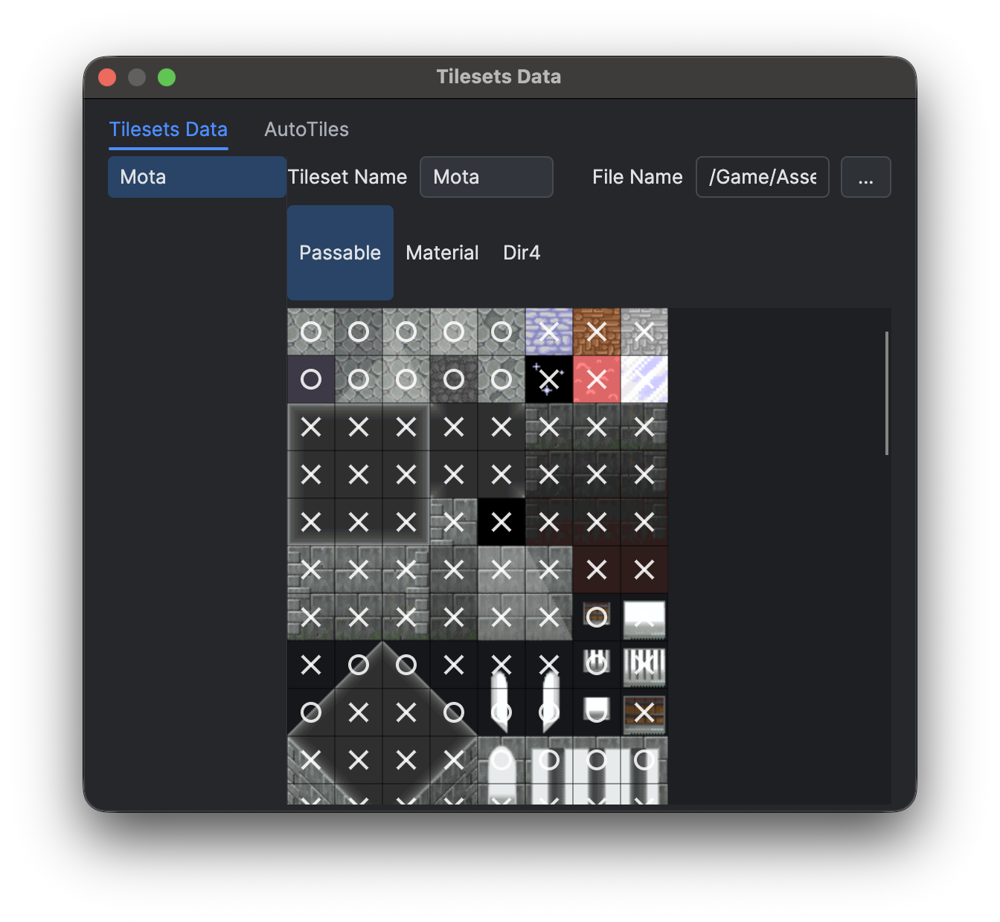
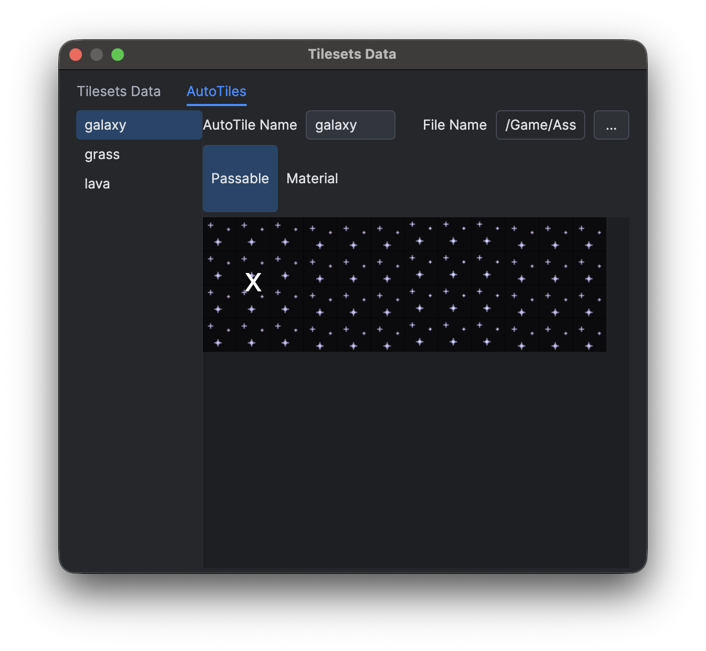
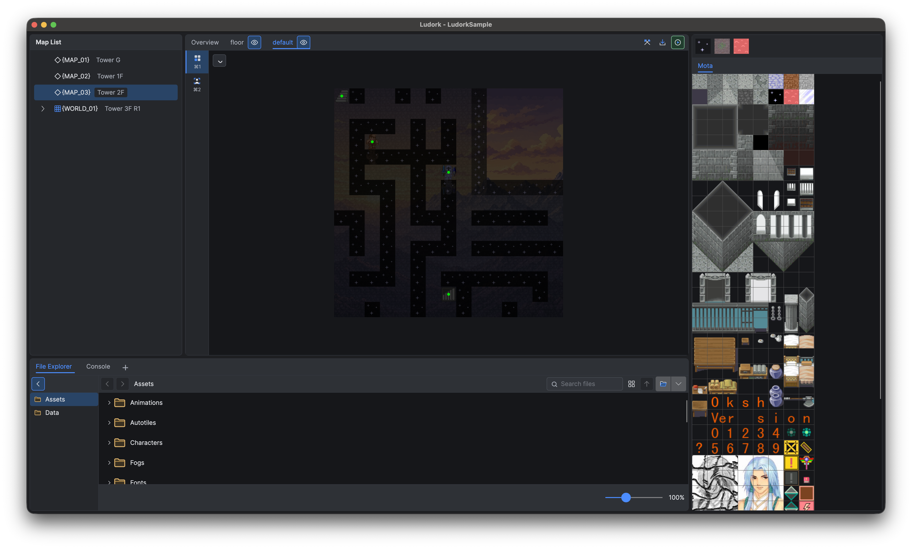
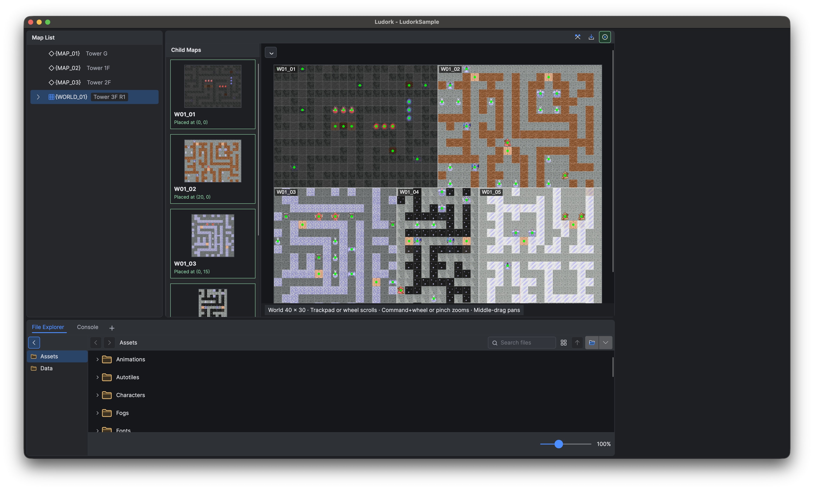
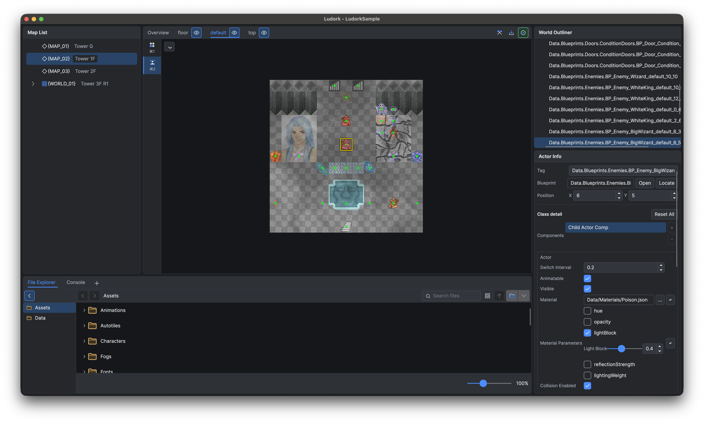

# Tilesets, Autotiles and Maps

Author tilesets, autotiles, ordinary maps and composite worlds, then paint tile layers and place interactive Actors and lights.

## Tilesets and autotiles

Open **Database → Tilesets Data** (`F7`) to configure tilesets (**Tilesets Data** tab) and animated or connected autotiles (**AutoTiles** tab). Store source images under `Assets/Tilesets` or `Assets/Autotiles`, and their JSON definitions in the corresponding `Data` subdirectory.

Select a definition, edit its display `name`, and use the browse button beside **File Name** to pick its source image. The map palette displays `name` on tabs while the JSON filename acts as the internal key: editing `name` preserves references, whereas renaming the key updates every affected map's `layerTileset` (including unopened maps) under the shared [save and Undo rules](<Start Page Workspace and Shortcuts.md#editing-and-saving>).

*In Passable mode, circles mark passable tiles and crosses mark blocked tiles.*

*Autotile properties apply to the entire asset rather than individual displayed cells.*

### Editing tile properties

| Mode | Ordinary tileset (per tile) | Autotile (whole asset) |
|---|---|---|
| **Passable** | Left-click toggles tile passability. | Toggles whole-asset passability. |
| **Material** | Left-click selects a [material resource](<Materials.md>); clearing removes the sparse entry and restores default rendering. | Assigns one [material resource](<Materials.md>) to the asset. |
| **Dir4** | Left-click toggles passability on the edge nearest the click. | Not applicable. |

In an ordinary tileset, `Shift+left-drag` copies the pressed source tile's property across every crossed cell in a single Undo step (boolean in **Passable**, resource reference in **Material**, all four edges in **Dir4**). Autotiles do not support this batch brush.

> **Note:** Modifying a tileset after maps are authored can change how existing tile indices render. Moving a tileset or editing arbitrary gameplay strings does not rewrite hardcoded string paths automatically.

### Map layer order

Map JSON requires a `layerOrder` string array defining the authoritative draw and Actor-processing sequence, while `layers` and `actors` are dictionaries keyed by those names and kept in sync by the editor. Loading ordinary maps and streamed child maps rejects missing or duplicate layer references, layers absent from `layerOrder`, and Actor groups whose layer is absent from `layerOrder`. Loading never infers order from JSON key order.

*Select a layer tab above the canvas to paint from the tile palette; eye icons toggle layer visibility.*

## Map list and composite worlds

The **Map List** displays ordinary maps and composite worlds. A world row shows `worldName` from `_world.json` and expands to list direct child maps by their editable `mapName` (`_world.json` stays hidden).

Use **World Map Properties** to change `worldName` and **Rename World Map** to rename the folder and runtime paths. Each child stores its own **Map Name** so it stays usable standalone; select a world to open its composition panel and use context menus to create each asset type.

### Ordering, nesting and moving maps

- **Visual order (`_info.json`):** The Map List reflects `Data/Maps/_info.json` (top level) and each world's `_info.json` (children). Nesting is purely organisational with no runtime effect. Drag a row to the top or bottom edge of another row to reorder, or onto its centre to nest beneath it (nested rows move with their parent). Worlds stay at the top level and cannot be nested. Unlisted maps appear last in filename order; stale entries are dropped. Reordering marks the project modified (not part of Undo/Redo).
- **Moving into or out of a world:** Dragging an ordinary map onto a world (or among its rows) moves that map and its nested children into the world folder; dragging a child to the top level or another world moves it out. Moved maps arrive unplaced, and leaving a world removes any placement.
  - Moving updates recognised references and inserts an Undo barrier. Moves are rejected on destination name collision, Actor tag conflict in the destination world, or active references to a map moving into a world (unplaced children cannot be runtime destinations).
- **Create, copy, rename and delete:** Use the Map List (not File Explorer, which preserves `Data/Maps` hierarchy) to create, delete or move maps between top level and worlds. Copying a child assigns fresh Actor map tags without placing the copy.
  - Renaming updates recognised references (see [Project Settings and Asset Layout](<Project Settings and Asset Layout.md>)); automatic reference, placement and layer-order updates insert Undo barriers across separate world and child histories. Deleting a world recycles its entire saved directory (manifest, children and other files); see [resource deletion and recovery](<Start Page Workspace and Shortcuts.md#file-explorer-and-reference-tree>).

### Composing a world

*Child-map thumbnails display placement coordinates alongside the combined canvas preview.*

- **Placing and removing:** Drag an unplaced child onto the world canvas to place it, drag a placed child to reposition it, and press `Delete` / `Backspace` (or use its context menu) to unplace it. Each placement edit is one Undo/Redo step.
- **Overlaps and bounds:** Temporary overlaps are permitted while arranging or resizing a child map, but Save fails until all overlaps are resolved. Bounds and layer-order violations are rejected immediately during editing, and resizing cannot push a child outside the world. Remove a child's placement and save before deleting its file. Actor tags must be unique across the world, and non-JSON regular files are ignored.
- **Click priority:** The selected placement draws above overlapping siblings within each layer and takes click priority so you can drag it free; otherwise the last placement takes priority. You can also drag an obscured child from the child-map list onto the canvas.
- **Navigation:** Scroll or pan the canvas, and zoom with `Ctrl+wheel` (Windows/Linux) or `Command+wheel`/pinch (macOS). See [Map and World Previews](<../PreviewHost/Map and World Previews.md>).

### New map defaults and map properties

Creating an ordinary map or world child pre-fills **Map Properties** (dimensions, ambient light, BGM/BGS and filters, fog parameters and panorama) as independent copies from the most recently modified map, assigning fresh filename and map-name defaults.

Current-session edits (including unsaved edits and Undo/Redo) take priority over file modification time, whereas opening or saving alone does not alter edit order. With no existing maps, standard defaults apply.

- **Ambient Light:** Click the swatch button (displaying ARGB and a checkerboard for transparency) to choose a colour.
- **Audio and Panorama:** Click the browse button beside BGM, BGS or **Panorama** (conventionally in `Assets/Panoramas`) to select a file, or choose **Clear** to remove it, then confirm. World Map Properties configures a global panorama the same way. See [Panorama rendering](<../Lua and Blueprint Scripting/Default Gameplay/Resources Audio Video and Effects.md#shaders-fog-and-transitions>).

## Fog

**Map Properties** and **World Map Properties** share identical **Fog** settings (enable fog to reveal controls). The GPU generates the noise pattern procedurally in world coordinates with no asset image required, so panning and zooming do not pin fog to the screen. Worlds can combine global fog with child-region fog seamlessly across region boundaries.

| Setting | Meaning | Standard default |
|---|---|---|
| **Enabled** | Whether the map renders fog. | Off |
| **Colour** | RGBA tint and alpha. | White, fully opaque |
| **Density** | Fog coverage (`0–1`). | `0.5` |
| **Scale** | Pattern size in map pixels (smaller values produce smaller cloud patches). | `256` |
| **Velocity X / Y** | Drift speed in map pixels per second. | `15` / `15` |
| **Turbulence** | Pattern variation (`0–1`). | `0.5` |
| **Seed** | Non-negative integer choosing a repeatable pattern. | `0` |

Density controls coverage and colour alpha controls opacity; black fog darkens the scene while preserving density variation. For example, the supplied `Map_02` uses black `(0, 0, 0, 128)` with Density `0.5`, Scale `128`, Velocity `[15, 15]` and Turbulence `0.8`.

See [Viewport options](<../PreviewHost/Map and World Previews.md#viewport-options>) for preview controls and [Map and world-map assets](<Project Settings and Asset Layout.md#map-and-world-map-assets>) for the JSON schema.

## Layers and painting

Tile mode supports creating, renaming, reordering, copying, pasting and deleting layers, and assigning a [layer material](<Materials.md#create-and-assign>). Selecting a tileset tab immediately switches the active layer's tileset, reinterpreting existing tile indices against it.

- **Visibility:** Each layer tab shows its name on the left and a visibility toggle on the right. Visibility is saved map data; hidden layers do not render and are read-only. **Overview** displays all visible layers at full brightness; selecting a single layer dims the others without altering draw order.
- **Brush selection:** Select a tile, multi-tile region or autotile in the palette. Clicking a single selected ordinary tile again clears selection; with nothing selected, the brush erases. Zooming and panning never modify map data.

| Gesture | Painting action |
|---|---|
| `Left-drag` | Paint continuously (multi-tile selections place the full pattern at each position). |
| `Shift+left-drag` | Fill the outlined rectangle, repeating multi-tile patterns from the top-left corner and clipping to bounds. |
| `Shift+left-click` | Paint a single cell. |
| `Right-click` | Sample the clicked cell. |
| `Alt+left-click` (`Option+left-click` on macOS) | Flood-fill the 4-connected region matching the clicked cell's tile and autotile values (works with multi-tile patterns, autotiles and erase). |

Each brush stroke, rectangle or flood-fill is one Undo step. Saving during a stroke starts a new Undo step for subsequent painting; Undo or Redo ends the active stroke until the mouse button is pressed again.

## Lights and Actors

Use Actor mode to place Blueprint instances, move them and edit exposed attributes (instance overrides never alter Blueprint defaults). Attach lights via `lightComp` and edit them in **Actor Info**; see [Light Component](<Actor Components/Light.md>) for Blueprint defaults and fields.

*Selecting an instance in **World Outliner** exposes its overrides in **Actor Info**, such as overriding the `Poison` material's `lightBlock` parameter.*

### Selecting and editing Actors

Project editing supports single or multiple Actor selection on the active layer of an ordinary map or independently opened world child (Live Debug supports single selection only).

| Location and gesture | Selection behaviour |
|---|---|
| **World Outliner:** plain click | Replace selection with that Actor. |
| **World Outliner:** `Ctrl-click` (`Command-click` on macOS) | Toggle that Actor. |
| **World Outliner:** `Shift-click` | Select range from the selection anchor (`Ctrl/Command+Shift` adds the range). |
| **World Outliner:** click another layer's Actor or layer row | Switch layers and select that Actor, or clear selection on a layer row. |
| **Map:** plain click on a selected Actor | Keep group selection ready to drag. |
| **Map:** plain click on an unselected Actor | Replace selection with that Actor. |
| **Map:** `Shift-click` / `Ctrl/Command-click` | Add / toggle that Actor. |

- **Gesture thresholds:** Map modifier clicks apply on release; moving at least `4` device-independent screen pixels on either axis starts a drag and cancels the click. Modifier drags must begin on an already-selected Actor or the entire gesture is ignored. With multiple Actors selected, a plain click on empty map space clears the selection without placing an instance; otherwise normal placement applies. Switching maps or leaving Actor mode clears selection.
- **Multi-selection in Actor Info:** Displays only properties common to all selected Actors with compatible types and editing rules (including common children of structures, components, lists and dictionaries). Values reflect inherited defaults and overrides, showing **multiple choices** where values differ. Editing one sub-field (such as a vector's X) updates only that sub-field across the group. Dependent properties are editable only when their condition holds for every selected Actor.
- **Multi-selection restrictions:** Tag is read-only; Blueprint displays a shared reference (with Open/Locate) or **multiple choices**; container add/remove and type-switching controls are disabled. Resetting a property or all overrides restores each Actor's own defaults for common editable fields while preserving others. Batch edits apply atomically or fail without partial changes.

### Moving and transforming Actors

| Gesture | Transform effect |
|---|---|
| `Left-drag` selected Actor | Move group by the same grid delta; stops at map edges preserving relative offsets (rejected if the group cannot fit). |
| `Ctrl+left-drag` (`Command+left-drag` on macOS) | Adjust `defaultTranslation` continuously in map pixels without changing grid cells. |
| `Alt/Option+left-drag` | Adjust each Actor's `defaultOrigin` in local coordinates (accounting for rotation and scale; image moves opposite the drag; unavailable if a scale axis is zero). Takes precedence over `Ctrl/Command`. |
| `Ctrl/Command+wheel` or `Command+pinch` (macOS) | Scale `defaultScale` (preserving axis ratios and signs, including zero axes; `×1.1` per wheel unit, continuous on pinch). Zooms the map if no eligible editable selection exists; unmodified pinch always zooms. |
| `Alt/Option+wheel` or `Option+pinch` (macOS) | Adjust `defaultRotation` around each Actor's origin (`+15°` per wheel unit, `+18°` per `0.1` pinch; positive/outward = clockwise, negative/inward = counterclockwise). Takes precedence over `Ctrl/Command`; falls back to viewport behaviour without an eligible selection. |

These transform shortcuts do not apply in Live Debug. A complete group drag, batch edit, reset, delete or paste is one Undo step; consecutive wheel or pinch adjustments to the same property and selection merge into one step until selection, map, layer or mode changes, or the project is saved.

### Copying and deleting Actors

Copy or delete the selection from the World Outliner or map context menu, or press `Ctrl/Command+C` and `Delete`/`Backspace`. Right-clicking a selected Actor preserves the group; right-clicking an unselected Actor selects it alone first.

Paste via the map context menu or `Ctrl/Command+V` at the pointer's grid cell. The primary Actor anchors to that cell while other copied Actors keep their relative offsets. Paste targets the active layer, preserves instance overrides, generates unique tags for the map or world, and selects the pasted group. If any target cell is out of bounds, occupied or self-colliding, the entire paste fails without changing the map.

See [Actor and layer assistance](<../PreviewHost/Map and World Previews.md#actor-and-layer-assistance>) for invisible Actors, layer dimming and light-range overlays.

### Light offset and occlusion

- **Emitter position:** `LightComponent.lightOffset` is measured from the centre of the Actor's local bounds and follows the full Actor transform (rotation and scale). For a wall-mounted torch, place the offset at the flame on the room side of the wall because the renderer does not shift emitters into nearby passable cells.
- **Light blocking (`Surface.LightBlock`):** Material opacity in `[0, 1]` applied per `CellSize` of penetration (`0` = fully transmissive, `1` = fully opaque, intermediate values compound by physical path length — e.g. `0.5` transmits roughly `0.707`, `0.5` and `0.25` through half, one and two cells respectively).
- **Self-occlusion:** An emitting Actor is excluded from dynamic occluders for its own light only — it occludes other lights, while tiles and other Actors at the same position occlude normally. Separate walls and torches into distinct Actors so excluding the torch does not exclude the wall.

### Map tags in a world

Creating or pasting an Actor inside a world child prefixes its default tag with `<child-file-stem>.` and enforces uniqueness across the entire world. Renaming a child or world does not rewrite existing or custom tags. Copying a child rewrites copied tags to `<new-child-stem>.<old-tag-body>` and updates their matching `BPClassVarChanged` keys.

## Map targets

The `startMap` file field and the Blueprint Transfer picker share the same map tree:

- **World selection:** Stores `<WorldFolder>/_world.json` with world-cell coordinates.
- **Placed child selection:** Stores `<WorldFolder>/<ChildFile>.json` with child-local coordinates converted to world coordinates at runtime.
- **Unplaced children:** Visible in the tree but cannot be selected as runtime destinations.

## Live Debug

With **Individual Window** Play and [Live Debug](<Run Debug and Package.md#live-debug>) enabled, the map panel follows the player's current ordinary map or world child; see that section for allowed operations and save boundaries.
