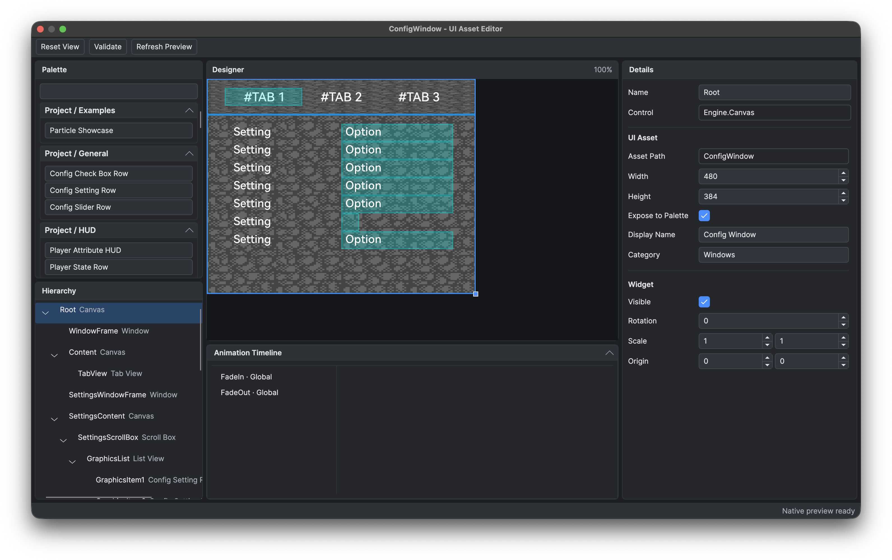

# UI Asset Editor

Visually author declarative UI screens, windows and reusable parts in a single window combining the **Palette**, **Hierarchy**, **Designer**, **Inspector** and **Timeline**.

## Open or create an asset

Choose **Game → New UI Asset**, or create and open a JSON asset under `Data/UI` from File Explorer. See [Declarative UI Authoring Workflow](<../Lua and Blueprint Scripting/Declarative UI/Authoring Workflow.md>) for asset ownership (`Parts/<Owner>` versus `Shared`).

## Layout workflow

1. Set the asset's design width and height.
2. Add a root control (`Engine.Canvas` for most screens).
3. Drag system controls or exposed project assets from the **Palette** into the **Hierarchy** (see [UI Controls in the Palette](<UI Controls in the Palette.md>) to compare built-in controls).
4. Select each node and configure its properties in the **Inspector**.
5. Configure each child's Slot according to its container's [child and Slot rules](<UI Controls in the Palette.md#children-and-slots>).
6. Assign every node a clear, unique name within the asset — generated Views expose these names as typed control or child-View keys.
7. Enable **Exposed** only for complete reusable assets meant to appear in the Project Palette.
8. Save the asset, then click **Export** in the main window to generate the Lua View and declarations.

- **Hierarchy drop targets:** Drop a Palette item onto the middle of a container row to append a child, onto the top or bottom quarter of a row to insert a sibling, or onto blank Hierarchy space to append to the root. Double-clicking a Palette item inserts using the active selection.
- **Reparenting and Undo:** Moving a node into a Canvas preserves visual position and fixed dimensions while stretched axes adapt to the new parent's available size; rotation and scale stay intact, so differently transformed parents can change the visual result. Reordering within the same parent preserves the Slot. Every reparent, indent or outdent is one Undo step.
- **Nested assets and WrapBox:** Nested project assets cannot be expanded or edited inline — open the source asset to edit its internals. A `WrapBox` holds one child template: the Designer renders every repetition, and editing any repetition edits that single template (see the [WrapBox API](<../Lua and Blueprint Scripting/Global and Core Modules/Core Modules/Engine/Layout and Image Controls.md#wrapbox>)).

## Timeline

The **Timeline** lists animations on the left, starting unselected with an empty detail pane and the authored UI pose. Right-click to add or delete a local animation, select an animation to edit its name, target, duration, pivot, tracks and keys, or click blank space to deselect. Colour keys use integer RGBA components. See [UI previews](<../PreviewHost/UI Actor Particle and Subtitle Previews.md#ui-previews>) for playback and scrubbing.

Nested project nodes list Global animations inherited from their source asset as read-only; use **Override Animation** to create a same-name local override targeting that instance.

## Asset paths and node names

An asset's identity is its exact-case extensionless path relative to `Data/UI` using `/` separators. Moving or renaming an asset updates managed JSON nesting references automatically; the next **Export** regenerates Views and declarations, so update handwritten `require` paths and renamed node references before exporting. See [UI Asset Schema and Control Registry](<../Lua and Blueprint Scripting/Declarative UI/Asset Schema and Control Registry.md>).
