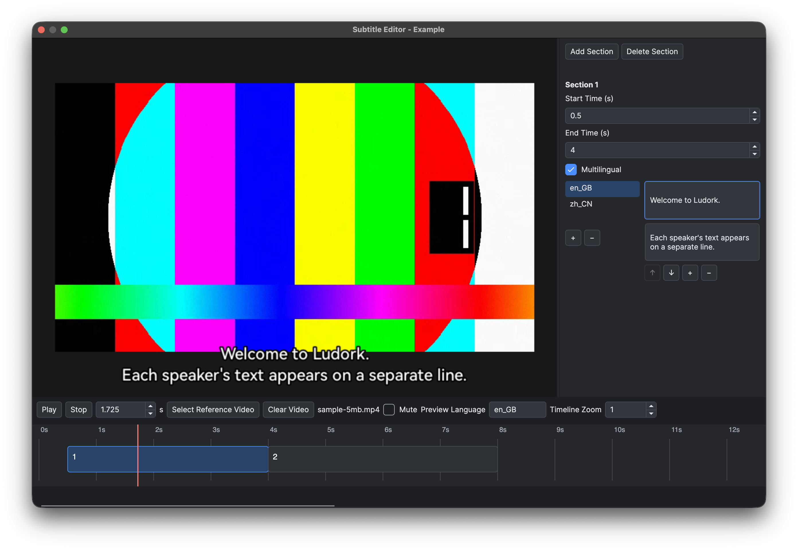

# Video Subtitles

Author timed single-language and multilingual subtitle tracks under `Data/Subtitles` and attach them to in-game video playback. Create a subtitle document in File Explorer under `Data/Subtitles` (subdirectories are supported), or double-click an existing JSON file to open the Subtitle Editor. Subtitle files follow the shared [save and Undo rules](<Start Page Workspace and Shortcuts.md#editing-and-saving>).

## Editing sections

The Subtitle Editor pairs video/subtitle preview (top left), section properties (top right) and a scrubber timeline (bottom). Sections are selected by array index and have no separate name or ID.



- **Timeline editing:** Add, select, delete, move or resize sections on the timeline, zoom and drag the playhead to inspect frames, or type exact start/end times in seconds. Save sorts sections by start time and rejects invalid times or overlaps.
- **Multilingual mode:** Each section has a multilingual toggle (off by default). Enabling it moves existing text under `en_GB` and adds empty entries for the document's other languages; disabling it keeps the selected language after confirming disposal of the other translations.
- **Shared languages:** All multilingual sections share one language list. Use `+` and `−` below the language list to add or remove a language across the whole document, or right-click to rename it (names must be non-empty and unique; new languages start empty).
- **Synchronised text rows:** Every language in a section keeps the same row count (counts may vary across sections). Focus a row and use `↑`, `↓`, `+` and `−` below the text list to reorder, append or remove rows across all languages in that section while typing edits only the active language. Switching languages keeps row selection; switching sections selects the first row. Empty language or text lists are permitted (text actions disable when no language exists).
- **Normalisation on open:** When loading existing files, the editor unifies language keys and pads missing languages or shorter arrays with empty strings to match each section's longest array in one unsaved, undoable step (Undo restores the original file; re-padding occurs on the next content edit in the same Undo step).

See [Subtitle previews](<../PreviewHost/UI Actor Particle and Subtitle Previews.md#subtitle-previews>) for reference video, preview language and session playback settings.

## Data format

Store UTF-8 JSON under `Data/Subtitles` and reference it by case-sensitive project-relative `Data/Subtitles/...json` path (identical for loose files, `Data.ldpak` and encrypted `.ldc`; absolute paths and directory traversal are rejected). Documents specify `type: "subtitle"` and a `sections` array:

```json
{
  "type": "subtitle",
  "sections": [
    {
      "startTime": 0.5,
      "endTime": 3.0,
      "content": {
        "en_GB": ["Speaker 1's content", "Speaker 2's content"],
        "zh_CN": ["角色一的内容", "角色二的内容"]
      }
    },
    {
      "startTime": 3.0,
      "endTime": 5.5,
      "content": ["Content shared by all languages"]
    }
  ]
}
```

- **Timing:** Finite seconds satisfying `0 ≤ startTime < endTime`; active on `[startTime, endTime)`. Adjacent sections may touch without overlapping; gaps show nothing, and an empty `sections` array is valid.
- **Content lookup:** Either a direct string array or a language-keyed dictionary. Dictionaries check the active game language first and fall back to `en_GB` only if that key is missing (displaying nothing if neither exists; an explicit empty array shows nothing without falling back).

## Playback and layout

Pass the subtitle path as the optional fourth argument to [Video.PlayVideo](<../Lua and Blueprint Scripting/Node Functions/Video.md>). Omitted or empty paths play video only; non-empty paths must load and validate cleanly or report an error.

Subtitles track the video clock and clear when playback finishes or is skipped. Text renders in the game's default font and size (white fill, black outline), stacking array entries top to bottom, wrapping as needed and centring each visual line horizontally.

The block sits at the bottom of the logical viewport with `5%` horizontal margins and a `3%` bottom margin, scaling down uniformly if taller than the available area. Runtime playback and editor preview share identical layout.
