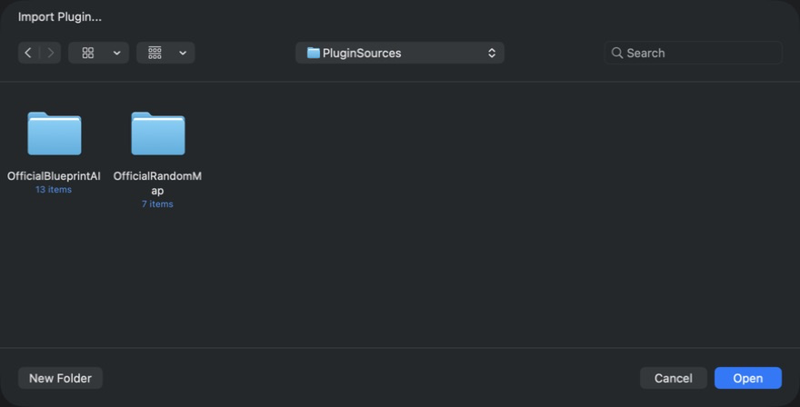

# Installing and Managing Plug-ins

Create, import, update or uninstall C# source plug-ins globally across all projects or scoped to the current project. Plug-ins can add editor commands, text hints and operation hooks through the [public registration API](<Registration and Hook Reference.md>); to extend the game runtime itself, use [native C++](<../Native C++ Development/Build and Module Layout.md>).

> **Warning:** Editor plug-ins are trusted in-process code running with the full permissions of the editor process and are not sandboxed. Inspect the source, manifest and origin of any third-party plug-in directory and import only code you trust.

Each plug-in owns its source, windows, labels, settings, retained data and third-party notices. The editor host owns registration, lifecycle, command contexts, restricted host bridges (map, Blueprint and resource cleanup) and operation sequencing. Longer creation, import, status-refresh and uninstall tasks display a progress dialog during which related windows cannot start another operation or close; trust confirmation is a separate step before import.

## Create a plug-in

1. Open **Plug-ins → Manage Plug-ins** and select **New Plug-in...**.
2. Enter a display name and a unique plug-in ID, then choose **With a Window** (default) or **Logic Only**.
3. Choose **Global Plug-ins** or **Current Project Plug-ins**. With a project open, **Current Project Plug-ins** is selected by default; on the start page, only **Global Plug-ins** is available.
4. Confirm creation. The editor generates and compiles the template, validates its entry type, then installs and registers it. If an error occurs, no partial plug-in is left behind and no existing directory is overwritten.
5. The source directory opens automatically. Edit the generated files, then restart Ludork to load your changes.

Neither template registers commands or opens a window automatically; see [Generated template](<Manifest and Minimal Plug-in.md#generated-template>) for the generated files and entry class.

## Import a third-party plug-in

1. Close any sensitive work that must not be exposed to unverified code, and inspect the plug-in's source, `plugin.json` manifest and origin.
2. Select **Plug-ins → Import Plug-in...** or **Import Plug-in...** in the **Plug-in Manager**. When a project is open, choose **Global Plug-ins** or **Current Project Plug-ins** (default: current project; the start page always imports globally), select the complete source directory and confirm the trust prompt.
3. Review the import result and resolve any manifest or compilation errors before continuing.
4. Restart Ludork (imported source is never hot-loaded).
5. Open **Plug-ins → Manage Plug-ins** and confirm the plug-in reports **Loaded** in its scope (open the target project first for a project plug-in).



*Select the directory containing `plugin.json`, not an individual source file or build output.*

### Import validation rules

- **Directory name and collisions:** The imported directory keeps its name. Invalid manifests, compilation failures, duplicate IDs within the effective global-plus-current-project set and existing target directories block installation. `__ProjectPlugins` is reserved for project plug-in storage and cannot be imported as a plug-in directory.
- **Required and rejected files:** The directory must contain `plugin.json` and at least one participating `.cs` file. Inaccessible paths, symbolic or broken links, reparse points, embedded `.data`, host-shared DLLs, F# or VB projects, and loose Avalonia XAML files are rejected before installation.
- **Ignored build and IDE files:** A `.csproj` file may remain for IDE diagnostics, though the plug-in compiler never executes it. Sources beneath `bin`, `obj`, `.git` and `.vs` are ignored.

## Global and project storage

On Windows and macOS, newly created and imported global plug-ins install to `~/Ludork/Plugins` with registrations in `~/Ludork/plugins.json` (`~` is the user's home directory, typically `C:\Users\<user>` on Windows). Writable retained plug-in data always lives under this user directory.

### Discovery and priority

- **Working directory vs user directory:** At startup, the editor reads both the working directory's `plugins.json` (and sibling `Plugins` directory) and the user installation. Development builds launched from another directory without a registry fall back to the repository identified by the build's development marker.
- **Conflict resolution:** Within each scope, working-directory registrations take priority: a matching plug-in ID loads only from the working directory, while unique IDs from either location load normally. Load failures on the selected copy are reported without substituting the other copy. A missing registry contributes no plug-ins; an invalid registry reports a diagnostic while the other location loads. Directories must be registered explicitly — scanning never auto-registers directories.
- **Manager routing:** The **Plug-in Manager** shows each plug-in's active source and routes unregistration or deletion to that source's registry and directory. Importing an unregistered immediate child of the working directory's plug-in root registers it in place; all other imports and new plug-ins go to the user directory. Removing a working-directory registration activates a remaining user copy on the next restart.
- **Repository and portable packages:** Official plug-ins load directly from a repository checkout. Windows development archives ship `Plugins` and `plugins.json` beside `Ludork.exe` (which sets the working directory to the archive root), loading bundled plug-ins without copying to the user directory. Windows release packages keep `BuildTools/OfficialPlugins` as an installation input and never overwrite user plug-ins at startup. See [User data directory](<../Editor User Guide/Start Page Workspace and Shortcuts.md#user-data-directory>) for other editor data and manual migration.

### Project plug-in layout

Project plug-ins follow this layout under either scanned root with the same working-directory priority, while writable `.data` stays under the user root:

```text
Plugins/__ProjectPlugins/<project-key>/
├── plugins.json
├── .data/<plugin-id>/
└── <plugin-directory>/
    ├── plugin.json
    └── Plugin.cs
```

`<project-key>` identifies each project by its absolute path, so projects sharing a directory name at different paths stay independent. Newly created plug-in directories use `<plugin-id>`, whereas imported directories keep their original name.

Each project scope has its own registry and data, and the **Plug-in Manager** separates **Global Plug-ins** and **Current Project Plug-ins** with their respective statuses and diagnostics. Project plug-ins apply only to that project's menus, map context menus, text hints and operation hooks. Moving or renaming a project directory creates a new scope with no automatic migration; re-import its plug-ins into the new scope.

## Official release plug-ins

The [official plug-ins](<Official Plug-ins/Overview.md#included-plug-ins>) ship as global plug-ins with a generated `plugins.json`. Once installed, they load on the next editor start without the third-party trust dialog. Official distributions include no project plug-ins.

> **Warning:** Quit Ludork and back up anything you need before installing official plug-ins. Installation replaces the entire `~/Ludork/Plugins` directory and `~/Ludork/plugins.json` — it does not merge them. Existing third-party source, registrations, `Plugins/.data` and all project plug-ins, registries and data under `Plugins/__ProjectPlugins` are permanently removed. Other editor settings and template caches are preserved.

An ordinary installation failure rolls back to the previous installation; if rollback cannot finish, follow the reported recovery instructions. Successful replacement deletes the temporary backup, reporting cleanup failure separately if it cannot be removed.

### Windows installers (EXE and MSI)

- **Opt-out:** Both Windows installers install official plug-ins by default for the user who started setup. Clear **Install Official Plug-ins** in the EXE wizard or pass `INSTALL_OFFICIAL_PLUGINS=0` to the MSI to skip without modifying existing plug-ins.
- **User identity:** Launch setup normally as your own account so plug-ins install to your profile even when another administrator provides UAC credentials. Explicitly starting setup as another user targets that user instead; service-account installations must skip user plug-ins.
- **Repair, upgrade and uninstall:** Repair preserves user plug-ins, whereas an upgrade that installs official plug-ins replaces them again. Editor uninstall deletes user data (including plug-ins) by default; clear **Delete user data** to keep it. See [User data directory](<../Editor User Guide/Start Page Workspace and Shortcuts.md#user-data-directory>) for deletion scope, identity rules and silent flags.

### macOS DMG

The macOS DMG keeps plug-ins outside `Ludork.app`: Finder displays `Ludork.app`, an `Applications` link and **Install Official Plugins** (its `.command` extension and the plug-in payload are hidden).

1. Drag `Ludork.app` to `Applications` — do not drag plug-in files to `Applications`.
2. Ensure Ludork is closed, then double-click **Install Official Plugins**.
3. Review the replacement warning and select **Replace and Install** to validate the hidden payload and transactionally replace `~/Ludork/Plugins` and `~/Ludork/plugins.json`.

### Repository and portable installation

Repository checkouts load registered plug-ins directly. To install a separate user copy outside the checkout, build Toolchain, quit Ludork and run:

```sh
.tools/Toolchain/ludork-editor editor-official-plugins prepare Plugins obj/official-plugins
.tools/Toolchain/ludork-editor editor-official-plugins install-current-user obj/official-plugins
```

On Windows, use `.tools\Toolchain\ludork-editor.exe`. To retry a failed installation from an installed Windows release editor directory:

```bat
BuildTools\Toolchain\ludork-editor.exe editor-official-plugins install-current-user BuildTools\OfficialPlugins
```

Run these commands as your normal user without **Run as administrator** or `sudo`; the same full-replacement rules apply. Windows installer operations and `install-current-user` write their latest log to `~/Ludork/Log/OfficialPluginInstall.log` when writable. If an EXE setup reports that plug-in installation failed, the editor itself remains installed — inspect the log and installer output (or installer output alone if identity resolution failed before resolving the user directory) before retrying. The macOS DMG installer displays its own status and recovery details.

## Restart and status

Creation and import compile source before registration. Global plug-ins compile and load at editor startup. Each project's plug-ins compile and load once before its first project window opens in that session (shown in the project-opening progress dialog), and that result is reused when switching or reopening projects.

After creating, importing, uninstalling or editing a plug-in, choose **Quit Ludork** and launch the editor again. Closing every window can leave the editor and its plug-ins running under the [background preference](<../Editor User Guide/Start Page Workspace and Shortcuts.md#start-page>). Plug-ins have no hot enable or disable switch. **Loaded** identifies a plug-in active in the current session.

Open **Plug-ins → Manage Plug-ins** to inspect plug-in diagnostics and states (**Loaded**, **Invalid Manifest**, **Compilation Failed**, **Initialisation Failed**, **Pending Restart**, **Unregistered; Active Until Restart** and **Pending Deletion**) before replacing or deleting installed source.

## Data and uninstall

- **Writable plug-in data:** Global plug-ins store writable state in `~/Ludork/Plugins/.data/<plugin-id>` (supplied via `PluginDataDirectory`; for example, `~/Ludork/Plugins/.data/Ludork.OfficialBlueprintAI`). Project plug-ins use `~/Ludork/Plugins/__ProjectPlugins/<project-key>/.data/<plugin-id>`, keeping the same plug-in ID isolated per project. Always write settings and history under `PluginDataDirectory` rather than the read-only plug-in source directory.
- **Uninstalling:** Uninstalling through the **Plug-in Manager** unregisters the plug-in and optionally schedules safe deletion of its installed source files (a loaded assembly's directory may remain until the next restart). Unregistering without deletion lets you re-register the same immediate child directory under that scope's plug-in root later. Both modes preserve plug-in data, which must be removed in a separate explicit action. Never edit `plugins.json` by hand while the editor is running.
- **Project-owned keep lists:** Official Resource Cleanup stores project-specific keep-list additions in `EditorCache/ResourceCleanupKeep.list` through its host bridge, separate from both plug-in source and `PluginDataDirectory`.

## Compilation references

Source plug-in compilation can reference the .NET runtime, `Ludork.Plugin.Abstractions`, `Ludork.Plugin.Avalonia` and the editor's shared Avalonia assemblies. Plug-ins cannot reference internal editor implementation assemblies.
