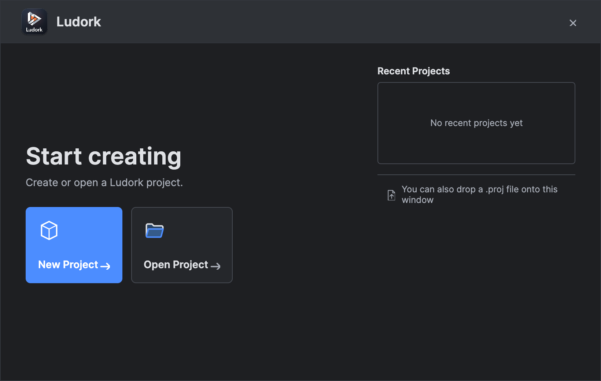
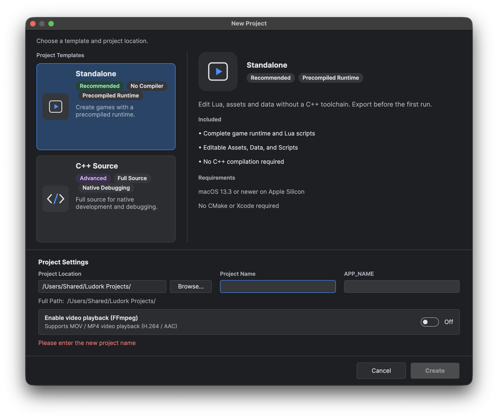

# 创建第一个项目

使用模板创建 Standalone 项目，打开初始地图，导出资产并在编辑器中运行。

## 创建项目

1. 在**启动页**选择**新建项目**。

2. 选择 **Standalone**。
3. 除非游戏需要播放视频，否则保持**启用视频播放（FFmpeg）** 未勾选。
4. 选择一个已存在的目标目录，输入新项目名称，并填写必填字段 **APP_NAME**。两者的具体用途请参阅[项目模板](<项目模板.md#模板参考>)。
5. 确认目标路径后点击**创建**。创建完成后，Ludork 会自动打开 `Main.proj`。

> **注意**：正式版编辑器首次使用时会下载对应的模板。有关模板可用性、离线复用与取消操作，请参阅[获取模板](<项目模板.md#获取模板>)。

## 保存与运行

1. 在**地图列表**中选择一张地图。
2. 点击**导出**并解决所有报告的错误。必须成功导出后才能点击**运行**。
3. 点击**运行**。Windows 支持内嵌模式或独立窗口模式，其他平台均使用独立窗口。有关窗口设置与导出细节，请参阅[编译、导出与运行](<../编辑器用户指南/运行、调试与打包.md#编译导出与运行>)。
4. 打开**控制台**查看运行时输出。游戏运行期间无法编辑项目，除非在运行前启用了[实时调试](<../编辑器用户指南/运行、调试与打包.md#实时调试>)。
5. 再次点击同一按钮（此时显示为**停止**），结束游戏并恢复编辑。

若项目的 `APP_NAME` 尚无对应的用户配置，运行时会自动创建；若已有配置，则复用现有设置。配置文件的格式、路径与共享规则请参阅[游戏配置](<../编辑器用户指南/项目设置与资产布局.md#游戏配置>)。
