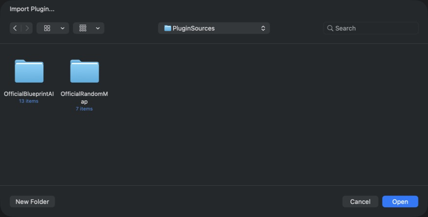

# 安装与管理插件

你可以在全局（对所有项目生效）或当前项目作用域下新建、引入、更新或卸载 C# 源码插件。插件可通过[公开注册接口](<注册点与 Hook 参考.md>)向编辑器添加菜单命令、文本提示与操作 Hook；如需扩展游戏运行时本身，请使用[原生 C++ 开发](<../C++ 原生开发/构建与模块布局.md>)。

> **警告**：编辑器插件属于受信任的进程内代码，以编辑器进程的完整权限运行，不受沙箱隔离。引入任何第三方插件目录前，请务必审查其源码、清单文件与来源，仅引入你信任的代码。

插件自行负责其源码、窗口、标签、设置、保留数据与第三方许可声明；编辑器宿主负责注册、生命周期、命令上下文、受限宿主桥接（地图、蓝图与资源清理）以及操作时序。耗时较长的新建、引入、状态刷新与卸载任务会弹出进度对话框，完成前相关窗口无法启动其他操作或关闭；信任确认作为独立步骤在引入前完成。

## 新建插件

1. 打开**插件 → 插件管理**，点击**新建插件...**。
2. 填写显示名称与唯一插件 ID，并选择**带界面**（默认）或**不带界面**。
3. 选择**全局插件**或**当前项目插件**。已打开项目时默认选中**当前项目插件**；在启动页仅可选择**全局插件**。
4. 确认创建。编辑器会生成并编译模板，校验入口类型无误后执行安装与注册；若发生错误，不会残留半成品插件，也不会覆盖已有目录。
5. 源码目录会自动打开。编辑生成的文件后，重启 Ludork 使改动生效。

两种模板均不会自动注册命令或打开窗口；生成的目录结构与入口类见[自动生成模板](<Manifest 与最小插件.md#自动生成模板>)。

## 引入第三方插件

1. 关闭不应暴露给未验证代码的工作内容，并检查插件的源码、`plugin.json` 清单文件及来源。
2. 选择**插件 → 引入插件...**或在**插件管理**中点击**引入插件...**。已打开项目时先选择**全局插件**或**当前项目插件**（默认选中当前项目；启动页固定引入为全局插件），再选择完整源码目录并确认信任提示。
3. 查看引入结果，若存在清单或编译错误请先修复后再继续。
4. 重启 Ludork（引入的源码不会热重载）。
5. 打开**插件 → 插件管理**，确认该插件在对应作用域下的状态为**已加载**（项目插件须先打开对应项目）。



*请选择包含 `plugin.json` 的插件目录，而不要选择单个源码文件或构建输出目录。*

### 引入校验规则

- **目录名称与冲突**：引入的插件保留原目录名。清单无效、编译失败、有效的“全局＋当前项目”集合内插件 ID 重复，或目标目录已存在时，均会阻止安装。`__ProjectPlugins` 为项目插件专用保留目录，不能作为插件目录引入。
- **必需与禁止文件**：目录内必须包含 `plugin.json` 与至少一个参与编译的 `.cs` 文件。不可访问路径、符号链接或失效链接、重解析点（reparse point）、内嵌 `.data`、宿主共享 DLL、F# 或 VB 项目以及零散的 Avalonia XAML 文件都会在安装前被拒绝。
- **忽略的构建与 IDE 文件**：目录内可保留 `.csproj` 文件供 IDE 诊断，但插件编译器不会执行它；`bin`、`obj`、`.git` 与 `.vs` 下的源码会被忽略。

## 全局与项目存储

在 Windows 与 macOS 上，新建与引入的全局插件均安装至 `~/Ludork/Plugins`，注册记录写入 `~/Ludork/plugins.json`（`~` 代表用户主目录，Windows 上通常为 `C:\Users\<user>`）。可写的插件保留数据始终存放在该用户目录下。

### 发现机制与优先级

- **工作目录与用户目录**：编辑器启动时会同时读取工作目录中的 `plugins.json`（及同级 `Plugins` 目录）和用户目录中的安装内容。从其他目录启动且不含注册表的开发构建会回退至构建开发标记指向的代码仓库。
- **冲突裁决**：在每个作用域内，工作目录的注册记录优先：同 ID 插件仅从工作目录加载，两处各自独有的 ID 均正常加载。若选中的副本加载失败，系统会报告错误而不会改用另一副本。注册表缺失时跳过该位置；注册表无效时输出诊断，另一位置继续正常加载。所有插件目录必须显式注册，扫描不会自动注册未登记的目录。
- **插件管理路由**：在**插件管理**中可查看每个插件当前生效的来源，取消注册或删除操作均路由至对应来源的注册表与目录。引入工作目录插件根目录下尚未注册的直接子目录时会原地注册；其余引入与新建操作均写入用户目录。取消工作目录中的注册后，用户目录中同 ID 副本会在下次重启后生效。
- **仓库与便携包**：代码仓库检出目录可直接加载其中的官方插件。Windows 开发压缩包在 `Ludork.exe` 旁附带 `Plugins` 与 `plugins.json`（启动器会将工作目录设为压缩包根目录），可直接加载随包插件而无需复制到用户目录。Windows 正式发行包将 `BuildTools/OfficialPlugins` 作为安装输入，启动时绝不覆盖用户插件。其他编辑器数据与手动迁移说明见[用户数据目录](<../编辑器用户指南/启动页、工作区与快捷键.md#用户数据目录>)。

### 项目插件布局

项目插件在两处扫描根目录下均采用以下布局，且同样遵循工作目录优先规则；可写的 `.data` 始终位于用户目录下：

```text
Plugins/__ProjectPlugins/<project-key>/
├── plugins.json
├── .data/<plugin-id>/
└── <plugin-directory>/
    ├── plugin.json
    └── Plugin.cs
```

`<project-key>` 按项目绝对路径唯一标识项目，因此位于不同路径下的同名项目彼此隔离。新建插件以 `<plugin-id>` 命名目录，引入插件则保留原目录名。

每个项目作用域拥有独立的注册表与数据，**插件管理**会分别展示**全局插件**与**当前项目插件**的状态与诊断信息。项目插件仅作用于对应项目的菜单、地图右键菜单、文本提示与操作 Hook。移动或重命名项目目录会形成新作用域且不自动迁移，请将插件重新引入新作用域。

## 发行版官方插件

官方插件 [Blueprint AI](<官方插件/Blueprint AI.md>)、[Locale Tools](<官方插件/Locale Tools.md>)、[Random Map](<官方插件/Random Map.md>)、[Mota Map Fill](<官方插件/Mota Map Fill.md>) 与 [Resource Cleanup](<官方插件/Resource Cleanup.md>) 均作为全局插件随附生成的 `plugins.json` 一同分发。安装完成后，它们会在下次启动编辑器时自动加载，无需经过第三方插件信任对话框。官方发行包不包含项目插件。

> **警告**：安装官方插件前请先关闭 Ludork 并备份需要保留的内容。安装过程会整体替换 `~/Ludork/Plugins` 与 `~/Ludork/plugins.json`，而不会与现有内容合并——原有第三方插件源码、注册记录、`Plugins/.data` 以及 `Plugins/__ProjectPlugins` 下的全部项目插件、注册表与数据均会被永久移除。其他编辑器设置与模板缓存不受影响。

常规安装失败会自动回滚到上一次安装状态；若回滚未能完成，请按提示的恢复说明处理。替换成功后会清理临时备份，若清理失败会单独报告。

### Windows 安装器（EXE 与 MSI）

- **跳过安装**：两种 Windows 安装器默认均为发起安装的用户安装官方插件。取消勾选 EXE 向导中的**安装官方插件**（**Install Official Plug-ins**），或向 MSI 传入 `INSTALL_OFFICIAL_PLUGINS=0`，即可跳过而不改动现有插件。
- **用户身份**：请以日常账户正常启动安装器，即使 UAC 弹窗由另一管理员输入凭据，插件仍会安装到你的用户目录。若明确以另一账户启动安装器，则目标为该账户；服务账户安装必须跳过用户插件。
- **修复、升级与卸载**：修复安装会保留用户插件，而选择安装官方插件的升级会再次整体替换。卸载编辑器默认删除含插件在内的用户数据，取消勾选**删除用户数据**（**Delete user data**）可予以保留。删除范围、身份规则与静默参数见[用户数据目录](<../编辑器用户指南/启动页、工作区与快捷键.md#用户数据目录>)。

### macOS DMG

macOS DMG 将官方插件置于 `Ludork.app` 外部：Finder 窗口中可见 `Ludork.app`、`Applications` 替身与 **Install Official Plugins**（其 `.command` 扩展名与插件载荷均已隐藏）。

1. 将 `Ludork.app` 拖入 `Applications`——切勿将插件文件拖入 `Applications`。
2. 确认 Ludork 已完全关闭，随后双击 **Install Official Plugins**。
3. 仔细阅读替换警告并点击 **Replace and Install**，安装器会校验隐藏载荷并以事务方式整体替换 `~/Ludork/Plugins` 与 `~/Ludork/plugins.json`。

### 从仓库与便携包安装

在代码仓库检出目录中运行时，已注册插件可直接加载。如需在仓库外安装独立的用户副本，请先构建 Toolchain 并关闭 Ludork，再运行：

```sh
.tools/Toolchain/ludork-editor editor-official-plugins prepare Plugins obj/official-plugins
.tools/Toolchain/ludork-editor editor-official-plugins install-current-user obj/official-plugins
```

在 Windows 上请将可执行文件替换为 `.tools\Toolchain\ludork-editor.exe`。若需在已安装的 Windows 正式版编辑器目录中重试失败的插件安装，请运行：

```bat
BuildTools\Toolchain\ludork-editor.exe editor-official-plugins install-current-user BuildTools\OfficialPlugins
```

请以普通用户身份运行上述命令，不要使用**以管理员身份运行**或 `sudo`；该命令同样执行整体替换。当目标路径可写时，Windows 安装器操作与 `install-current-user` 会将最近一次日志写入 `~/Ludork/Log/OfficialPluginInstall.log`。若 EXE 安装器报告插件安装失败，编辑器本体仍已安装完成——请先查看该日志与安装器输出（若在解析用户目录前即因身份校验失败，则仅查看安装器输出）再重试。macOS DMG 安装器会直接在自身界面显示状态与恢复说明。

## 重启与状态

新建与引入插件都会在注册前完成源码编译。全局插件在编辑器启动时编译并加载；每个项目的插件则在本次会话首次打开该项目窗口前编译并加载（进度显示在打开项目进度窗中），后续切换或重新打开该项目时复用加载结果。

任何新建、引入、卸载或直接修改源码的操作都需要重启编辑器才能生效——重新打开项目不会重新加载插件，编辑器也不提供热启用或热禁用开关。请将**已加载**视为生效启用状态。

替换或删除已安装源码前，请先打开**插件 → 插件管理**查看诊断信息与状态（**已加载**、**清单无效**、**编译失败**、**初始化失败**、**等待重启加载**、**已取消注册，重启前仍在运行**与**等待下次启动删除**）。

## 数据与卸载

- **可写插件数据**：全局插件将可写状态存放在 `~/Ludork/Plugins/.data/<plugin-id>`（通过 `PluginDataDirectory` 获取，例如 `~/Ludork/Plugins/.data/Ludork.OfficialBlueprintAI`）；项目插件存放在 `~/Ludork/Plugins/__ProjectPlugins/<project-key>/.data/<plugin-id>`，使不同项目中的同 ID 插件彼此隔离。所有设置与历史都应写入 `PluginDataDirectory`，切勿写入只读的插件源码目录。
- **卸载插件**：在**插件管理**中卸载插件会取消其注册，并可选择安排安全删除已安装的源码文件（已加载程序集所在目录可能保留至下次重启后删除）。选择**仅取消注册**不删除文件时，后续可重新选择同一作用域插件根目录下的该直接子目录再次注册。两种卸载方式都会保留插件数据，如需清除数据须另行手动删除。编辑器运行期间切勿手工修改 `plugins.json`。
- **项目归属保留清单**：官方插件 Resource Cleanup 通过宿主桥将项目级追加保留路径存放在 `EditorCache/ResourceCleanupKeep.list`，与插件源码及 `PluginDataDirectory` 相互独立。

## 编译引用范围

源码插件编译时可引用 .NET 运行时、`Ludork.Plugin.Abstractions`、`Ludork.Plugin.Avalonia` 以及编辑器共享的 Avalonia 程序集，不得引用编辑器内部实现程序集。
