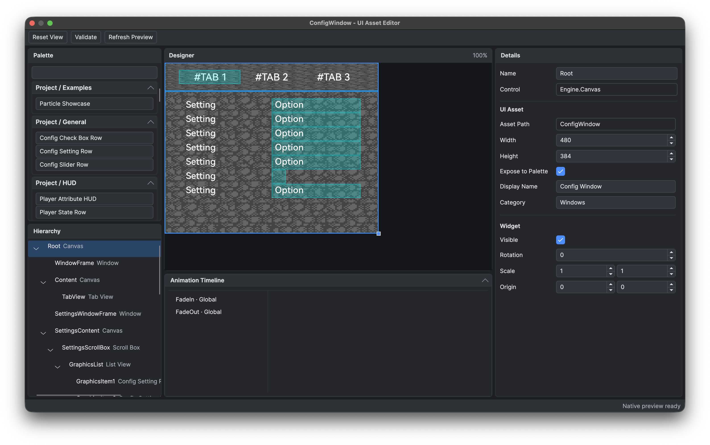

# UI 资产编辑器

在集成了 **Palette**、**Hierarchy**、**Designer**、**Inspector** 与 **Timeline** 的单一窗口中，可视化编排声明式 UI 界面、窗口与可复用部件。

## 打开或创建资产

选择**游戏 → 新建 UI 资产**，或在文件浏览器的 `Data/UI` 下新建并打开 JSON 资产。资产归属（`Parts/<Owner>` 与 `Shared`）见[声明式 UI 编写工作流](<../Lua 与蓝图脚本/声明式 UI/编写工作流.md>)。

## 布局流程

1. 设置资产的设计宽度与高度。
2. 添加根控件（绝大多数界面以 `Engine.Canvas` 为根）。
3. 将系统控件或已暴露的项目资产从 **Palette** 拖入 **Hierarchy**（内置控件对比见 [Palette 控件](<Palette 控件.md>)）。
4. 逐一选中节点，在 **Inspector** 中配置控件属性。
5. 按所属容器的[子节点与 Slot 规则](<Palette 控件.md#子节点与-slot>)配置每个子节点的 Slot。
6. 为每个节点指定清晰且在当前资产内唯一的名称——生成的 View 会将这些名称暴露为带类型的控件键或子 View 键。
7. 仅当资产完整、可复用且需要出现在 Project Palette 中时，启用 **Exposed**。
8. 保存资产，然后在主窗口点击**导出**生成 Lua View 与类型声明。

- **Hierarchy 拖放落点**：将 Palette 条目拖至容器行中部添加为子节点，拖至行顶部或底部四分之一处插入为同级节点，拖至 Hierarchy 空白处追加至根节点。双击 Palette 条目会按当前选区自动插入。
- **更换父节点与撤销**：将节点移入 Canvas 会保留视觉位置与固定尺寸，拉伸轴随新父节点可用尺寸自适应；旋转与缩放保持不变，因此父节点变换差异可能改变视觉呈现。同一父节点内重排顺序保持 Slot 不变。每次更换父节点、缩进或取消缩进均记为一步撤销。
- **嵌套资产与 WrapBox**：嵌套的项目资产无法在父资产内展开或就地编辑，须打开源资产修改内部结构。`WrapBox` 仅持有一个子模板：Designer 会渲染所有重复项，编辑任一重复项即编辑该唯一模板（见 [WrapBox API](<../Lua 与蓝图脚本/全局与 Core 模块/Core Modules/Engine/布局与图像控件.md#wrapbox>)）。

## Timeline

**Timeline** 左侧列出动画，初始不选中任何项，详情区为空且画布显示资产编排姿态。右键可新建或删除本地动画，选中动画可编辑名称、目标、时长、轴心、轨道与关键帧，单击空白处取消选择。颜色关键帧采用整数 RGBA 分量。播放与时间轴拖动预览见 [UI 预览](<../PreviewHost/UI、Actor、粒子与字幕预览.md#ui-预览>)。

嵌套项目节点会以只读方式列出从源资产继承的 Global 动画；使用**覆盖动画**可为当前实例创建同名本地覆盖动画。

## 资产路径与节点名称

资产标识是相对于 `Data/UI`、严格区分大小写、以 `/` 分隔且不含扩展名的路径。移动或重命名资产会自动更新受管 JSON 中的嵌套引用；下一次**导出**会重新生成 View 与类型声明，因此在导出前请同步更新手写的 `require` 路径与重命名节点引用。详见 [UI 资产 Schema 与 Control Registry](<../Lua 与蓝图脚本/声明式 UI/资产 Schema 与 Control Registry.md>)。
