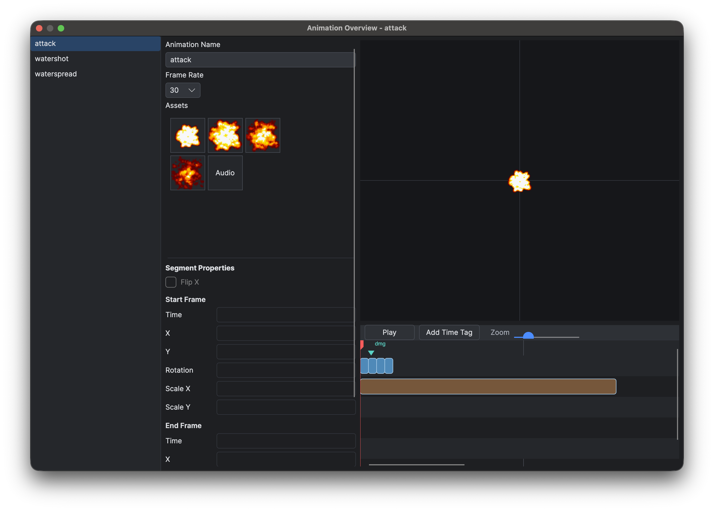
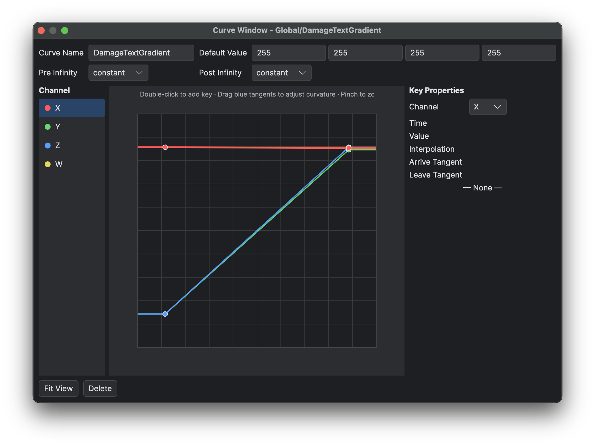

# 动画与曲线

在 `Data/Animations` 下制作逐帧 2D 动画，并在 `Data/Curves` 下编写标量插值曲线，供战斗特效、UI 过渡与粒子轨道使用。

## 动画

打开**数据库 → 动画总览**（`F5`）浏览项目动画，或通过**游戏 → 新建动画**在 `Data/Animations` 下创建 JSON 资产。动画编辑器支持编辑帧时序、视觉轨道、音频片段与事件时间标签。

源图片存放在 `Assets/Animations`（或其他资产子目录）；非空的图片与声音字段均保存规范的 `/Game/Assets/...` 路径。



### 本地导出 MP4

导出前请先保存动画。在仓库根目录运行 `tools\animation_to_mp4.bat`（Windows）或 `sh tools/animation_to_mp4.sh`（macOS），可将 `Game/Data/Animations` 下的全部 JSON 导出至 `Game/EditorCache/AnimationMp4`。该工具需要包含 Pillow 的已构建 Toolchain，以及支持 `libx264` 与 AAC 的独立 FFmpeg 可执行文件；详见[工具准备与参数](https://github.com/JasonLeon01/Ludork/blob/main/tools/README.md#animation-mp4-export)。

```bat
tools\animation_to_mp4.bat Game --input Game/Data/Animations/attack.json --output Game/EditorCache/attack.mp4
```

| 参数 | 作用 |
|---|---|
| `--input`、`--output` | 指定单个 JSON 文件或目录（目录会递归扫描并保持子目录结构）。 |
| `--size 512x512` | 指定宽高为偶数的固定画布，超出内容直接裁剪而不缩放（默认以动画原点为中心自动适配所有采样帧）。 |
| `--background "#202020"` | 指定不透明背景色（默认为黑色）。 |
| `--mute` | 移除音轨，但不缩短时间轴长度。 |
| `--overwrite` | 仅在导出成功后覆盖已存在的输出文件。 |

导出过程完整保留帧率、轨道顺序、位置／旋转／缩放插值、水平翻转及音频时序与裁剪。每段视频播放一遍直至最后一个图像或音频片段结束（时长向上取整至整帧；视觉轨道结束后仅显示背景）。时间标签不编码为视频事件；输入须为已保存的源 JSON 与未归档资产，不支持压缩缓存或 `.ldpak` 归档。

## 曲线

通过**游戏 → 新建曲线**在 `Data/Curves` 下创建曲线资产。每条曲线包含名称、默认值、首尾外推行为及有序关键帧（时间、数值、插值方式与进入／离开切线）。

可在曲线编辑器中添加、拖动与删除关键帧。请保持关键帧时间有序；除非所选插值方式明确支持跳变，否则避免出现重复时间戳。



## 数据引用

由元数据驱动的选择器可在蓝图与通用数据中引用动画与曲线键。重命名 JSON 文件会改变由路径推导出的逻辑键，重命名前请先检查引用树。
