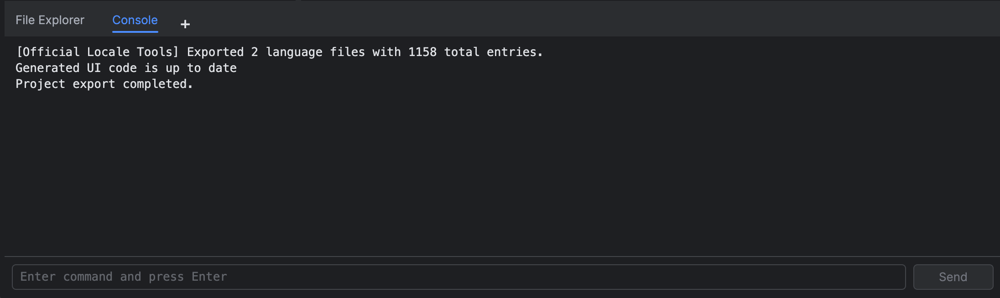
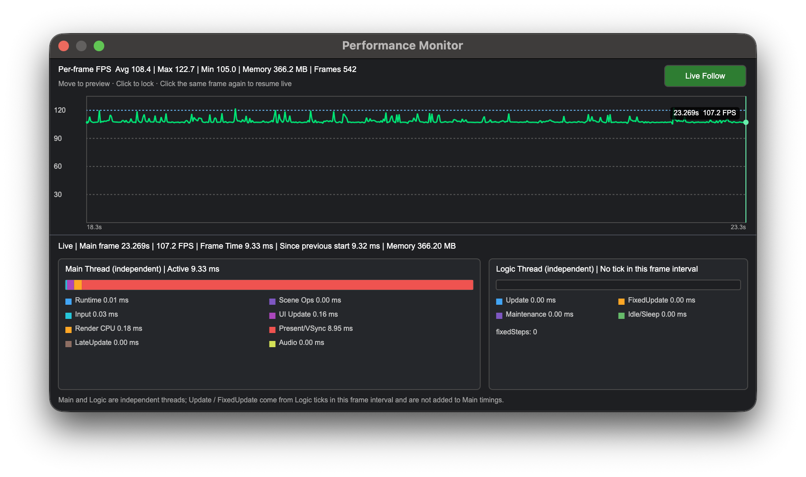

# 启动页、工作区与快捷键

了解 Ludork 编辑器的工作区布局，管理全局偏好与用户数据，使用文件浏览器与引用树，并掌握常用快捷键、保存流程与诊断工具。

## 启动页

启动页最多显示三个最近打开的项目，并提供**新建项目**与**打开项目**入口。打开通过校验的 `.proj` 文件后，该项目会移至列表顶部；启动页加载时会自动清理已失效的记录。打开 `Main.proj` 时，编辑器会先完成当前项目的未保存改动检查，通过后再替换活动项目。

将已有的 `.proj` 文件拖放到启动页任意位置即可打开。若一次拖入多个文件，编辑器仅打开第一个存在的 `.proj` 文件，其余文件予以忽略。版本不受支持的项目无法打开，兼容范围见 [Main.proj](<项目设置与资产布局.md#mainproj>)。

## 主工作区

| 区域 | 内容 |
|---|---|
| **左侧面板** | **地图列表**，用于管理普通地图与组合式大地图。 |
| **中央面板** | 地图画布与上方的图层页签；图块模式与角色模式开关位于画布旁（大地图模式下隐藏）。 |
| **右侧面板** | 图块模式下显示图块调色板；角色模式下显示**世界大纲**与**角色信息**。 |
| **底部标签栏** | 多个**文件浏览器**页签与**控制台**。 |
| **工具栏** | **编译 → 导出 → 运行** / **停止**（Standalone 项目隐藏**编译**按钮）。流程见[运行、调试与打包](<运行、调试与打包.md>)。 |

资源窗口打开时会显示加载指示；若加载失败，可点击**重试**。

## 在线文档

按 `F1` 可在编辑器内打开在线手册。开发版编辑器加载持续更新的 `trunk` 文档（`/Ludork/docs/trunk/`）；正式版加载与自身主、次版本号对应的冻结快照（例如 `1.0.7` 对应 `/Ludork/docs/v1.0/`）。

手册默认采用当前编辑器语言，也可在侧栏切换语言与版本。**关于**页面与第三方声明从同一文档版本在线加载，其中**关于**页面同时显示当前安装包版本号。

嵌入页面会隐藏官网导航栏：站内文档链接在窗口内打开，官网首页、下载页及外部链接则在系统浏览器中打开。浏览在线页面需要网络连接，加载失败时可点击**重试**。Windows 需要 Microsoft Edge WebView2 运行时（缺失时会提供安装入口），macOS 使用系统内置的 WKWebView。

## 编辑器全局偏好

跨项目共享的编辑器偏好在 macOS 上保存为 `~/Ludork/Ludork.plist`（XML plist 格式，见[平台、配置与文件](<../快速入门/Ludork Lua 进阶.md#平台配置与文件>)），其他平台保存为 `~/Ludork/Ludork.ini`。macOS 不会读取或迁移已有的 `Ludork.ini`；plist 不存在时采用默认偏好。

| 区域 | 保存内容 |
|---|---|
| **主窗口** | 正常位置与尺寸、最大化状态、地图列表与 Inspector 宽度、下方区域高度、Actor 大纲与属性区比例，以及大地图子地图列表宽度。 |
| **文件浏览器** | 新工作区的初始图标／列表视图、内容缩放、来源列表展开状态，以及首选外部打开方式。 |
| **工具窗口** | 按窗口类型保存位置、正常尺寸与最大化状态。 |
| **工具内容** | 可拖动分区的宽度或比例、UI 时间轴与系统控件分类的展开状态，以及粒子配置分组的展开状态。 |

- **默认值与容错**：文件浏览器默认使用图标视图、`100%` 缩放、收起的来源列表与系统文件管理器。项目中已保存的页签各自独立记录显示偏好。偏好值缺失或无效时回退为默认值；若 plist 无法读取或格式损坏，编辑器会报告错误且不会在保存偏好时覆盖它，需手动修复并重启编辑器后方可继续保存。
- **作用范围与显示器适配**：项目浏览目录与地图选择保存在 `Main.proj` 中；全局偏好不会改动项目文件，也不恢复搜索词、输入草稿、图层选择或画布视图状态。窗口布局会自动适配当前显示器，按窗口类型恢复最近一次非最小化的几何尺寸。项目级显示偏好见[视口选项](<../PreviewHost/地图与世界预览.md#视口选项>)。

## 用户数据目录

Windows 与 macOS 编辑器的安装版、便携版和仓库运行版均在 `~/Ludork`（Windows 通常为 `C:\Users\<用户名>\Ludork`，macOS 通常为 `/Users/<用户名>/Ludork`）保存持久化数据。

| 数据 | `~/Ludork` 下的路径 |
|---|---|
| 偏好、最近项目与窗口布局 | `Ludork.plist`（macOS）或 `Ludork.ini`（其他平台） |
| 全局与项目插件、注册记录及保留数据 | `Plugins/` 与 `plugins.json` |
| 四种项目模板的下载缓存 | `Templates/v<基础版本>/` |
| 签名配置索引 | `macos-signing.json`、`ios-signing.json`、`harmony-signing.json`、`android-signing.json` |
| 本地测试服务器设置 | `.localserver/<项目目录名>/test.json` |
| 各项目的控制台日志 | `Log/<项目标识>/Ludork.log` |
| Windows 内嵌浏览器数据 | `WebView2/` |

插件发现还会扫描工作目录中的注册表与源码，同 ID 时优先采用工作目录版本，同时将插件保留数据留在 `~/Ludork`（见[全局与项目存储](<../插件开发与安装/安装与管理插件.md#全局与项目存储>)）。

项目文件、构建产物与 `EditorCache` 保存在各自项目目录内；游戏运行时配置与存档使用各自独立目录；密码由操作系统凭据存储保管；macOS 的 WebKit 缓存由系统单独管理。

> **警告**：在 Windows 上，MSI 与 EXE 卸载程序默认勾选**删除用户数据**，卸载时会删除经身份确认的卸载发起用户的整个 `~/Ludork` 目录——包括全部插件、注册记录、偏好、日志、模板缓存、浏览器数据与签名索引。
>
> 卸载前请先关闭 Ludork 并备份需要保留的文件，或取消勾选该选项以保留数据。位于 `~/Ludork` 之外的项目目录（如 `~/LudorkProjects`）及其他用户的数据不会被删除。在 macOS 上移除应用时，`~/Ludork` 会保持完整。

| 卸载程序 | 参数 | 行为 |
|---|---|---|
| **Windows MSI** | `REMOVE_USER_DATA=0`（保留）/ `1`（删除，默认） | 仅在主动执行完整卸载且卸载事务提交后触发（修复安装（Repair）与大版本升级不会删除数据）。删除出错时会报告错误，可能需要手动清理。服务账户或无法确认发起用户的会话必须传入 `REMOVE_USER_DATA=0`。 |
| **Windows EXE** | `/REMOVEUSERDATA=0`（保留）/ `1`（删除，默认） | 交互式卸载与静默卸载均遵守该参数，并保留 Windows 卸载入口。若 UAC 由另一管理员授权、不存在交互式桌面或无法确认发起用户，则保留数据并提示手动清理，不会误删管理员或桌面用户的目录。 |

如需手动清理，请登录对应目标用户，备份必要文件后仅删除该用户的 `~/Ludork` 目录。

### 迁移已有编辑器数据

除工作目录插件扫描外，编辑器不会自动读取或迁移旧版本路径的数据（Windows 旧版曾将数据保存在安装目录，仓库运行版可能使用过当时的工作目录或仓库目录；macOS 旧版将偏好与签名索引存放在 `~/Library/Application Support/Ludork`，发布版插件与模板缓存已位于 `~/Ludork`）。

1. **在卸载旧版之前**关闭 Ludork 并备份需要保留的数据文件。
2. 安装新版本。如需保留现有插件，请取消勾选 EXE 安装程序的**安装官方插件**选项，或向 MSI 传入 `INSTALL_OFFICIAL_PLUGINS=0`（若在启用该选项安装前先恢复备份，官方插件安装步骤会覆盖已有插件）。
3. 将[当前平台格式的偏好文件](#编辑器全局偏好)、签名索引、模板缓存与本地测试服务器设置恢复至 `~/Ludork` 对应路径；覆盖目标文件前请先备份。`Plugins` 与 `plugins.json` 必须取自同一份备份一并恢复。

操作系统凭据存储中的条目与项目文件无需迁移。

## 全局快捷键

Windows 主修饰键为 `Ctrl`，macOS 为 `Command`。

| 快捷键 | 操作 |
|---|---|
| `Ctrl/Command+N` | 新建项目 |
| `Ctrl/Command+O` | 打开项目 |
| `Ctrl/Command+S` | 保存 |
| `Ctrl/Command+Z` | 撤销 |
| `Ctrl/Command+Shift+Z` 或 `Ctrl/Command+Y` | 重做 |
| `Ctrl/Command+W` | 退出或关闭项目窗口 |
| `Ctrl/Command+1` | 图块模式 |
| `Ctrl/Command+2` | 角色模式 |
| `F1` | Ludork 文档 |
| `F3` | 游戏配置 |
| `F4` | 系统配置 |
| `F5` | 动画总览 |
| `F6` | 通用粒子总览 |
| `F7` | 图块集数据 |
| `F8` | 公共函数 |
| `F9` | 游戏变量 |
| `F10` | 通用数据 |

- **上下文 `F2` 重命名**：可在蓝图编辑器中重命名选中的事件页签、在公共函数窗口中重命名选中的公共函数、在文件浏览器中重命名选中的文件（Windows/Linux 可用，macOS 不可用），或在动画编辑器中重命名选中的时间标签。窗口界面不显示 `F2` 提示。
- **对话框按键**：单按钮提示与错误对话框可按 `Enter`、`Return`、`Space` 或 `Escape` 关闭；确认对话框按 `Enter`、`Return` 或 `Space` 确认，按 `Escape` 取消。

## 编辑与保存

界面显示的字段默认值仅在实际编辑后写入文档。支持清空的文件字段会在文件选择窗口的每个目录与文件类型筛选列表首位显示**清空**项：选中后点击**打开**、按 `Enter` 或双击即可清空字段；点击**取消**或按 `Escape` 保留原值。保存对话框、多文件导入及必选文件选择器不提供**清空**项。

### 保存与操作锁

- **全局保存**：受管资源的修改以及资产文件／文件夹的重命名与移动在保存前仅驻留内存（选择**不保存**会恢复上次保存的路径）。任意保存按钮与 `Ctrl/Command+S` 均会写入全部已修改文档（含未打开资源）；编译、导出、运行与打包共用同一套保存流程。保存成功时不弹窗提示，失败时仅列出失败项与错误详情。普通保存会校验改动过的蓝图，强制保存可保留尚未完成的蓝图。[游戏配置](<项目设置与资产布局.md#游戏配置>)在点击**确认**时立即写入磁盘。
- **操作锁定**：保存、删除、文件转移、重命名、撤销与重做执行期间，编辑器会暂时禁用编辑、切换项目与关闭窗口。耗时操作（包括删除前的引用检查）会弹出不可中途取消的动画进度对话框，展示当前阶段、当前文件与完成计数，并在需要确认时让出界面。若校验期间项目数据或外部文件发生变更，编辑器会提示重试。
- **未保存标记**：已修改文档会在文件浏览器、窗口标题与资源选择器中显示 `*`。关闭资源窗口会保留未保存修改直至项目关闭。关闭或替换项目时会列出所有未保存文件并提供**保存**、**不保存**与**取消**；保存失败会保留修改标记并阻止关闭。

### 撤销、重做与待保存移动

- **按文件记录历史**：撤销与重做作用于当前活动文件，每个文件最多保留 `100` 步。显示同一文件的多个窗口共享数据与撤销历史，关闭后重新打开亦然。同一字段内的连续文本或数值输入会合并为一步（切换控件或视图、自动更新、保存、撤销或重做时结束该步）；按钮、复选框与下拉选择各自独立成步。
- **引用屏障**：撤销无法恢复指向已删除资源的引用，也无法恢复因重命名而失效的资产路径或通用数据成员 ID（被拒绝的操作不改变文档与历史）。自动更新引用会在每个受影响的目标文件（含未打开文件）中插入带标记的撤销屏障：屏障之后的编辑仍可撤销，但撤销会停在屏障处并说明来源。撤销或重做源文件的重命名时，编辑器按目标文件当前内容更新引用并插入新屏障，同时保留无关编辑。保存会完整保留历史与屏障。
- **待保存资产路径**：在文件浏览器中选中文件或文件夹即可撤销或重做其路径变更（撤销文件夹移动会保留子条目后续的独立修改）。在待保存移动的源路径或目标路径下复制、删除、导入、新建或写入文件前，须先保存路径变更；继续重命名与移动不受限制。
- **外部变更冲突**：选择**保留内存数据**会采纳磁盘内容，同时保留待保存路径、已更新引用与撤销／重做历史（若源文件缺失或目标路径被占用则整体失败，不留部分修改）。选择**使用磁盘数据**会取消受影响的待保存移动并将可识别引用恢复至已保存路径，同时保留无关编辑，但不会恢复缺失文件或清空其引用。

## 文件浏览器与引用树

**文件浏览器**通过来源列表与面包屑浏览 `Assets` 和 `Data`，“返回上级”最多退至所选根目录。

### 页签、导航与布局

- **多页签浏览**：点击**控制台**旁的 **＋** 或选择**视图 → 新建文件浏览器页签**可新增页签。首个**文件浏览器**页签始终保留；新增页签带编号与 **×** 关闭按钮，继承最近活动文件浏览器的目录与显示偏好，且搜索、历史与选中项为空。关闭当前活动的新增页签后，焦点自动切换至其左侧页签。
- **导航历史与定位**：每个页签独立维护访问历史，可通过**后退**／**前进**、`Alt+Left`／`Alt+Right` 或鼠标侧键导航（同步恢复该时刻的搜索词、目录展开状态、选中项、滚动位置与显示偏好；后退后进入新目录会清空前进历史；刷新、调整选中项／搜索词或切换页签不新增历史）。
  - 资源的**定位**操作始终作用于最近活动的文件浏览器（即便当前停留在**控制台**）。重新打开项目时，编辑器按 [Main.proj](<项目设置与资产布局.md#mainproj>) 恢复各页签、目录、显示偏好与活动页签；搜索、历史、选中项与滚动位置仅在当前会话有效。
- **视图与缩放**：列表视图支持原地展开与收起文件夹（双击进入目录，`Right` 展开或选中首个子项，`Left` 收起或选中父项，展开状态持续至本次会话结束）；图标视图与搜索结果平铺显示。按 `Ctrl/Command` 加滚轮或拖动右下角滑杆可在 `50%–200%` 间缩放，按 `F5` 可刷新外部变更。
- **搜索**：在当前目录及子目录中按文件名不区分大小写匹配（包含未保存资源，排除符号链接文件夹）。清空搜索框、切换目录或执行定位会退出搜索。
- **媒体预览**：格式受支持的图片与视频会显示缩略图（蓝图 JSON 预览见 [Actor 预览](<../PreviewHost/UI、Actor、粒子与字幕预览.md>)）。在图片、音频或视频上按 `Space`（或在文件选择器右侧面板中）即可在本地预览，默认暂停并提供播放、进度跳转与音量控件（按 `Escape` 关闭）。预览依赖系统编解码器（Windows 需要 Microsoft Edge WebView2 运行时），无需启用 FFmpeg 选项或构建原生程序；不支持或损坏的文件会显示错误。

### 文件操作、删除与引用树

- **右键菜单与拖放**：右键条目可打开条目操作菜单，右键空白处可打开当前目录菜单。粘贴或拖放时，落点为文件夹则放入该文件夹，落点为文件则放入其所在目录，落点为空白处则放入当前目录（展开的子目录与搜索结果同样适用）；按 `Ctrl/Command+V` 时，单选以所选条目为准，未选或多选则放入当前目录。
  - 拖动任意已选条目即可整组移动（按下后直接松开仅选中该条目；文件夹不能移入自身或子目录）。右键条目选择**在文件资源管理器中查看**（Windows）或**在 Finder 中查看**（macOS）可定位被右键点击的单个条目（未保存条目不可用，操作不会触发保存）。
- **原地复制与移动冲突**：选中文件夹并连续按 `Ctrl/Command+C` 与 `Ctrl/Command+V` 可在同级创建副本（重名时追加 `_copy`、`_copy2` 等后缀，文件位于扩展名前；文件夹全部内容复制完成后方在目标位置显现）。剪切或拖动若引发目标路径重复或重名冲突，整批移动将被拒绝（剪切板内容保留，解决冲突后可直接再次粘贴）。移动期间发生磁盘错误时，编辑器会尝试回滚并报告未能归位的条目，剪贴板保留剩余条目。
- **引用树与新建资源**：引用树展示当前文件的出站与入站引用。请在编辑器内创建、重命名和移动受管资源，以自动同步可识别引用（普通字符串与源码中的路径需手动修改）。新建或复制的受管资源处于未保存状态且无创建撤销步；重命名即时生效，全局保存时连同更新后的引用一并落盘。[固定资源目录](<项目设置与资产布局.md#固定资源目录>)施加额外的路径保护。
- **删除前引用检查**：删除资源前，请先解除已识别引用并保存引用方文件。删除 `Assets` 下的文件或文件夹时，文件浏览器会同时检查当前内存数据与上次保存的磁盘数据（包含文件夹内嵌套资源），只要任一版本存在引用即阻止整批删除，并逐一列出资产路径、引用文件与字段（若引用方也需删除，请先删除引用方再删资产）。
- **回收与恢复**：确认删除后，已保存文件会移入 Windows 回收站或 macOS 废纸篓（回收失败项保持不动，已回收项不会自动还原）。回收保留磁盘上最后保存的路径与内容并丢弃未保存编辑；从未保存的新资源直接移除，无回收副本。已删资源会退出托管文档与列表，保存时不会重建；编辑器撤销无法还原资源删除（需从系统回收站／废纸篓还原后重新打开项目；文档内部项删除仍使用文档撤销）。

### 在外部编辑器中打开

右上角打开菜单始终包含系统文件管理器（打开当前浏览目录），并记住你选择的目标作为首选项；在其他项目或机器上该程序不可用时，临时回退至系统文件管理器而不覆盖偏好。

菜单会列出本机已安装的 VS Code 与 Cursor，C++ Source 项目还会列出已安装的 CLion 及 Windows Visual Studio 2022。VS Code、Cursor 与 CLion 始终打开项目根目录，不受当前浏览路径影响。缺少 `.idea` 或 `.vs` 目录时，打开 CLion 或 Visual Studio 会先弹出**初始化 IDE 环境**确认提示，确认后运行项目环境生成器（取消则保持项目不变）；Visual Studio 打开项目根目录生成的 `Main.sln`。

## 控制台与性能监视器

**控制台**汇集插件、构建与运行时输出，仅在建立兼容的运行时连接后接受输入。运行游戏时，打开**编辑 → 开发工具与设置 → 性能监视器**可实时查看帧率、逻辑与内存采样。

控制台日志保存在 `~/Ludork/Log/<项目标识>/Ludork.log`，项目标识由项目绝对路径生成，不同目录中的同名项目互不干扰。每次新会话开始时会按修改时间戳归档旧日志；移动或重命名项目会启用新的日志目录，历史日志保留在磁盘上。

### 大地图流送样本

采样组合式大地图时，性能监视器会附带可选的 `worldStreaming` 快照（普通地图与未采样的逻辑帧不包含该字段）：

| 字段 | 含义 |
|---|---|
| `queueDepth` | 排队等待流送的子区域数量。 |
| `reading` | 当前处于 `Reading` 状态的区域数量。 |
| `prepared` | 已加载且处于 `Prepared` 状态的区域数量。 |
| `active` | 处于 `Active` 状态的区域数量。 |
| `dormant` | 已加载且处于 `Dormant` 状态的区域数量。 |
| `cacheBytes` | 非 Active 区域缓存的保守估算值（不等同于精确的进程、Lua、原生代码或 GPU 内存占用）。 |
| `publishMilliseconds` | 单次逻辑帧中转换并发布区域所耗费的时间。 |
| `visibleTileChunks` | 最近一次绘制中，可见子图层提交的不重复 32×32 格 `TileLayer` 分块数量。 |
| `activeActors` | 当前位于大地图 Active 更新与渲染批次中的 Actor 数量。 |

*监视器会等待兼容的运行时遥测会话接入。*
