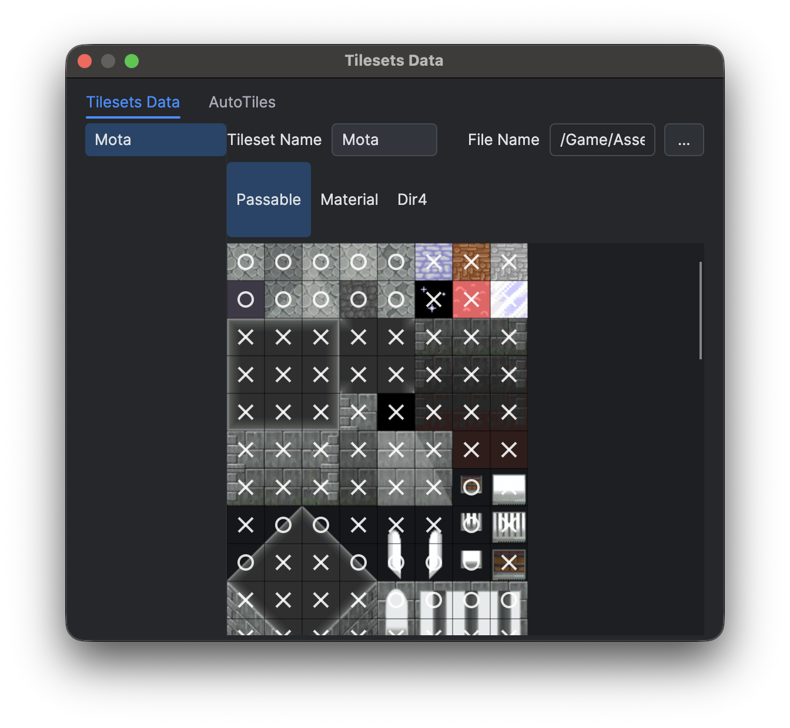
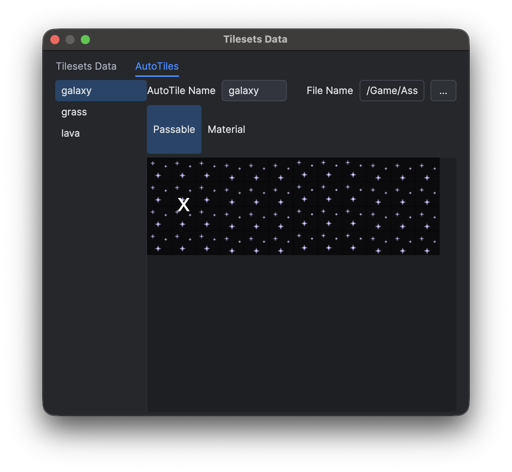
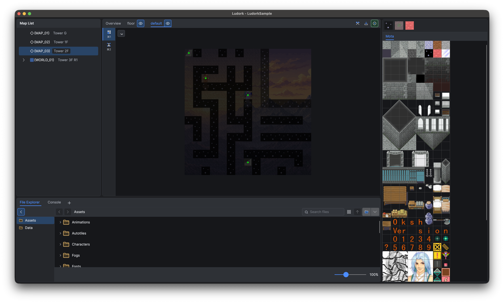
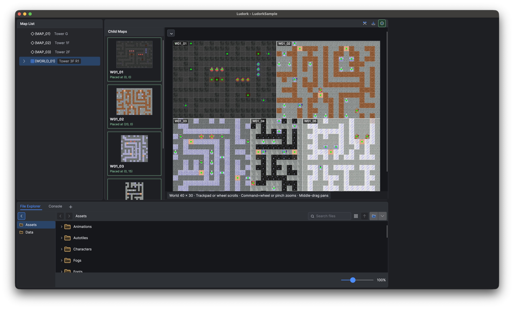
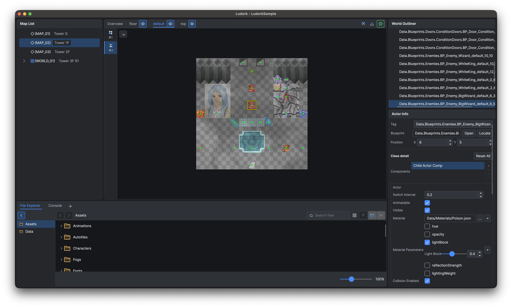

# 图块集、自动图块与地图

配置图块集与自动图块，创建普通地图与组合式大地图，绘制多层图块并在场景中摆放交互式 Actor 与光源。

## 图块集与自动图块

打开**数据库 → 图块集数据**（`F7`），在**图块集数据**与**自动图块**两个页签中分别管理普通图块集和动画／连接自动图块。源图片存放在 `Assets/Tilesets` 或 `Assets/Autotiles`，JSON 定义保存在对应的 `Data` 子目录中。

选中一条定义即可修改显示名称 `name`，点击**文件名**旁的浏览按钮选取源图片。地图调色板在页签上显示 `name`，内部引用键则是 JSON 文件名：修改 `name` 不影响现有引用；重命名键会自动更新所有受影响地图（含未打开地图）的 `layerTileset`，并遵循统一的[保存与撤销规则](<启动页、工作区与快捷键.md#编辑与保存>)。

*在**通行**模式中，圆圈表示可通行图块，叉号表示阻挡图块。*

*自动图块属性作用于整个资产，而非单独显示出来的各个源单元格。*

### 编辑图块属性

| 模式 | 普通图块集（逐图块） | 自动图块（整体资产） |
|---|---|---|
| **通行** | 左键单击切换单个图块的通行状态。 | 切换整个资产的通行状态。 |
| **材质** | 左键单击选择[材质资源](<材质.md>)；清除选择会删除该稀疏条目并恢复默认渲染。 | 为整个资产指定单一[材质资源](<材质.md>)。 |
| **四方向** | 左键单击切换离点击位置最近的边通行状态。 | 不适用。 |

在普通图块集中，`Shift+左键拖动`会将起始源图块的属性批量复制到所有经过的图块并合并为一步撤销（**通行**复制布尔值，**材质**复制资源引用，**四方向**复制全部四个方向）。自动图块不支持该批量笔刷。

> **注意**：地图制作完成后修改图块集定义可能改变已有图块索引的显示内容。移动图块集或修改硬编码的玩法字符串不会自动重写源码中的字符串路径。

### 地图图层顺序

地图 JSON 必须提供 `layerOrder` 字符串数组作为权威的绘制与 Actor 处理顺序，而 `layers` 与 `actors` 是以图层名为键的字典并由编辑器保持同步。加载普通地图与流送子地图时，若存在缺失或重复的图层引用、未列入 `layerOrder` 的图层，或所属图层不在 `layerOrder` 中的 Actor 分组，均会被拒绝；加载从不按 JSON 键序推断顺序。

*先点击画布上方的图层页签，再从右侧调色板选取图块绘制；眼睛图标控制图层显隐。*

## 地图列表与组合式大地图

**地图列表**同时展示普通地图与组合式大地图。大地图行显示 `_world.json` 中的 `worldName`，展开后按各自可编辑的 `mapName` 列出直接子地图（`_world.json` 保持隐藏）。

通过**大地图属性**修改 `worldName`，通过**重命名大地图**修改目录名与运行时路径。子地图独立保存**地图名称**，移出后仍可作为独立地图使用。选中大地图会打开其拼合面板，右键菜单用于创建各类地图资产。

### 排序、嵌套与移动地图

- **视觉顺序（`_info.json`）**：地图列表依据 `Data/Maps/_info.json`（顶层）及各大地图目录内的 `_info.json`（子地图）排列。嵌套仅用于分组管理，不产生运行时影响。将一行拖至另一行的上沿或下沿可调整先后顺序，拖至中部则嵌套于其下（嵌套子项随父项一起移动）。大地图始终位于顶层，不可嵌套。未列入文件的地图按文件名顺序排在末尾，失效条目自动丢弃。调整顺序会将项目标记为已修改（不进入撤销／重做）。
- **移入与移出大地图**：将普通地图拖到大地图行上（或其子行之间）会连同其嵌套子项一并移入该大地图目录；将子地图拖回顶层或其他大地图则将其移出。移入的地图默认处于未摆放状态，移出大地图会自动移除原摆放记录。
  - 移动操作会更新可识别引用并插入撤销屏障。若目标位置存在同名地图、目标大地图内发生 Actor tag 冲突，或待移入地图仍被其他资产引用（未摆放子地图不可作为运行时目的地），移动将被拒绝。
- **创建、复制、重命名与删除**：请通过地图列表（而非维持目录层级的**文件浏览器**）执行地图创建、删除及顶层与大地图之间的移动。复制子地图会分配全新的 Actor 地图 tag，但不会自动摆放副本。
  - 重命名会更新[项目设置与资产布局](<项目设置与资产布局.md>)所述的可识别引用；自动更新引用、摆放与图层顺序时会在独立的大地图与子地图历史中插入撤销屏障。删除大地图会整体回收其已保存目录（含清单、子地图及其他文件），详见[资源删除与恢复](<启动页、工作区与快捷键.md#文件浏览器与引用树>)。

### 拼合大地图

*子地图缩略图标注摆放坐标，右侧画布实时预览组合结果。*

- **摆放与移除**：将未摆放的子地图拖入画布即可摆放，拖动已摆放子地图调整位置，按 `Delete`／`Backspace` 或通过右键菜单可移除摆放。每次摆放编辑记为一步撤销／重做。
- **重叠与边界**：调整位置或子地图尺寸时允许临时重叠，但保存前必须消除全部重叠。越界与图层顺序冲突在编辑时即刻拒绝，调整尺寸亦不可将子地图推出大地图边界。删除已摆放的子地图文件前须先移除摆放并保存。Actor tag 在整个大地图范围内必须唯一，非 JSON 普通文件不参与加载。
- **点击优先级**：选中的摆放项在各图层内绘制于重叠兄弟项之上并优先命中点击，便于直接拖开；否则优先命中最后加入的摆放项。被遮挡的子地图也可从左侧子地图列表重新拖至画布。
- **画布导航**：可滚动或平移画布，通过 `Ctrl+滚轮`（Windows/Linux）或 `Command+滚轮`／触控板捏合（macOS）缩放。详见[地图与世界预览](<../PreviewHost/地图与世界预览.md>)。

### 新建地图默认值与地图属性

新建普通地图或大地图子地图时，**地图属性**会以独立副本方式预填项目中最近修改地图的参数（尺寸、环境光、BGM／BGS 与滤镜、雾效参数与远景），并生成新的默认文件名与地图名称。

当前会话中的修改（含未保存编辑与撤销／重做）优先于文件修改时间；仅打开或保存地图不改变修改顺序。若项目中尚无地图，则使用标准默认值。

- **环境光**：点击色块按钮（显示 ARGB 值并以棋盘格表现透明度）即可选色。
- **音频与远景**：点击 BGM、BGS 或**远景**（通常位于 `Assets/Panoramas`）旁的浏览按钮选择资源，或点击**清空**移除引用，确认后生效。**大地图属性**采用相同方式配置全局远景。详见[远景渲染](<../Lua 与蓝图脚本/默认玩法/资源、音频、视频与特效.md#着色器雾与转场>)。

## 雾效

**地图属性**与**大地图属性**提供相同的**雾效**设置（勾选启用后展开参数）。GPU 在世界坐标系中程序化生成噪声雾图案，无需任何雾效图片资产，平移或缩放视口时图案不会贴附于屏幕。组合式大地图可将全局雾效与子区域雾效在边界处无缝衔接。

| 设置 | 含义 | 标准默认值 |
|---|---|---|
| **启用** | 地图是否渲染雾效。 | 关闭 |
| **颜色** | RGBA 颜色与透明度。 | 不透明白色 |
| **密度** | 雾效覆盖程度（`0–1`）。 | `0.5` |
| **尺度** | 图案尺寸，单位为地图像素（值越小雾团越细密）。 | `256` |
| **X / Y 速度** | 雾效飘移速度，单位为地图像素／秒。 | `15` / `15` |
| **湍流强度** | 图案扰动变化强度（`0–1`）。 | `0.5` |
| **随机种子** | 决定可重复图案的非负整数。 | `0` |

密度控制覆盖范围，颜色 Alpha 控制不透明度；黑色雾效可在保留浓淡变化的同时压暗场景。例如，随附的 `Map_02` 使用黑色 `(0, 0, 0, 128)`，密度 `0.5`、尺度 `128`、速度 `[15, 15]`、湍流强度 `0.8`。

预览开关见[视口选项](<../PreviewHost/地图与世界预览.md#视口选项>)，JSON 结构见[地图与大地图资产](<项目设置与资产布局.md#地图与大地图资产>)。

## 图层与绘制

图块模式支持新建、重命名、排序、复制、粘贴与删除图层，并可为图层指定[图层材质](<材质.md#创建与使用>)。切换图块集页签会立即替换活动图层的图块集，已有图块索引随之按新图块集重新解释。

- **显隐控制**：图层页签左侧显示名称、右侧为显隐开关。显隐状态写入地图数据，隐藏图层既不渲染也不可编辑。**全貌**以完整亮度展示全部可见图层；选中单个图层时会淡化其余图层而不改变绘制顺序。
- **画笔选择**：在调色板中点选单个图块、多格区域或自动图块。再次点击已单选的普通图块可取消选择；未选中任何图块时画笔切换为橡皮擦。缩放与平移画布不改变地图数据。

| 手势 | 绘制行为 |
|---|---|
| `左键拖动` | 连续绘制（多格选区在每个位置放置完整图案）。 |
| `Shift+左键拖动` | 填充框选矩形，多格图案从左上角起重复平铺并裁剪至矩形内。 |
| `Shift+左键单击` | 绘制单个格子。 |
| `右键单击` | 取样所点击的格子。 |
| `Alt+左键单击`（macOS 为 `Option+左键单击`） | 对与点击格图块及自动图块值一致的四连通区域执行漫水填充（支持多格图案、自动图块与擦除）。 |

每次笔画、矩形填充或漫水填充记为一步撤销。笔画中途保存会使后续绘制开启新一步撤销；执行撤销或重做会结束当前笔画，再次按下鼠标即可继续。

## 光源与 Actor

在角色模式下可摆放蓝图实例、移动位置并编辑其公开属性（实例覆盖不会改动蓝图默认值）。通过 `lightComp` 为 Actor 挂载光源并在**角色信息**中调整，蓝图默认值与组件字段见 [Light 组件](<Actor 组件/Light.md>)。

*在**世界大纲**中选中实例后，可在**角色信息**中编辑覆盖值，例如覆盖 `Poison` 材质的 `lightBlock` 参数。*

### 选择与批量编辑 Actor

项目编辑支持在普通地图或单独打开的大地图子地图当前图层中单选或多选 Actor（实时调试仅支持单选）。

| 位置与手势 | 选择行为 |
|---|---|
| **世界大纲**：普通单击 | 将选集替换为该 Actor。 |
| **世界大纲**：`Ctrl+单击`（macOS 为 `Command+单击`） | 切换该 Actor 的选中状态。 |
| **世界大纲**：`Shift+单击` | 从选择锚点连续选区（`Ctrl/Command+Shift` 追加范围）。 |
| **世界大纲**：单击其他图层的 Actor 或图层行 | 切换至对应图层并选中该 Actor；单击图层行则清空选集。 |
| **地图**：普通单击已选 Actor | 保留当前整组选集，便于直接拖动。 |
| **地图**：普通单击未选 Actor | 将选集替换为该 Actor。 |
| **地图**：`Shift+单击` / `Ctrl/Command+单击` | 追加选中／切换该 Actor 的选中状态。 |

- **手势阈值**：地图上的修饰键单击在松开按键时生效；任一轴移动满 `4` 个设备无关像素即转入拖动并取消单击选择。修饰键拖动必须起始于已选 Actor，否则整次手势无效。多选状态下普通单击地图空白处仅清空选集而不摆放新实例，其余情况正常摆放。切换地图或退出角色模式会清空选集。
- **多选时的角色信息**：仅显示所有选中 Actor 共有的、类型与编辑规则兼容的属性（含结构体、组件、列表与字典中的共有子项）。显示值综合继承默认值与实例覆盖，取值不一致时显示**正在多选中**。编辑单个子字段（如向量的 X）仅更新整组中该子字段。有依赖条件的属性须在所有选中 Actor 上均满足条件才可编辑。
- **多选限制**：Tag 只读；蓝图引用一致时显示共享引用（提供打开与定位），否则显示**正在多选中**；容器增删与类型切换禁用。重置单个字段或全部覆盖时，仅对共有可编辑字段恢复各 Actor 自身默认值，其余字段保持原样。批量编辑为原子操作，失败时不留部分修改。

### 移动与变换 Actor

| 手势 | 变换效果 |
|---|---|
| `左键拖动`已选 Actor | 整组按相同格子增量移动；触及地图边界时整组停止以保持相对偏移（整组无法容纳时拒绝移动）。 |
| `Ctrl+左键拖动`（macOS 为 `Command+左键拖动`） | 按地图像素连续调整 `defaultTranslation`，不改变格子坐标。 |
| `Alt/Option+左键拖动` | 按各 Actor 本地坐标调整 `defaultOrigin`（计入各自旋转与缩放，图像朝拖动反方向移动；存在零缩放轴时不可用）。优先于 `Ctrl/Command`。 |
| `Ctrl/Command+滚轮` 或 `Command+捏合`（macOS） | 缩放 `defaultScale`（保持各轴比例与符号及零轴；每单位滚轮 `×1.1`，捏合连续缩放）。无符合条件选集时缩放地图；无修饰键捏合始终缩放地图。 |
| `Alt/Option+滚轮` 或 `Option+捏合`（macOS） | 绕各 Actor 自身原点旋转 `defaultRotation`（每单位滚轮 `+15°`，每 `0.1` 捏合 `+18°`；正向／外扩顺时针，反向／内缩逆时针）。优先于 `Ctrl/Command`，无符合条件选集时回退视口操作。 |

上述变换快捷键不适用于实时调试。一次完整的整组拖动、批量编辑、重置、删除或粘贴记为一步撤销；同一选集与属性的连续滚轮或捏合调整会合并为一步，直至选集、地图、图层或模式变更或项目保存。

### 复制与删除 Actor

通过**世界大纲**或地图右键菜单，或按 `Ctrl/Command+C` 与 `Delete`／`Backspace` 复制、删除所选 Actor。右键已选 Actor 会保留整组选集；右键未选 Actor 则先单独选中它。

通过地图右键菜单或 `Ctrl/Command+V` 可在指针所在格子粘贴：主选 Actor 对齐目标格子，其余副本保持相对偏移。粘贴目标为活动图层，保留实例覆盖、在地图或大地图范围内生成唯一 tag 并自动选中新组。若任一落点越界、被占用或组内自冲突，整次粘贴失败且不改动地图。

不可见 Actor、图层淡化与光源范围辅助显示见 [Actor 与图层辅助显示](<../PreviewHost/地图与世界预览.md#actor-与图层辅助显示>)。

### 光源偏移与遮挡

- **发光点偏移**：`LightComponent.lightOffset` 以 Actor 本地包围盒中心为基准，并随完整的 Actor 变换（旋转与缩放）同步变换。布置墙面火把时，请将偏移设置在朝向房间一侧的火焰位置，因为渲染器不会自动将发光体挪入附近可通行格子。
- **材质遮光（`Surface.LightBlock`）**：材质在 `[0, 1]` 区间内每穿透一个 `CellSize` 距离的遮光不透明度（`0` 完全透光，`1` 完全阻挡，中间值按物理路径长度指数复合——例如 `0.5` 穿透半格、一格与两格的透射率分别约为 `0.707`、`0.5` 与 `0.25`）。
- **自身遮挡排除**：发光 Actor 仅从自身光源的动态遮挡体中排除，它依然遮挡其他光源，同位置的图块与其他 Actor 也照常产生遮挡。请将墙体与火把拆分为独立 Actor，避免排除火把时连带排除墙体。

### 大地图中的 Actor tag

在大地图子地图内新建或粘贴 Actor 时，默认 tag 以 `<子地图文件名去扩展名>.` 为前缀，并在整个大地图范围内强制唯一。重命名子地图或大地图不会改写已有或自定义 tag。复制子地图时，副本 tag 会改写为 `<新子地图名>.<原 tag 主体>`，并同步更新对应的 `BPClassVarChanged` 键。

## 地图目标

`startMap` 文件字段与蓝图 Transfer 选择器共用同一棵地图树：

- **选择大地图**：保存 `<WorldFolder>/_world.json`，坐标采用大地图格子坐标。
- **选择已摆放子地图**：保存 `<WorldFolder>/<ChildFile>.json`，坐标采用子地图本地坐标并在运行时换算为世界坐标。
- **未摆放子地图**：显示在树中，但不可选为运行时目的地。

## 实时调试

以**独立窗口**运行并开启[实时调试](<运行、调试与打包.md#实时调试>)时，地图面板会自动跟踪玩家所在的普通地图或大地图子地图；允许的操作与存档边界详见该节。
