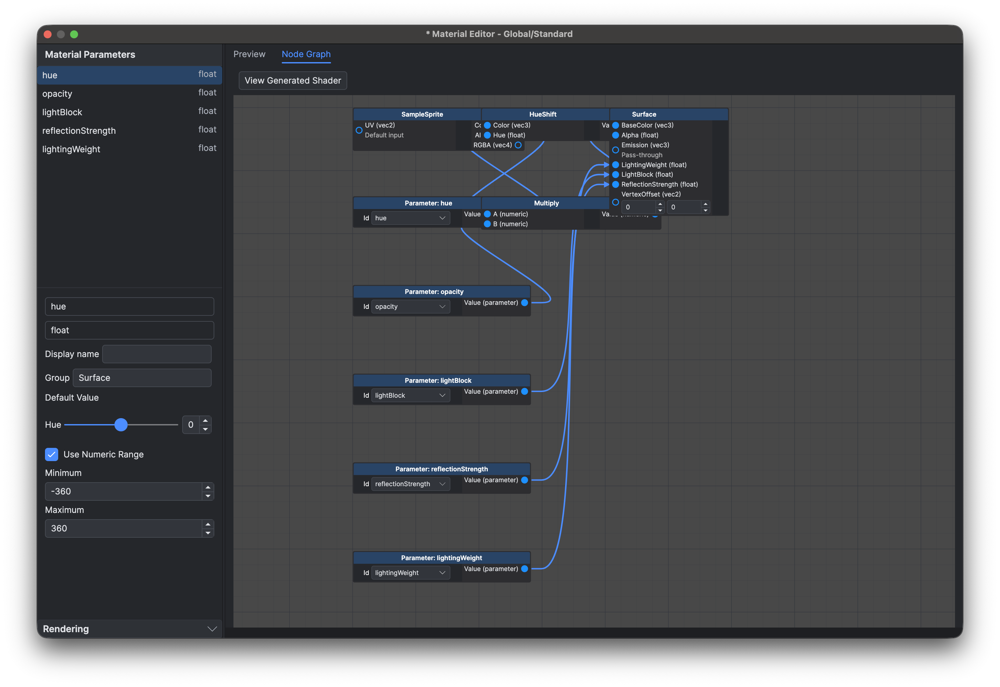
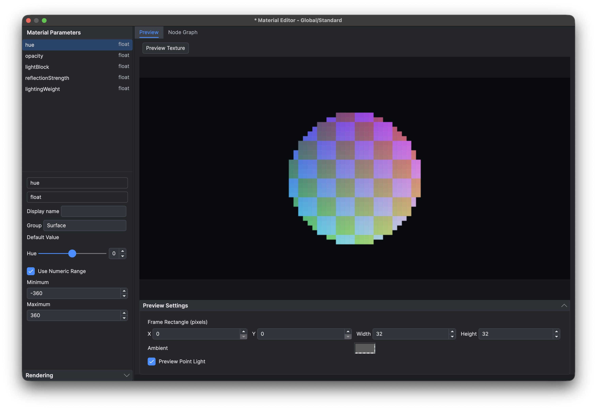

# 材质

通过可视化节点图编写 2D 材质，控制精灵颜色、透明度、局部自发光、场景受光响应、遮光、反射强度与顶点位移。Actor、`CharacterView` 控件、图块、自动图块与图块图层均可引用 `Data/Materials` 下的材质资产。

Actor 默认使用 `Data/Materials/Global/Standard.json`；`CharacterView` 控件、图块与自动图块在材质留空时使用内置默认材质（原始纹理正常受光，无自发光、反射、遮光或顶点位移）。效果示例与 `Surfaces` 预设位于 `Global` 目录之外。

## 创建与使用

在文件浏览器或**文件**菜单中选择**新建材质**，将文件保存至 `Data/Materials` 下，或双击已有 `.json` 资产打开编辑。在 Actor 蓝图中，当材质字段为 `Standard` 时也可直接从字段旁新建材质；点击字段旁的打开按钮可编辑当前生效材质。材质属于项目共享资源。

材质编辑器默认打开**预览**页签：左侧为参数列表，下方为选中参数详情，右侧包含**预览**与**节点图**页签（可拖动分隔条调整布局）。切换页签会保留选区、画布缩放与平移位置、预览设置及播放时间。修改参数默认值会影响所有未覆盖该参数的实例。

- **赋值路径**：`material` 字段填写完整的 `Data/Materials/...json` 路径。可识别的材质与纹理引用均纳入引用检查、重命名更新与删除保护，遵循统一的[保存与撤销规则](<启动页、工作区与快捷键.md#编辑与保存>)；脚本中动态拼接的路径需手动维护。
- **继承关系**：子蓝图与地图实例在未覆盖材质字段时继承父级材质。在材质选择器中选择**清空**或显式选择 `Standard`，可将继承材质（如 `Rainbow`）覆盖回 `Standard`；清除该覆盖即可恢复继承。Actor 字段、参数列表与预览均以实际生效的材质为准。
- **参数覆盖（`materialParameters`）**：在 Actor 与 `CharacterView` 上，勾选参数即可设置实例覆盖值，取消勾选则沿用资源默认值。Actor 在**清空**与显式 `Standard` 间切换时保留 `lightBlock` 等覆盖；切换至不同材质会在同一次编辑中清除旧覆盖。子蓝图切换材质时会写入空覆盖字典以阻断旧材质的继承参数；重置整个实例可恢复继承。
- **图块、自动图块与图层**：图块集在稀疏 `materials` 对象中按从 0 开始的图块索引记录材质（如 `{"7": "Data/Materials/Water.json"}`），清除选择会移除对应键。自动图块保存单个 `material` 字段。图块图层先执行图块或自动图块材质，再叠加图层材质；同层 Actor 使用自身材质。

## 公开参数

左侧参数列表显示显示名称与类型，悬停提示展示稳定 ID 与分组。右键点击条目或空白处选择**添加参数**，输入非空且唯一的稳定 ID 并选择类型（`float`、`vec2`、`vec3`、`vec4`、`color`、`bool` 或 `texture`）。通过右键菜单或 `Delete` 键删除参数（新增与删除均支持撤销／重做）。

在列表下方可编辑选中参数的默认值、显示名称、分组与可选数值范围：

- **ID 与类型**创建后只读；修改显示名称不影响节点图引用与实例覆盖所依赖的 ID。
- **取值与范围**：向量使用数字数组（数值范围逐分量生效，须满足 `min ≤ max`）；颜色使用 `[0, 1]` 区间内的四个通道；纹理使用规范的 `/Game/Assets/...` 路径，支持 PNG（`.png`）与 JPEG（`.jpg`、`.jpeg`）。
- **已删除引用**：删除节点图正在使用的参数会产生编译诊断，须重新连线或移除对应 Parameter 节点。实例面板支持删除 ID 已失效的参数覆盖。

## 编辑节点图

切至**节点图**页签，右键点击画布空白处打开**添加节点**分类菜单，选择分类与节点类型即可创建节点；拖动标题栏移动节点，拖动端口建立连线。最大顶点位移等全局设置位于参数区下方默认收起的**渲染配置**中。



*点击画布上方的**查看生成着色器**可检查编译生成的顶点与片元 GLSL。*

### 编辑与导航

- **输入与常量**：未连接的字面量输入可直接在对应引脚下方编辑，节点属性在节点内部编辑（已连接输入自动隐藏数值控件）。声明的默认值仅展示而不写入覆盖；隐式输入与继承输入显示**默认输入**或**透传输入**。右键点击未连接的输入引脚可选择**设置常量**或**恢复默认输入**。
- **断开连线**：右键输入引脚可断开该连接，右键输出引脚可断开全部输出连线。节点右键菜单另提供**断开所有输入连线**与**断开所有输出连线**（单次批量断线记为一步撤销，无连线时禁用）。断开后的输入恢复默认或透传行为，不保留连接前的常量。
- **选择、复制与平移**：右键节点可删除（右键多选组内节点时保留整组；右键其他节点则先单独选中它）。`Surface` 输出节点不可删除。右键拖动可平移画布，松开不弹出菜单。复制／粘贴会分配新节点 ID 并保留组内连线；常规撤销／重做与聚焦控件键盘输入均适用。
- **macOS 触控板与缩放**：双指滚动可水平与垂直平移画布；捏合或 `Command+滚轮`以指针为中心缩放（`10%–1000%`）。指针悬停在节点数值控件上时，滚动直接调整该控件。
- **受限节点属性**：Parameter 选择器显示名称并保存稳定 ID；数值节点提供受支持的标量或向量维度；Compose 仅可选 `2`、`3` 或 `4` 个分量；Swizzle 提供输出长度与各分量通道下拉框（`X/R`、`Y/G`、`Z/B`、`W/A`）。编译器会校验所选通道是否存在于输入中，并对无效已存值报告错误直至修复。数值控件仅遵循声明边界，不对无界字段额外设限。

### Surface 通道与数据流

材质图是纯数据流图，仅含一个受保护的 `Surface` 输出节点，不包含玩法事件或蓝图执行流。

可用节点由原生运行时的节点注册表提供（包括表面输入、公开参数、时间、位置、精灵／纹理采样、算术、向量组合、分量选择与角度制 `HueShift`）。例如，可将 `SurfaceInput.BaseColor` 与一个 `float` 参数连入 `HueShift`，再将其 `Value` 输出接至 `Surface.BaseColor`。

| Surface 输入 | 含义 |
|---|---|
| `BaseColor`、`Alpha` | RGB 颜色与透明度。 |
| `Emission` | 独立于场景照明叠加的局部 RGB 自发光（照亮周围物体请使用 Light 组件）。 |
| `LightingWeight` | 无光照颜色与场景光照之间的混合权重。 |
| `LightBlock` | 每穿透一个 `CellSize` 的遮光不透明度；见[光源遮挡](<图块集、自动图块与地图.md#光源与-actor>)。 |
| `ReflectionStrength` | 对地图反射表面的贡献强度。 |
| `VertexOffset` | 像素单位的局部附加顶点位移。 |

未连接的表面通道透传入站表面值；未连接的 `VertexOffset` 不施加位移，因此图层材质可仅改写单个通道而保留图块材质其余通道结果。请将 `rendering.maxVertexOffset` 设为覆盖所有可能位移（含参数范围）的非负 `[x, y]` 边界，供裁剪与预览取景使用。纹理采样仅限片元阶段，跨阶段非法连接会触发编译诊断。

## 预览与排错

在**预览**页签中选取**预览纹理**，设置整数帧边界（`X`、`Y ≥ 0`；`Width`、`Height ≥ 1`），并调节环境光与可选点光源以检查受光与自发光效果。预览设置仅临时生效；材质预览及 Actor、地图、UI 预览均直接读取未保存的材质快照。



*在**预览设置**中调节预览帧矩形、环境光与可选点光源。*

编译诊断显示在右侧页签底部，可定位到节点时会自动高亮该节点；点击错误即可跳转至**节点图**并聚焦定位。**查看生成着色器**以只读方式展示生成的顶点与片元 GLSL。节点图由原生编译器生成 GLSL，不接受原始着色器源码；暂不支持法线贴图、材质图继承与子图。

## 材质组合

地图中实际使用的“图块 + 图层”组合会在游戏初始化时自动扫描。仅当脚本在运行时动态组合材质（例如动态更换图层材质或构建地图）时，才需通过**游戏 → 材质组合**手动登记额外组合。Actor 或 UI 控件切换单个材质，或修改材质参数，均无需添加额外组合。

| 列表 | 内容 |
|---|---|
| **基础材质** | `Data/Materials` 下的全部材质，首项为**默认材质**（先于图层材质执行）。 |
| **图层材质** | 同一批材质，不含空项或默认材质。 |
| **已有组合** | 仅列出手动保存的额外组合（`Material + Layer`）；地图自动扫描到的组合不在此显示。 |

条目按相对于 `Data/Materials` 且去掉 `.json` 的路径显示（保留子目录，如 `Surfaces/Water`）。分别选中一项**基础材质**与**图层材质**后点击**添加**（未选齐或该有序组合已存在时按钮禁用；`A + B` 与 `B + A` 互异，且允许材质与自身组合）。选中已有组合后即可点击**删除**。

每次添加或删除均立即保存（打开窗口或切换选择不写入；保存失败会显示错误并保留原列表）。已失效的保存引用会标记缺失并允许删除；运行时准备会报告缺失引用及其来源位置。

编辑器自动维护 `Data/MaterialCombinations.json`（请勿手工编辑）：首次添加时创建，清空后自动删除。每条 `additionalCombinations` 记录以 `material`（空字符串表示默认材质）与 `layer` 保存完整 `Data/Materials/...json` 路径。模板与游戏发行包均包含该文件；变更在下一次材质缓存准备时生效。

## 运行时生成

运行游戏前请先保存材质修改。`SceneInit` 阶段由原生材质编译器在 `<用户数据>/Assets/Shaders/MaterialGenerated` 下生成 GLSL 着色器与运行时元数据（独立于编辑器**导出**）。桌面端预览在内存中用同一编译器实时编译未保存快照，不写入运行时缓存。

- **编译范围**：准备阶段编译全部独立材质（含内置默认材质），以及[额外组合](#材质组合)与地图实际使用组合的去重、路径排序并集。源文件读取遵循[用户目录资源优先规则](<项目设置与资产布局.md#运行时资源查找>)。
- **地图扫描**：递归扫描 `Data/Maps` 下全部普通地图（含大地图子地图），不受启动地图或可见状态限制。每个指定了材质的图层都会与该层实际放置的图块及自动图块基础材质配对（未指定材质的图块使用默认材质，图块集中未使用的条目不生成组合）。准备阶段不扫描也不执行脚本。
- **缓存目录结构**：`Data/Materials/Surfaces/Water.json` 映射至 `Assets/Shaders/MaterialGenerated/Materials/Surfaces/Water/`，内置默认材质映射至 `Assets/Shaders/MaterialGenerated/Builtin/Default/`。

| 条目 | 内容 |
|---|---|
| `resource.json` | 参数声明、默认值与 `maxVertexOffset`。 |
| `single/` | 不叠加图层的基础材质。 |
| `layers/<不含 .json 的相对路径>/` | 基础材质叠加指定图层材质的组合。 |

每个程序目录包含 `vertex.vert`、`color.frag`、`surface.frag`、`transmission.frag`、`source.frag` 与元数据 `program.json`（输出路径映射冲突时会报告错误）。当[打包加密选项](<运行、调试与打包.md#打包>)启用时，这些逻辑文件名会对应至加密着色器后缀与 `.ldc` 元数据。

- **缓存校验**：仅当输入内容、生成器版本、加密配置与生成文件哈希全部一致时才复用缓存；变更、缺失或损坏的文件会自动重编。新产物在完整构建并校验通过后原子发布（失败或取消不留半成品），成功后自动清理过期组合及旧明文／密文文件。
- **缓存存储**：始终以未归档文件保存（即便启用 `.ldpak`），不包含在模板与发行包中，可在游戏停止后安全删除（下次启动自动重建）。
- **初始化顺序**：默认[初始化场景](<../Lua 与蓝图脚本/默认玩法/默认模板概述.md#入口与模块>)会先完成材质准备，再创建着色器或依赖材质的 UI 与图形；自定义初始化场景必须遵循同样顺序（接口见[材质缓存准备](<../Lua 与蓝图脚本/全局与 Core 模块/Core Modules/Engine/地图与材质.md#材质缓存准备>)）。绘制时直接加载已准备的运行时文件并绑定实例参数。

## 文件格式

材质 JSON 格式固定为版本 `1`：

```json
{
  "type": "material",
  "version": 1,
  "parameters": [],
  "graph": {
    "nodes": [{"id": "surface", "type": "Surface", "inputs": {}, "properties": {}}],
    "output": "surface"
  },
  "rendering": {"maxVertexOffset": [0, 0]},
  "editor": {"positions": {"surface": [400, 200]}}
}
```

节点输入存储字面量或连线对象（`{"node": "tint", "port": "Value"}`）。节点坐标与画布 `editor.view`（缩放与偏移；连续平移或缩放共享一步撤销）作为编辑器数据保存。

参数条目记录 `id`、`type`、`default` 及可选的 `displayName`、`group`、`min`、`max`；实例字典仅保存 ID 到值的覆盖。材质及其引用的纹理随项目常规流程打包，支持加密 Data 与 `.ldpak`。
