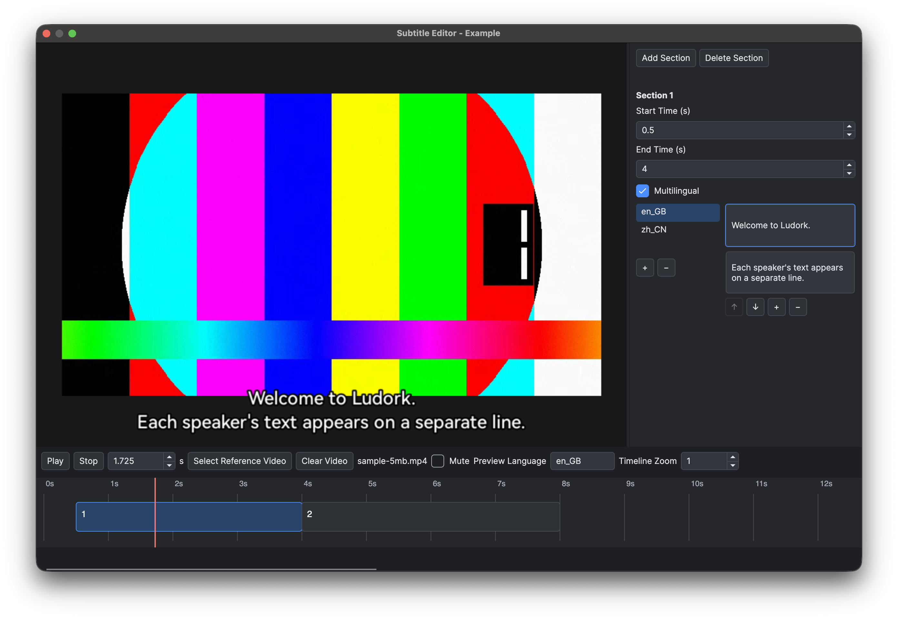

# 视频字幕

在 `Data/Subtitles` 下编写带时间轴的单语言或多语言字幕轨道，并将其挂载至游戏内视频播放。在文件浏览器的 `Data/Subtitles` 下新建字幕文档（支持子目录），或双击已有 JSON 文件即可打开字幕编辑器。字幕文件遵循统一的[保存与撤销规则](<启动页、工作区与快捷键.md#编辑与保存>)。

## 编辑片段

字幕编辑器将视频／字幕预览（左上）、片段属性（右上）与可拖动时间轴（底部）集成于同一窗口。片段按数组索引选择，不含独立名称或 ID。



- **时间轴编辑**：在时间轴上新建、选择、删除、移动或拖拽调整片段时长，缩放时间轴并拖动播放头检视帧画面，或直接输入以秒为单位的精确起止时间。保存时自动按开始时间排序，并拒绝非法时间或重叠片段。
- **多语言模式**：每个片段拥有独立的多语言开关（默认关闭）。开启时将原有文本归入 `en_GB`，并为文档中的其余语言补齐空项；关闭前会弹出确认提示丢弃其他译文，仅保留当前所选语言。
- **共享语言列表**：全部多语言片段共用同一语言列表。使用列表下方的 `+` 与 `−` 在整份文档中同步增删语言，右键语言项可重命名（名称非空且唯一，新增语言默认空文本）。
- **同步文本行**：同一片段内各语言始终保持相同行数（不同片段行数可独立变化）。聚焦某行后，点击文本列表下方的 `↑`、`↓`、`+`、`−` 会同步对该片段所有语言执行调序、追加空行或删除行；键入内容仅修改当前激活语言。切换语言保留当前选中行，切换片段默认选中首行。允许空语言列表与空文本列表（无语言时文本操作按钮禁用）。
- **打开时规范化**：加载已有文件时，编辑器会统一语言键并按各片段最长数组补齐缺失语言与较短数组的空字符串，记为一步未保存且可撤销的编辑（撤销后恢复原文件，下次内容编辑时会重新补齐并与该次编辑合并为同一步撤销）。

参考视频、预览语言与会话播放设置见[字幕预览](<../PreviewHost/UI、Actor、粒子与字幕预览.md#字幕预览>)。

## 数据格式

在 `Data/Subtitles` 下保存 UTF-8 JSON，并以区分大小写的项目相对路径 `Data/Subtitles/...json` 引用（未归档文件、`Data.ldpak` 与加密 `.ldc` 均使用相同逻辑路径；绝对路径与目录穿越将被拒绝）。文档包含 `type: "subtitle"` 与 `sections` 数组：

```json
{
  "type": "subtitle",
  "sections": [
    {
      "startTime": 0.5,
      "endTime": 3.0,
      "content": {
        "en_GB": ["Speaker 1's content", "Speaker 2's content"],
        "zh_CN": ["角色一的内容", "角色二的内容"]
      }
    },
    {
      "startTime": 3.0,
      "endTime": 5.5,
      "content": ["所有语言共用的内容"]
    }
  ]
}
```

- **时间范围**：有限秒数，须满足 `0 ≤ startTime < endTime`，生效区间为 `[startTime, endTime)`。相邻片段可首尾衔接但不可重叠；间隙期间不显示字幕；允许空的 `sections` 数组。
- **内容查找**：支持直接字符串数组或以语言为键的字典。使用字典时优先查找当前游戏语言，仅在该键缺失时回退至 `en_GB`（两者均无时不显示；显式空数组直接不显示，不触发回退）。

## 播放与布局

将字幕路径作为可选第四参数传入 [Video.PlayVideo](<../Lua 与蓝图脚本/节点函数/Video.md>)。省略或传空字符串时仅播放视频；非空路径须成功加载并通过校验，否则报告错误。

字幕跟随视频时钟同步更新，并在播放结束或跳过时清除。文本采用游戏默认字体与字号（白色填充、黑色描边），按数组顺序自上而下排布，自动换行并将每个视觉行水平居中。

字幕块位于逻辑视口底部，左右各留 `5%` 边距、底部留 `3%` 边距；若总高度超出可用区域则等比缩小。运行时播放与编辑器预览采用完全一致的排版逻辑。
