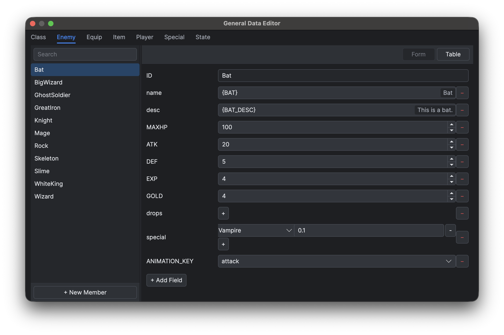
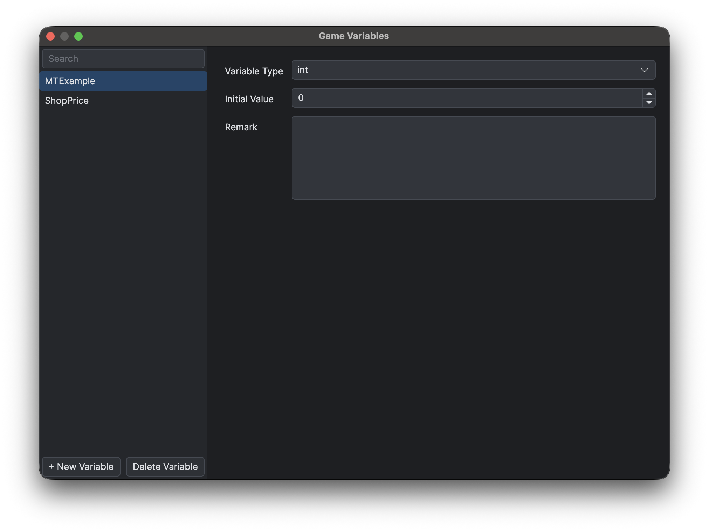
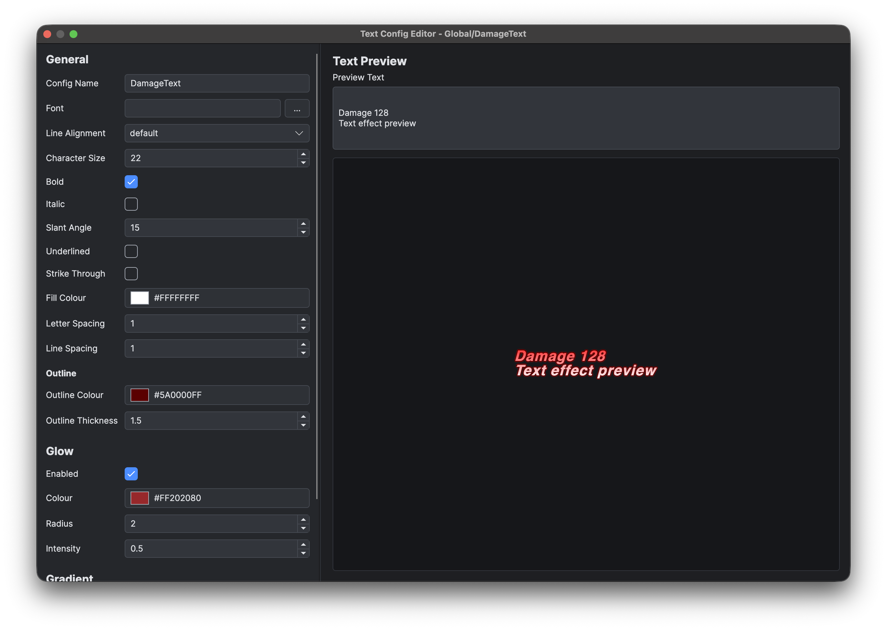

# 通用数据与文本配置

在 `Data/General` 下维护结构化项目数据库，声明跨蓝图共享的运行时游戏变量，并通过文字配置管理可复用的富文本样式。

通用数据适合存放敌人、物品、装备、玩家预设、状态等跨地图与蓝图共享的数据记录。每个 JSON 文件定义一个类型 Schema 及其命名成员；同一类型的**表单**、**表格**与成员能力图窗口共享同一份文档和撤销／重做历史。

## 类型结构

| 键 | 含义 |
|---|---|
| `params` | 有序字段定义，包含 `type`、`defaultValue`、可选 `comment` 以及枚举与容器的递归 Schema。 |
| `members` | 命名记录，为 Schema 中的每个字段存储对应值。 |
| `events` | 可选的有序事件名列表；每个成员可为各事件编写独立能力图。 |

### 支持的类型与枚举

支持字符串、布尔值、整数、浮点数、文件、列表、字典、`sf.Vector2f/i/u`、`sf.Vector3f/i/u`、`sf.Color`、`sf.IntRect` 以及 `any`（保留异构 JSON 字面类型且绝不将字符串求值为代码）。枚举、元组与联合类型的组合规则见[元数据结构与 Decorator](<../Lua 与蓝图脚本/蓝图脚本/元数据结构与 Decorator.md>)；编辑联合类型值前请先选定分支。

新增与编辑的字段均写入完整递归 `type` 对象——例如 `{ "list": "int" }` 或 `{ "dict": "int", "key": { "enum": "Enums.GeneralData.Item", "valueType": "string" } }`——同时保留对旧版 `"type": "list"` 加 `itemType` 以及 `"type": "dict"` 加 `valueType` 的读取支持。

- **添加或编辑枚举字段**：在**添加字段**／**编辑字段**中选择 `enum`，在 **kind** 中选定模块，选择推断或显式标量值类型（项目托管枚举使用 `string`；空源码枚举须显式指定标量类型）并设定默认值。字典可独立选择键类型与值类型。选择器直接写入 `type`，不保存单独的 `kind` 或 `reference` 属性。
- **内置托管枚举**：物品键使用 `{ "enum": "Enums.GeneralData.Item", "valueType": "string" }`，类型键使用 `Enums.GeneralDataKey`，动画键使用 `Enums.Animation`，粒子键使用 `Enums.Particle`（均可用于列表、字典键／值、元组与联合类型）。选择器实时反映未保存的新增、重命名与删除操作。
- **枚举规则**：字符串枚举选择器包含 **— 不选择 —**（`""`），保留未知非空值（仅校验标量类型而不限制必须属于选项），按字面保留 ID 中的空白与引号，且允许空托管集合。以枚举为键的字典新行在选定非空且唯一的键前处于待定状态，不保存占位键。即便尚无成员使用，枚举声明本身仍计为依赖项。
- **拒绝的旧版与非法 Schema**：缺少子类型、缺失或出现未定义且不以下划线开头的成员字段、类型不匹配、`linkedType`、旧 `GeneralDataVars` Decorator 以及旧 `reference` 协议均会导致加载失败。
- **字段注释**：可在**注释**中填写可选的纯英文提示文本（留空则不写入；鼠标悬停在**表单**标签或**表格**表头时显示；不属于本地化键或成员数据）。

### 重命名类型与成员 ID

- **重命名类型**：自动更新可编辑 JSON 中的可识别模块路径（包含自引用及因标识符冲突而重新分配的模块名）。Lua 元数据声明中的依赖会显示在引用树中，但须手动更新源码。删除被引用类型前请先移除并保存全部依赖。
- **修改成员 ID（`更改 ID`）**：自动更新默认值、蓝图与地图字段、图参数及容器（含字典键）中的类型化成员引用。继承值直接在声明处更新，不会生成子蓝图或地图覆盖。动画与粒子重命名同理更新对应类型的标量引用。若导致字典键冲突则拒绝整次重命名。撤销／重做遵循[编辑与保存](<启动页、工作区与快捷键.md#编辑与保存>)规则；普通字符串及 Lua／C++ 源码需手动维护。

## 编写流程

1. 打开**数据库 → 通用数据**（`F10`）。
2. 选择已有类型，或右键点击类型页签栏新建类型。
3. 在批量创建成员前先定义字段（右键**表单**中的字段名可编辑定义）。
4. 添加成员并填写数值。右键成员列表项或**表格**行可执行**更改 ID**、复制、删除或打开能力图。
5. 通过类型页签右键菜单管理事件，再点击**编辑能力图**打开成员图。重命名或删除事件会同步更新全部成员图。
6. 重命名或删除类型及成员前先检查引用，完成后保存。

- **生成的 Lua 模块**：保存时自动生成 `Enums.GeneralDataKey`、各 `Enums.GeneralData.<TypeName>`（例如 `require("Enums.GeneralData.Item")` 提供 `Item.EnemyBook`）、`Enums.Animation`、`Enums.Particle` 以及 `Source.Configs.GeneralDataTypes`（含 LuaLS 声明）。切勿手工编辑这些生成文件；重命名或删除类型会同步维护生成模块而不触碰手写文件。调用 `GeneralDataTypes.Create(typeName, memberID, memberData)` 可按类型还原成员记录。
- **Schema 编辑**：重命名字段会保留各成员现有值；仅改默认值不影响已有成员。更改字段类型或容器的元素／键／值类型时会先请求确认，并将全部已有成员的该字段重置为新默认值。删除字段不会自动修复读取该字段的脚本。
- **成员能力图**：仅支持类型声明的事件与同步节点，无类继承、Parent 或 `self` 节点；请配合全局节点与 `GameplayEventData` 编写逻辑。成员图须由运行时显式激活（见[通用数据事件执行](<../Lua 与蓝图脚本/蓝图脚本/执行流、事件与变量.md#事件>)）。

对于声明了对应 Actor 类的通用数据类型，可用[通用数据蓝图导出](<../插件开发与安装/官方插件/通用数据蓝图导出.md>)批量创建缺失的蓝图。

## 搜索与视图

搜索不区分大小写，匹配成员 ID 与直接标量字段（字符串、数字、布尔值），不搜索容器内部或能力图。窗口保持打开期间，各类型独立记住搜索词、选中项及**表单**／**表格**视图模式。

- **表单视图**：完整编辑单个成员的全部字段。
- **表格视图**：按字段声明顺序横向滚动列出 ID 与字段，支持布尔值、数字与字符串行内编辑；结构化单元格点击**编辑**即可跳转至表单视图。编辑遵循统一的[撤销规则](<启动页、工作区与快捷键.md#编辑与保存>)。

## 游戏变量管理器

打开**数据库 → 游戏变量**（`F9`）声明由蓝图与当前游戏实例共享的可变运行时变量。使用搜索框按变量名不区分大小写过滤，点击**新建变量**添加声明，选中条目可编辑类型、初始值与仅编辑器可见的备注，点击**删除变量**并在确认后移除。一旦变量被图、地图或脚本引用，请保持变量名稳定。

| 管理器类型 | 写入的元数据类型 | 说明 |
|---|---|---|
| `bool`、`int`、`float`、`string` | `bool`、`int`、`float`、`string` | 标量默认值 |
| `list` | `any[]` | 普通 Lua table（非 Standard 原生 `list`） |
| `dict` | `Dict[string, any]` | 普通 Lua table（非 Standard 原生 `dict`） |

修改已有变量类型会清空原初始值并重置为新类型的空默认值。保存时同步生成 `Scripts/Source/Configs/GameVariables.lua`（初始值）与 `GameVariables_meta.lua`（声明）；请始终通过管理器修改（仅打开窗口不会写入文件）。

带 `InstVar` 标记的蓝图字段与节点引脚会展示可搜索的变量选择器（带类型过滤的选择器仅列出兼容变量，如 Game 项目的条件门），配套的 `InstVarValue` 字段会自动适配所选变量类型的编辑器控件。

> **重要**：修改 Schema 或游戏变量声明不会自动修复脚本、事件图、存档或硬编码字符串引用。通用数据与生成的变量声明属于项目定义数据，不可用作对局期间的可变状态存储。

## 文本配置

普通 UI 文本直接在对应 UI 节点上设置样式；需要可复用的共享样式或命名富文本标签时，使用**游戏 → 新建文字配置**。

`{ITEM_NAME}` 等本地化显示键在展示时解析，而非数据加载时解析；详见[游戏本地化工作流](<../插件开发与安装/官方插件/游戏本地化工作流.md>)。Game 项目内置数据库的完整 Schema 见[通用数据参考](<通用数据参考/概述.md>)。
