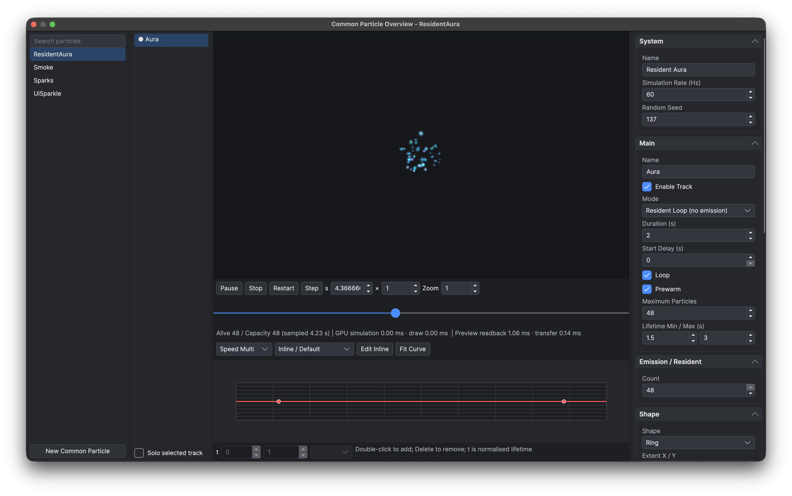

# 通用粒子

在 `Data/Particles` 下编写由有序 GPU 发射轨道组成的粒子特效，并通过 `EmitterComponent` 挂载到地图 Actor，或通过 `Engine.EmitterView` 嵌入 UI 界面。

## 编辑资源

通过**游戏 → 新建通用粒子**或在文件浏览器中新建粒子资产，并可在**数据库 → 通用粒子总览**（`F6`）中浏览 `Data/Particles` 下的全部粒子。轨道排列顺序即同一发射器内的绘制顺序。在轨道列表右键可新增轨道；右键具体轨道项会选中它并启用**复制轨道**与**删除轨道**（在列表空白处打开菜单时两项禁用）。



*左侧为轨道列表，中央为实时预览与生命周期曲线，右侧为轨道属性。*

纹理支持 PNG（`.png`）与 JPEG（`.jpg`），可用**纹理区域**裁剪子图。播放控制、轨道隔离与时间定位见[粒子预览](<../PreviewHost/UI、Actor、粒子与字幕预览.md#粒子预览>)。资源编辑遵循统一的[保存与撤销规则](<启动页、工作区与快捷键.md#编辑与保存>)。

## 资源标识与 Schema

粒子定义保存在 `Data/Particles/<key>.json`，引用时使用严格区分大小写、以 `/` 分隔且不含扩展名的相对键（如 `Combat/Hit`）。纹理路径采用规范的 `/Game/Assets/...` 逻辑路径。定义不包含 `version` 字段。

下述 JSON Schema 的颜色分量范围为 `0–255`。对应的运行时配置类型见 [Emitter 配置 API](<../Lua 与蓝图脚本/全局与 Core 模块/Core Modules/Engine/时间、渲染与粒子.md#emittertrack>)。

```json
{
  "type": "particle",
  "simulationRate": 60,
  "seed": 1,
  "tracks": [
    {
      "name": "Glow",
      "mode": "resident",
      "capacity": 64,
      "count": 32,
      "loop": true,
      "shape": "disk",
      "radius": 24,
      "lifetime": [0.8, 1.6],
      "speed": [4, 12],
      "texture": "/Game/Assets/Particles/Glow.png",
      "blend": "add",
      "curves": {
        "alpha": {
          "keys": [
            { "time": 0, "value": 0 },
            { "time": 0.2, "value": 1 },
            { "time": 1, "value": 0 }
          ]
        }
      }
    }
  ]
}
```

此示例要求项目中存在 `/Game/Assets/Particles/Glow.png`（纹理为空时渲染透明）。顶层 `simulationRate` 为 `1–240` 整数（默认 `60`）；`seed` 为 `0–16,777,215` 整数（默认 `1`）；`tracks` 为有序数组且 `name` 唯一。固定种子可在同一运行时与 GPU 上获得可重复结果，但 GPU 浮点模拟不保证跨设备确定性。

| 轨道字段 | 默认值与规则 |
|---|---|
| `name`、`enabled` | `"Track"`、`true`。轨道名称用于标识手动发射目标。 |
| `mode` | `"emission"` 或 `"resident"`（见[发射、空间与所有权](#发射空间与所有权)）。 |
| `duration`、`delay`、`loop`、`prewarm` | `2`、`0`、`true`、`false`（单位秒；`duration > 0`，`delay ≥ 0`）。 |
| `capacity`、`count` | `1024`、`min(32, capacity)`。容量范围为 `1–1,000,000`；常驻初始数量 `count` 为 `0–capacity`。 |
| `rate`、`distanceRate`、`bursts` | `30`、`0`、`[]`。分别为每秒发射数、宿主每移动 1 逻辑像素的发射数与定时爆发。 |
| `shape`、`extent`、`radius`、`innerRadius` | `"point"`、`[32, 32]`、`16`、`8`。支持 `point`、`line`（取 `extent.x`）、`rectangle`（取 `extent`）、`disk`、`ring`（`0 ≤ innerRadius ≤ radius`）。 |
| `direction`、`spread` | `-90`、`30` 度（在 `direction ± spread` 内采样；Y 轴正方向向下）。 |
| `lifetime`、`speed` | `[1, 2]` 秒（`> 0`）、`[20, 40]` 逻辑像素／秒（`[min, max]`）。 |
| `sizeMin`、`sizeMax` | `[8, 8]`、`[16, 16]` 逻辑像素（各轴非负）。 |
| `rotation`、`angularVelocity` | `[0, 360]` 度、`[0, 0]` 度／秒。 |
| `colourMin`、`colourMax` | 均为 `[255, 255, 255, 255]`（RGBA `0–255`）。 |
| `gravity`、`radialAcceleration`、`tangentialAcceleration`、`damping` | `[0, 0]`、`0`、`0`、`0`（逻辑像素／秒²；非负 `damping` 对速度施加指数衰减）。 |
| `texture`、`textureRect` | `""`、`[0, 0, 0, 0]`（`[x, y, width, height]`；宽高均为 `0` 时使用整图，否则须为正值且位于图像边界内）。 |
| `columns`、`rows`、`frameCount`、`frameRate` | `1`、`1`、`1`、`0`。网格 `1–4096`，帧数 `1–(columns × rows)`，帧率为非负帧／秒。 |
| `randomStartFrame`、`frameLoop` | `false`、`true`。帧序从左到右、从上到下；`0` 帧率停留在初始帧，不循环时停在末帧。 |
| `space`、`scaleMode`、`blend` | `"local"`、`"hierarchy"`、`"alpha"`（混合还支持 `"add"`）。 |
| `offset`、`rotationOffset`、`scale` | `[0, 0]`、`0` 度、`[1, 1]`（轨道相对宿主的变换）。 |
| `curves` | 可选生命周期曲线通道：`speed`、`sizeX`、`sizeY`、`rotation`、`red`、`green`、`blue`、`alpha`。 |

- **定时爆发（`bursts`）**：每条记录格式为 `{ "time": 0, "count": 16, "cycles": 1, "interval": 0 }`，其中 `time` 位于 `[0, duration)`、`count` 为 `0–1,000,000`、`cycles` 为 `1–10,000`、`interval ≥ 0` 秒（`cycles > 1` 时必须为正数）。所有数值须为有限值且 `[min, max]` 保持有序。
- **生命周期曲线**：支持内联标量[曲线](<动画与曲线.md>)（含 `defaultValue`、`preInfinity`、`postInfinity` 及由 `time`、`value`、`interpolation`、`arriveTangent`、`leaveTangent` 组成的 `keys`）或 `Data/Curves` 下不含扩展名的键，按归一化年龄 `[0, 1]` 采样。速度、尺寸与 RGBA 通道与基础值相乘（默认 `1`），旋转通道叠加角度（默认 `0`）。运行时将每条通道烘焙为 `256` 项 GPU 查找表，渲染结果为源曲线的近似。

## 发射、空间与所有权

### 生命周期模式

- **`emission`**：组合时间发射、宿主位移距离发射、定时爆发与手动 `emit(trackName, count)`。`loop = true` 时按 `duration` 循环周期；关闭 `loop` 后到达 `duration` 即停止自动发射，存活粒子继续走完寿命。GPU 槽位按环形缓冲区复用，满载时覆盖最旧槽位——`capacity` 是模拟预算，而非粒子存活保证。
- **`resident`**：经过 `delay` 后一次性生成 `count` 个粒子。`loop = true` 时各粒子按自身寿命循环复用而不再发射；`loop = false` 时初始批次过期后结束。时间／距离发射、爆发与手动 `emit` 不适用于常驻轨道。图集序列动画独立于轨道模式运行。
- **`prewarm`**：仅对循环轨道生效。开始播放前，GPU 以宿主当前静止位置预先模拟足以覆盖最大粒子寿命的完整周期，每帧上限为 `120` 个固定步。预热期间公开播放时间保持为 `0`；重启时会重新预热。

### 坐标空间与缩放

- **`space`**：`local` 令存活粒子跟随宿主变换；`world` 令已生成粒子保留出生时的坐标与变换（Actor 对应地图坐标，`EmitterView` 对应所属 Canvas 的逻辑坐标，与地图 View 无关）。Canvas 缩放仅在 UI 合成时应用一次；将 `EmitterView` 移至另一 Canvas 时会重置其粒子。
- **`scaleMode`**：`hierarchy` 将宿主与轨道缩放同时作用于发射形状、运动与粒子尺寸；`local` 剥离宿主缩放并保留轨道缩放；`shape` 仅将组合缩放作用于发射形状，保持粒子尺寸与运动不缩放。

### 宿主归属与暂停规则

通过 [Emitter 组件](<Actor 组件/Emitter.md>)将粒子挂载至 Actor，或通过 [Engine.EmitterView](<Palette 控件.md#engineemitterview>) 嵌入 UI（由 `ControlBase` 与父节点负责布局和裁剪，`getEmitter()` 返回播放控制对象）。播放控制与统计接口见 [Emitter、EmitterComponent 与 EmitterView API](<../Lua 与蓝图脚本/全局与 Core 模块/Core Modules/Engine/时间、渲染与粒子.md#emitter>)。

当 Actor 不可见或休眠、或 UI 控件隐藏或卸载时，粒子会自动暂停；重新显示后恢复播放（隐藏期间宿主移动不触发距离发射，手动暂停的发射器保持暂停）。销毁宿主会清除全部粒子；存活粒子不参与地图持久化。

## 运行要求与适用范围

> **重要**：通用粒子需要兼容的 GPU（移动端需支持 OpenGL ES 3）。在不满足要求的 GPU 上会直接报告错误，不提供 CPU 回退模拟。

碰撞、拖尾、噪声场与子发射器不在本粒子系统支持范围内。
