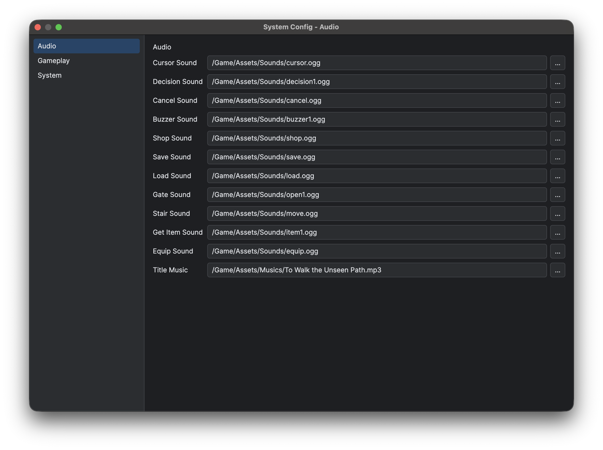

# 项目设置与资产布局

Ludork 项目在 `Main.proj` 中保存编辑器与打包设置，在[游戏配置](#游戏配置)中保存运行时偏好，并将原始资源、编辑器 JSON 数据与运行时 Lua 代码分别组织在 `Assets`、`Data` 和 `Scripts` 目录下。C++ Source 项目同时包含原生源码，布局详见[构建与模块布局](<../C++ 原生开发/构建与模块布局.md>)。

编辑器在所有平台上均以无字节顺序标记（BOM）的 UTF-8 编码和 LF 换行符写入项目 JSON（包括 `Main.proj`、`Data` 文档与导出记录），避免跨平台换行差异。

## Main.proj

`Main.proj` 定义项目兼容版本、原生构建选项、打包默认值与项目级工作区状态。例如，Game 项目启用了 C++ 与 FFmpeg，并默认使用独立运行窗口：

```json
{
  "version": "v1.0",
  "Cpp": true,
  "ffmpeg": true,
  "IndividualWindow": true,
  "packaging": {
    "version": "1.0.0",
    "dev": false
  },
  "editor": {
    "fileExplorer": {
      "tabs": [
        {
          "number": 1,
          "path": "Assets",
          "iconView": true,
          "zoom": 100,
          "sourcesExpanded": false
        }
      ],
      "activeTabNumber": 1
    }
  }
}
```

| 键 | 用途与规则 |
|---|---|
| `version` | 必填的引擎兼容版本（格式为 `v<major>.<minor>`，例如编辑器 `1.0.7` 生成 `"v1.0"`）。当前版本支持 `v1.0`；字段缺失、格式错误或版本不受支持时无法打开项目。打开受支持的旧项目不会迁移内容，也不会改写 `version`。 |
| `Cpp`、`ffmpeg` | 控制 C++ Source 模式与 FFmpeg 支持，应与创建项目时选择的模板保持一致。 |
| `compiler` | 可选的 Windows C++ Source 编译器路径。缺省表示 MSVC；MinGW 保存 `g++.exe` 绝对路径（如 `"C:\\Tools\\mingw64\\bin\\g++.exe"`）；LLVM Clang 保存 `clang-cl.exe` 绝对路径（如 `"C:\\Program Files\\LLVM\\bin\\clang-cl.exe"`）。改选 MSVC 时会移除该字段。 |
| `packaging.version`、`packaging.dev` | 分别保存游戏自身的基础发行版本（默认 `"1.0.0"`）与内部测试包标记（默认 `false`），独立于顶层 `version`。可在打包窗口中管理或由命令行单次覆盖，见[发行包与开发包](<运行、调试与打包.md#发行包与开发包>)。 |
| `editor.fileExplorer` | 保存文件浏览器 `tabs`（按页签顺序记录 `number`、相对 `path`、`iconView`、`zoom` `50–200` 与 `sourcesExpanded`）及 `activeTabNumber`。1 号页签常驻且不可关闭，缺省在 `Assets` 打开并采用[全局初始显示偏好](<启动页、工作区与快捷键.md#编辑器全局偏好>)。 |
| `lastOpenedMapKey` | 保存上次选中的地图键（含大地图与子地图），切换地图时即时写入而不保存地图数据。值缺失或失效时选中首项（无地图时不选）。实时调试引发的切图不会覆盖此键。 |
| `editor.mapList.expanded` | 记录地图列表中已展开的父行键名（例如 `["World_01", "Map_02"]`）。展开或收起行不会将项目标记为已修改，状态随项目保存并在打开时恢复；失效键会被忽略，列表为空时省略该项。 |

未知键属于编辑器内部状态，应原样保留。编辑器外观与窗口布局保存在全局偏好中，不写入 `Main.proj`（见[编辑器全局偏好](<启动页、工作区与快捷键.md#编辑器全局偏好>)）。

- **与机器绑定的 Windows 编译器**：编译、预览与 Windows 打包严格使用 `compiler` 指定的工具链，不可用时直接报告错误，不会回退至其他编译器。将项目迁移至其他电脑后，请通过[更改项目编译器](<运行、调试与打包.md#windows-项目编译器>)重新选择本机工具链以完成必要清理，切勿在残留旧原生产物时手工修改 `compiler`。通用模板与转换得到的 Standalone 项目不包含此字段。
- **文件浏览器路径恢复**：已保存路径必须位于 `Assets` 或 `Data` 下。若已保存目录不再存在，重新打开项目时会退回同一根目录内最近存在的父目录；无效、绝对、符号链接或越界路径均回退至 `Assets`。搜索词、导航历史、选中项与滚动位置不写入 `Main.proj`，详见[文件浏览器与引用树](<启动页、工作区与快捷键.md#文件浏览器与引用树>)。

## 游戏配置

打开**游戏 → 游戏配置**（`F3`）可修改游戏的语言、显示与音频设置。点击**确认**立即写入磁盘，不参与文档撤销或未保存状态统计；点击**取消**保留原值。写入失败时窗口保持打开并显示错误。

- **存储格式**：macOS 以 XML plist 格式保存在 `Main.plist` 中；其他平台（含 iOS）保存在 `Main.ini` 中，节名、键名与默认值完全一致。macOS 不会读取或迁移已有的 `Main.ini`；当 `Main.plist` 不存在时启用默认值且不触碰 `Main.ini`。若 plist 无法读取或格式损坏，编辑器会报告错误且拒绝以默认值覆盖，须先修复文件再保存。详见[平台、配置与文件](<../快速入门/Ludork Lua 进阶.md#平台配置与文件>)。
- **语言列表**：每次打开窗口时从已导出的 `Scripts/Source/Locale/*.lua`（排除 `Core.lua`）刷新列表，即便当前所选语言的导出文件缺失也会保留该选项。在本地化工作簿中新增语言后，需先执行导出再回来选择。
- **缩放行**：编辑器始终显示显示缩放设置行；游戏内 Config 窗口仅在 `Display.isDisplayScaleConfigurable()` 报告宿主支持缩放时才显示该行。

### 用户数据位置

| 平台 | 用户数据根目录（`Main.plist`／`Main.ini`、`Save/` 与运行时缓存） |
|---|---|
| Windows、macOS、Linux | `~/<APP_NAME>`（Windows 为 `C:\Users\<用户名>\<APP_NAME>`，macOS 为 `/Users/<用户名>/<APP_NAME>`），涵盖编辑器运行、IDE 启动、直接运行与发行包。 |
| iOS | `~/Library/Application Support/<APP_NAME>` |
| Android、HarmonyOS | 应用私有用户数据根目录下的 `<APP_NAME>` |
| WebGL | 虚拟路径 `/UserData/<APP_NAME>`，按浏览器配置与站点源（协议、主机、端口）持久化至 IndexedDB。 |

在 WebGL 平台上，宿主会在 `Entry` 执行前恢复 `/UserData/<APP_NAME>`，内置配置与存档写入后会同步至 IndexedDB 以跨刷新保留数据。清除站点数据、更换站点源或使用隐私浏览会删除或隔离这些数据；`APP_NAME` 不提供跨源访问能力。

`APP_NAME` 在[创建项目](<../快速入门/项目模板.md#模板参考>)时配置并静态写入 `Scripts/Entry.lua`。同名 `APP_NAME` 的项目在当前用户下共享配置、存档与缓存；修改该名称会切换至新目录而不迁移旧文件。

项目本地目录中的配置与 `Save/` 均不参与读写。在代码中请通过[运行时路径 API](<../Lua 与蓝图脚本/默认玩法/运行时数据、配置与存档.md#配置>)解析路径，各配置键、默认值与生效时机见[游戏设置参考](<../Lua 与蓝图脚本/默认玩法/游戏设置参考.md>)。

## 系统配置

打开**数据库 → 系统配置**（`F4`）可编辑 `Data/Configs` 下的 JSON 配置文件（包含 `type: "system"` 或省略 `type` 的对象，以不含扩展名的相对路径作为键名）。在左侧选择 **Audio**、**System** 或 **Gameplay**，右侧即展示对应表单。



*选择 **System** 配置游戏标题、分辨率与启动项，或选择 **Audio** 配置音乐与音效资源。*

**Gameplay** 用于编辑共享玩法配置，每行均配有**使用默认值**复选框：

- **勾选（新建数据默认）**：隐藏值编辑器并将 `value` 写为 `null`，运行时采用 Lua 脚本默认值。重新勾选**使用默认值**可清除已保存的覆盖值。
- **取消勾选**：读取已保存的 Lua 源文件（请先保存脚本改动），填入当前脚本默认值以建立覆盖值。已有覆盖值不会自动跟踪后续脚本变更；先勾选再取消勾选**使用默认值**即可重新读取。若读取失败，该行保持勾选状态并显示原因。
- **字段输入规则**：枚举使用下拉框，文本与数字支持直接输入，布尔值使用复选框。清空数值输入框会恢复**使用默认值**；空字符串、`false` 与数值 `0` 均为显式值（存档槽数量与教学收缩时长须填写正数）。

支持的键名与脚本默认值见[共享玩法配置](<../Lua 与蓝图脚本/默认玩法/运行时数据、配置与存档.md#共享玩法配置>)。保存配置后重启游戏生效。切换配置项会保留未保存修改（列表与标题以 `*` 标记）；按 `Ctrl/Command+S` 执行全局保存，撤销／重做作用于当前选中的配置。

## 固定资源目录

编辑器为运行时配置与内置资源保护以下项目目录（涵盖目录本身及其内部全部文件与子目录）：

| 目录 | 内容 |
|---|---|
| `Data/Configs` | 游戏配置（启动、音频与玩法设置） |
| `Assets/Shaders/Global` | 内置渲染着色器 |
| `Data/Curves/Global` | 共享动画与特效曲线 |
| `Data/Materials/Global` | `Standard.json` 等共享材质 |
| `Data/TextConfigs/Global` | 共享文本样式 |

这些目录中的资源允许编辑、保存与复制，但文件浏览器会阻止重命名（含仅更改大小写）、移动或删除任何受保护条目及其上级目录。批量选择中包含受保护条目时，整批操作都会被拦截并指出受保护路径。

## Assets

原始创作文件存放在物理目录 `Assets` 中。项目中存储的资源引用在所有平台上都必须采用严格区分大小写的 `/Game/Assets/...` 路径，使用 `/` 分隔符并包含文件扩展名（`Assets/...`、分类相对路径、原生绝对路径与路径穿越片段均无效）。

除非 `PathRoot` 指定为 `"Project"` 项目文件或 `"Data"` 数据文档，否则 `PathVars` 会将字段标记为经过校验的 `/Game/Assets/...` 引用；配置中的 `base` 仅限定选择器的根目录。直接调用 LuaSF 文件构造函数及标准物理文件系统接口时仍需原生路径。

资源解析会校验从目标直至资源根目录的完整路径，拒绝符号链接、断链、重解析点及不可访问路径。路径换算与选择器根目录允许指向尚未创建的文件或目录，前提是已存在的祖先路径全部通过校验。

请保留约定的顶级子目录以确保选择器准确筛选：`Tilesets`、`Autotiles`、`Characters`、`Animations`、`Particles`、`Icons`、`Fonts`、`Musics`、`Sounds`、`Voices`、`Shaders`、`Panoramas`、`Transitions`、`System` 与 `Videos`。启用 `.ldpak` 打包时，整个 `Assets` 目录树（含直接位于 `Assets` 下的文件）会整体归档为 `Assets.ldpak`，逻辑路径保持不变。

请通过编辑器重命名或移动 `Assets` 内的文件与文件夹，以便自动同步可识别引用；外部重命名、源码字面量与动态拼接路径需手动维护。详见[编辑与保存](<启动页、工作区与快捷键.md#编辑与保存>)。

## Data 与 Scripts

`Data` 目录存放编辑器生成的 JSON 数据与本地化工作簿：

| 位置 | 引用格式与用途 |
|---|---|
| `Data/Materials` | 完整 `Data/Materials/...json` 路径；详见[材质](<材质.md>)。 |
| `Data/Subtitles` | 完整 `Data/Subtitles/...json` 路径；详见[视频字幕](<视频字幕.md>)。 |
| `Data/Particles` | 不含扩展名的相对键（如 `Combat/Hit`）；详见[通用粒子](<通用粒子.md>)。 |
| `Data/UI` | 不含扩展名的相对资产键；详见 [UI 资产编辑器](<UI 资产编辑器.md>)。 |
| `Data/TextConfigs` | 共享文本样式与富文本标签（普通 UI 文本样式直接保存在对应 UI 节点上）。 |
| `Data/Locale/Locale.xlsx` | 由[官方 Locale Tools 插件](<../插件开发与安装/官方插件/Locale Tools.md>)管理的本地化工作簿。 |

`Scripts` 目录存放运行时 Lua 代码、元数据与类型声明。模块组织与生成输出见 [Lua 运行时与模块](<../Lua 与蓝图脚本/Lua 运行时与模块.md>)、[声明式 UI 编写工作流](<../Lua 与蓝图脚本/声明式 UI/编写工作流.md>)与[通用数据与文本配置](<通用数据与文本配置.md>)。

> **重要**：切勿手工编辑 `Engine_meta.lua`、`GlobalCore_meta.lua`、`GlobalFunctions_meta.lua` 及生成的 Core／LuaSF 类型声明。开发阶段请保持 `Data` 与 `Scripts` 为未归档目录；打包时会自动移除 `Scripts/stub` 并拒绝放错位置的 `.d.lua` 文件（详见[未归档目录与归档](<运行、调试与打包.md#未归档目录与归档>)）。

### 运行时资源查找

逻辑路径 `/Game/Assets/...`、`/Game/Data/...`、`/Game/Scripts/...`，以及相对 `Data/...` 引用和 Lua 模块名均按严格优先级解析：

1. **用户数据目录**：位于 `Engine.getUserDataPath()` 下（默认入口在加载项目模块前通过 `Engine.setAppName` 设置；入口脚本本身始终从游戏根目录加载）。用户数据目录不必同时包含全部三个目录树。
2. **游戏根目录或 `.ldpak` 归档**：已打包游戏的未归档目录或归档条目。

例如，`/Game/Assets/System/icon.png` 会优先读取 `<用户数据>/Assets/System/icon.png`，不存在时再读取游戏中的 `Assets/System/icon.png` 或 `Assets.ldpak` 内对应条目。绝对物理 Data 路径始终访问显式指定位置。

- **来源优先于格式**：用户目录中的 `.ldc` 会覆盖游戏中的 `.json`，用户目录中的 `.luac` 会覆盖游戏中的 `.lua`，加密着色器变体亦遵循同一规则。各来源内部遵循对应 API 的常规格式选择规则；按精确路径读取 JSON 的接口不会自动回退至加密文件。
- **错误处理与目录枚举**：仅当文件缺失时才继续查找下一来源；文件不可读、损坏或格式无效时会立即报告错误。枚举 Data 目录时会合并两处来源并去重，同名条目及文件／目录冲突均以用户目录为准。
- **热更下载文件**：游戏可将下载的更新写入物理用户数据路径；新文件在下一次读取或首次 `require` 时生效，已加载模块与缓存资源保持现有缓存（不会热替换存活对象或重新执行启动流程）。逻辑 `/Game/...` 路径为只读，写入必须使用显式物理用户数据路径。原生 `io.open` 与直接 LuaSF 构造函数不经过 `/Game` 解析。详见[入口与模块顺序](<../Lua 与蓝图脚本/Lua 运行时与模块.md#入口与模块顺序>)。

### 地图与大地图资产

普通地图为 `Data/Maps/<Name>.json`。组合式大地图为目录 `Data/Maps/<WorldFolder>/`，内含一个 `_world.json` 清单及若干直接子地图 `.json` 文件（禁止深层嵌套；`.DS_Store` 等非 JSON 普通文件会被忽略）。

编辑器[地图列表顺序](<图块集、自动图块与地图.md#地图列表与组合式大地图>)保存在 `Data/Maps/_info.json` 与 `Data/Maps/<WorldFolder>/_info.json` 中，结构为 `{"order": ["Map_01", {"Map_02": ["Map_03"]}, "World_01"]}`，字符串表示地图文件名（不含扩展名）或大地图目录名，单键对象表示视觉嵌套。运行时忽略 `_info.json`，[打包](<运行、调试与打包.md#打包>)也会将其排除，`_info` 不可用作地图或大地图名称。

目录名是大地图的路径标识，`_world.json` 保存显示名 `worldName` 并作为选择器与存档中的大地图标识（在地图列表中隐藏）。每张子地图独立保存可编辑的 `mapName`（移出大地图后仍保持完整），以其文件名作为路径与摆放标识：

```json
{
  "type": "worldMap",
  "worldName": "{WORLD_01}",
  "width": 256,
  "height": 192,
  "fog": {
    "enabled": false,
    "colour": [255, 255, 255, 255],
    "density": 0.5,
    "scale": 256,
    "velocity": [15, 15],
    "turbulence": 0.5,
    "seed": 0
  },
  "panorama": "",
  "layerOrder": ["floor", "default"],
  "placements": [
    {
      "map": "Map_01.json",
      "rect": [0, 0, 64, 64]
    }
  ]
}
```

- **坐标与边界**：`width`、`height` 与 `[x, y, width, height]` 摆放矩形均采用从 0 开始的格子坐标。矩形尺寸必须与对应子地图一致且位于大地图边界内，每张子地图至多摆放一次。相邻摆放与未覆盖空洞均合法；编辑期间允许临时重叠，但保存时会拒绝重叠摆放。
- **清单归属**：`worldName` 不能为空。`layerOrder` 由已摆放子地图自动推导（存在矛盾环时会报告错误）。清单拥有大地图的显示名称、尺寸、拼合关系、全局雾效与全局远景；音频、滤镜与环境光仍归属各子地图。
- **雾效格式**：普通地图与大地图共用相同的程序化 `fog` 对象，无需雾效图片资产；参数配置见[雾效](<图块集、自动图块与地图.md#雾效>)。

> **注意**：重命名或移动地图时，编辑器会自动更新可识别的地图文件配置以及 `GotoMap`、`RecordTelepoint` 蓝图节点中的目标路径。普通字符串与动态拼接路径需手动更新。
